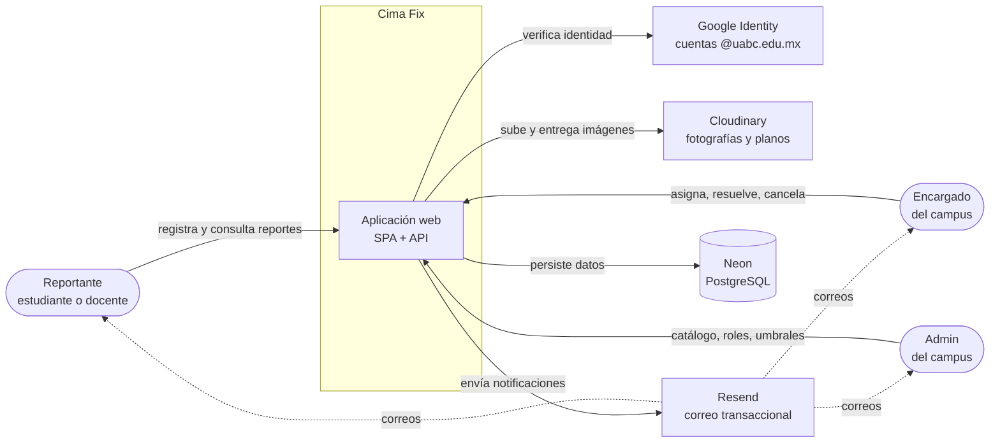
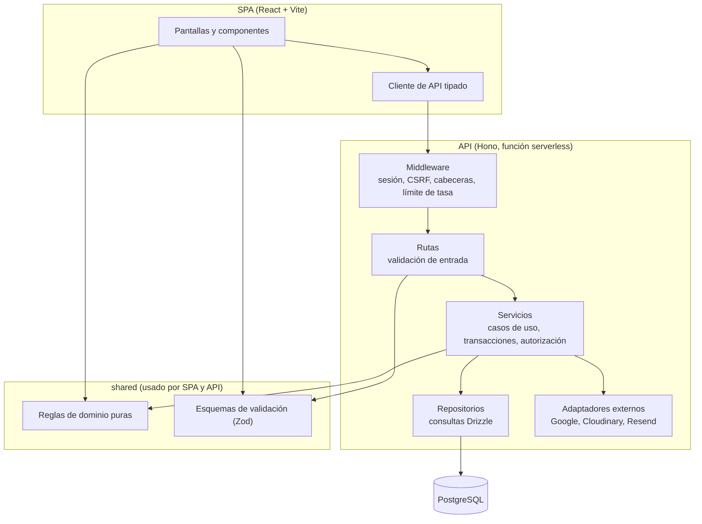
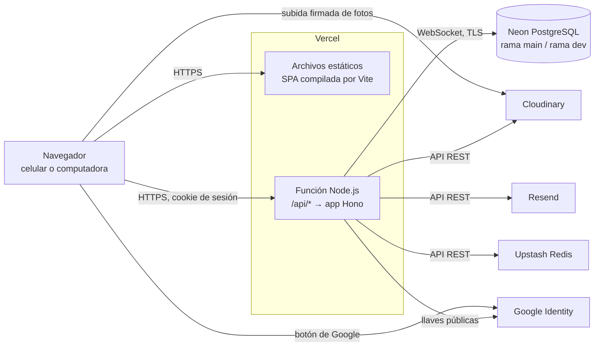
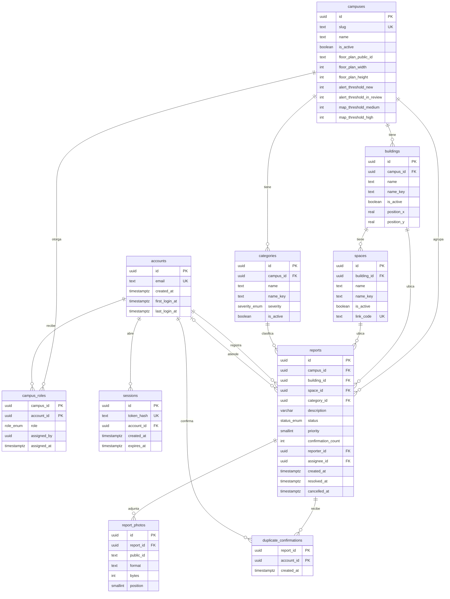
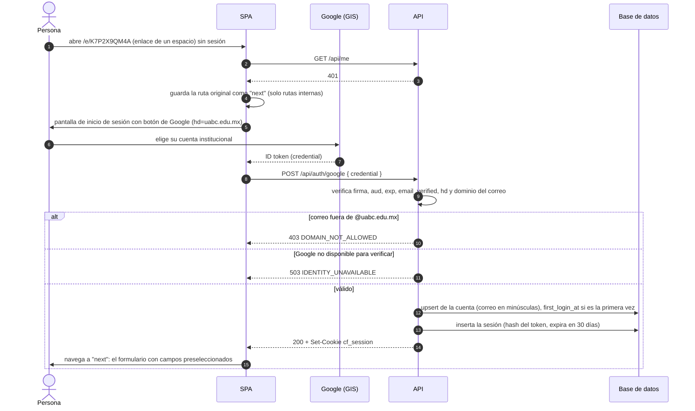
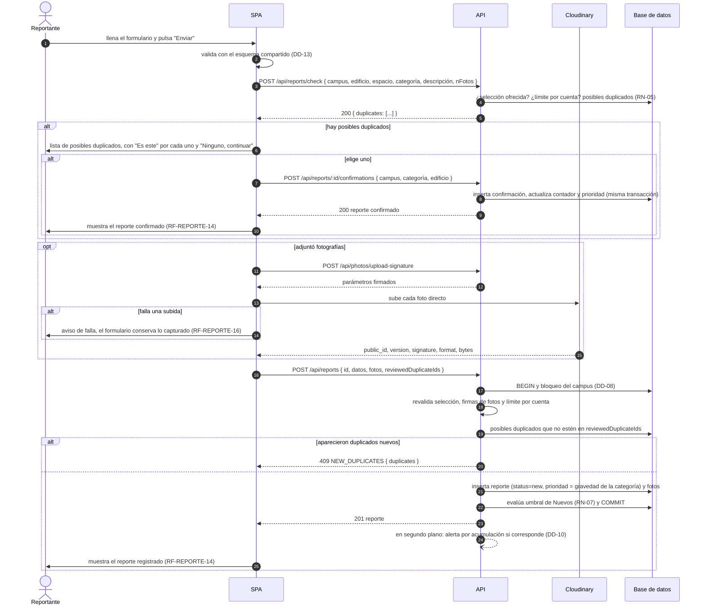
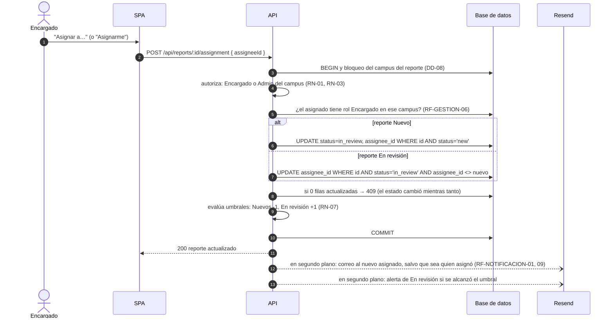
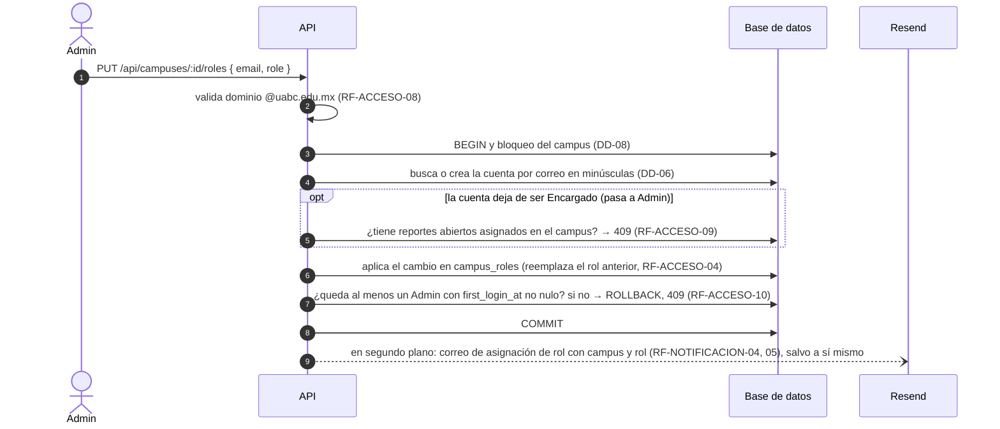
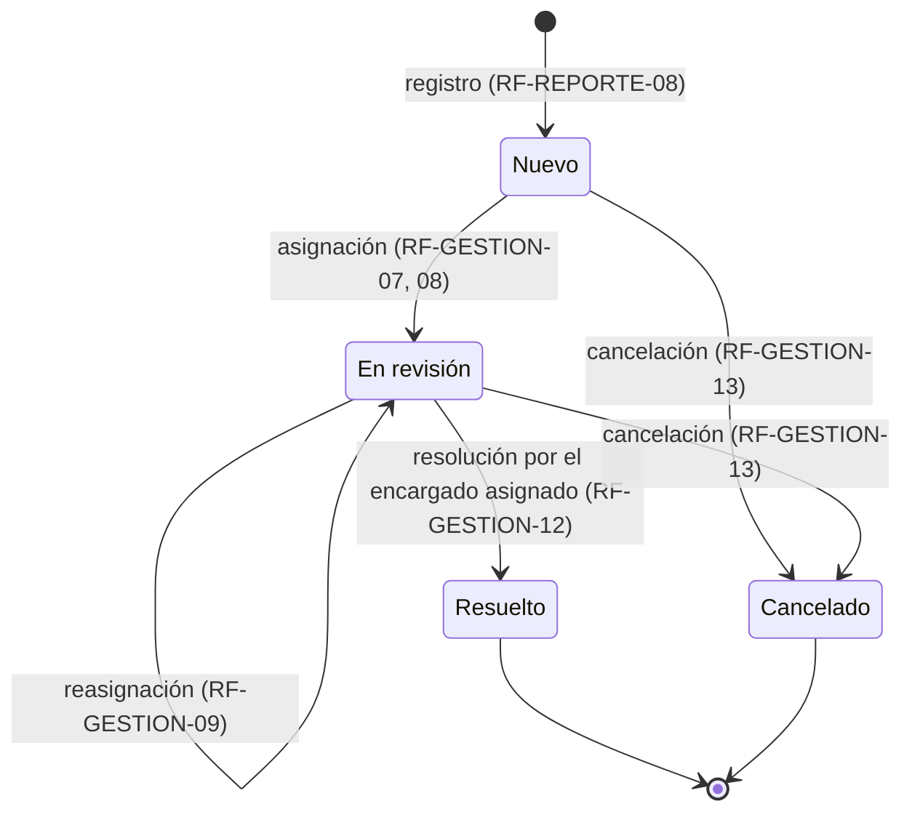
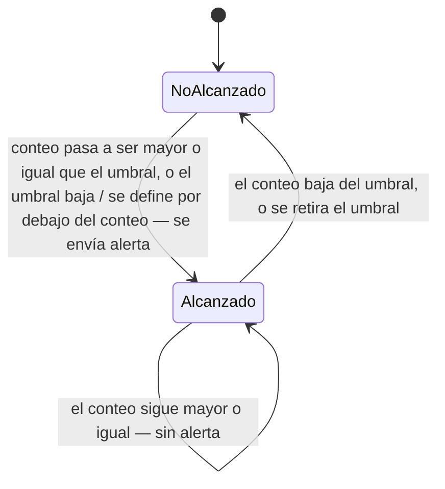

# Descripción de Diseño de Software (SDD)

## Cima Fix — Sistema de Reporte y Seguimiento de Incidencias de Mantenimiento e Infraestructura

| Campo                     | Detalle                                         |
| ------------------------- | ----------------------------------------------- |
| Producto                  | Cima Fix                                        |
| Versión del documento     | Borrador                                        |
| Fecha de creación         | 16 de noviembre de 2026                         |
| Estado                    | En revisión                                     |
| Responsable del documento | Troy Leonardo Moreno Calderon                   |
| Requisitos de origen      | [`cimafix_srs.md`](cimafix_srs.md) v1.0.0 (SRS) |

---

## Historial de cambios

| Versión  | Fecha                   | Cambio                                                                                       |
| -------- | ----------------------- | -------------------------------------------------------------------------------------------- |
| Borrador | 16 de noviembre de 2026 | Creación del documento. Cubre todos los módulos del SRS v1.0.0; se distribuye para revisión. |

---

## Tabla de contenidos

<!-- START doctoc generated TOC please keep comment here to allow auto update -->
<!-- DON'T EDIT THIS SECTION, INSTEAD RE-RUN doctoc TO UPDATE -->

- [1. Introducción](#1-introducci%C3%B3n)
  - [1.1 Propósito del documento](#11-prop%C3%B3sito-del-documento)
  - [1.2 Alcance](#12-alcance)
  - [1.3 Relación con otros documentos](#13-relaci%C3%B3n-con-otros-documentos)
  - [1.4 Convenciones de este documento](#14-convenciones-de-este-documento)
  - [1.5 Acrónimos y abreviaturas](#15-acr%C3%B3nimos-y-abreviaturas)
- [2. Contexto del diseño](#2-contexto-del-dise%C3%B1o)
  - [2.1 Interesados y sus preocupaciones](#21-interesados-y-sus-preocupaciones)
  - [2.2 Factores que guían la arquitectura](#22-factores-que-gu%C3%ADan-la-arquitectura)
  - [2.3 Restricciones de diseño](#23-restricciones-de-dise%C3%B1o)
  - [2.4 Supuestos de diseño](#24-supuestos-de-dise%C3%B1o)
- [3. Vista de contexto](#3-vista-de-contexto)
- [4. Arquitectura general](#4-arquitectura-general)
  - [4.1 Estilo arquitectónico](#41-estilo-arquitect%C3%B3nico)
  - [4.2 Vista de contenedores y despliegue](#42-vista-de-contenedores-y-despliegue)
  - [4.3 Registro de decisiones de diseño](#43-registro-de-decisiones-de-dise%C3%B1o)
- [5. Vista de composición: módulos](#5-vista-de-composici%C3%B3n-m%C3%B3dulos)
  - [5.1 Módulos funcionales](#51-m%C3%B3dulos-funcionales)
  - [5.2 Estructura del repositorio](#52-estructura-del-repositorio)
- [6. Vista de información: modelo de datos](#6-vista-de-informaci%C3%B3n-modelo-de-datos)
  - [6.1 Diagrama entidad-relación](#61-diagrama-entidad-relaci%C3%B3n)
  - [6.2 Tablas](#62-tablas)
  - [6.3 Lo que este modelo no guarda, a propósito](#63-lo-que-este-modelo-no-guarda-a-prop%C3%B3sito)
  - [6.4 Migraciones](#64-migraciones)
- [7. Vista de interfaces: API](#7-vista-de-interfaces-api)
  - [7.1 Convenciones](#71-convenciones)
  - [7.2 Endpoints](#72-endpoints)
  - [7.3 Vista de un reporte (DTO)](#73-vista-de-un-reporte-dto)
- [8. Vista de interacción](#8-vista-de-interacci%C3%B3n)
  - [8.1 Inicio de sesión y enlaces abiertos sin sesión](#81-inicio-de-sesi%C3%B3n-y-enlaces-abiertos-sin-sesi%C3%B3n)
  - [8.2 Registro de un reporte con posibles duplicados y fotografías](#82-registro-de-un-reporte-con-posibles-duplicados-y-fotograf%C3%ADas)
  - [8.3 Asignación de un reporte](#83-asignaci%C3%B3n-de-un-reporte)
  - [8.4 Cambio de rol](#84-cambio-de-rol)
- [9. Dinámica de estados](#9-din%C3%A1mica-de-estados)
  - [9.1 Estados de un reporte](#91-estados-de-un-reporte)
  - [9.2 Alcance del umbral de alerta (RN-07)](#92-alcance-del-umbral-de-alerta-rn-07)
- [10. Lógica de dominio](#10-l%C3%B3gica-de-dominio)
  - [10.1 Prioridad (RF-PRIORIDAD-01…06)](#101-prioridad-rf-prioridad-0106)
  - [10.2 Posibles duplicados (RN-05, RF-DUPLICADO-01…07)](#102-posibles-duplicados-rn-05-rf-duplicado-0107)
  - [10.3 Permisos (RN-01, RN-03)](#103-permisos-rn-01-rn-03)
  - [10.4 Visibilidad de reportes y de datos de gestión (RN-04, RN-06)](#104-visibilidad-de-reportes-y-de-datos-de-gesti%C3%B3n-rn-04-rn-06)
  - [10.5 Orden de la consulta (RF-GESTION-14)](#105-orden-de-la-consulta-rf-gestion-14)
  - [10.6 Nivel del indicador del mapa (RN-08)](#106-nivel-del-indicador-del-mapa-rn-08)
  - [10.7 Reglas de roles (RF-ACCESO-04…10)](#107-reglas-de-roles-rf-acceso-0410)
  - [10.8 Normalización de nombres y validación de texto](#108-normalizaci%C3%B3n-de-nombres-y-validaci%C3%B3n-de-texto)
  - [10.9 Resolución del enlace de un espacio (RF-REPORTE-05, 10)](#109-resoluci%C3%B3n-del-enlace-de-un-espacio-rf-reporte-05-10)
  - [10.10 Fotografías (RF-REPORTE-03, 04, 09, 15, 16)](#1010-fotograf%C3%ADas-rf-reporte-03-04-09-15-16)
- [11. Seguridad y privacidad](#11-seguridad-y-privacidad)
- [12. Disponibilidad: comportamiento ante fallas de servicios externos](#12-disponibilidad-comportamiento-ante-fallas-de-servicios-externos)
- [13. Diseño del frontend](#13-dise%C3%B1o-del-frontend)
  - [13.1 Principios](#131-principios)
  - [13.2 Rutas de la SPA](#132-rutas-de-la-spa)
  - [13.3 Formulario de registro](#133-formulario-de-registro)
  - [13.4 Mapa](#134-mapa)
  - [13.5 Accesibilidad (RNF-USABILIDAD-06)](#135-accesibilidad-rnf-usabilidad-06)
- [14. Notificaciones por correo](#14-notificaciones-por-correo)
  - [14.1 Flujo](#141-flujo)
  - [14.2 Contenido y envío](#142-contenido-y-env%C3%ADo)
- [15. Despliegue, entornos y operación](#15-despliegue-entornos-y-operaci%C3%B3n)
  - [15.1 Entornos](#151-entornos)
  - [15.2 Variables de entorno](#152-variables-de-entorno)
  - [15.3 Integración y entrega continua](#153-integraci%C3%B3n-y-entrega-continua)
  - [15.4 Alta de un campus (fuera de la aplicación)](#154-alta-de-un-campus-fuera-de-la-aplicaci%C3%B3n)
- [16. Estrategia de pruebas](#16-estrategia-de-pruebas)
- [17. Decisiones de documentos anteriores que el SRS reemplaza](#17-decisiones-de-documentos-anteriores-que-el-srs-reemplaza)
- [18. Riesgos y cuestiones abiertas](#18-riesgos-y-cuestiones-abiertas)
  - [18.1 Riesgos técnicos](#181-riesgos-t%C3%A9cnicos)
  - [18.2 Cuestiones abiertas para el equipo](#182-cuestiones-abiertas-para-el-equipo)
- [19. Trazabilidad SRS → diseño](#19-trazabilidad-srs-%E2%86%92-dise%C3%B1o)
  - [19.1 Requisitos funcionales](#191-requisitos-funcionales)
  - [19.2 Reglas de negocio](#192-reglas-de-negocio)
  - [19.3 Requisitos no funcionales](#193-requisitos-no-funcionales)
- [20. Glosario](#20-glosario)

<!-- END doctoc generated TOC please keep comment here to allow auto update -->

---

## 1. Introducción

### 1.1 Propósito del documento

Este documento describe **cómo** se construye Cima Fix: su arquitectura, sus módulos, su modelo de datos, su API, las interacciones entre sus componentes y las decisiones técnicas que las sustentan. Es el complemento del SRS, que define **qué** debe hacer el sistema (SRS 1.1).

Está dirigido al equipo de desarrollo (backend, frontend y QA). Cada integrante debe leer al menos las secciones 4 a 7 antes de escribir código, y la sección del módulo en el que va a trabajar.

### 1.2 Alcance

Cubre el sistema completo descrito por el SRS v1.0.0: los ocho módulos funcionales de 3.3, las reglas de negocio de 3.2 y los requisitos no funcionales de 3.4. Lo que el SRS deja fuera de alcance (SRS 1.2) también queda fuera de este documento; en particular, este diseño **no** incluye inteligencia artificial ni procesamiento de lenguaje natural para detectar duplicados ni para calcular prioridades.

El SRS es la referencia que manda: si este documento y el SRS se contradicen, el error está en este documento y se corrige aquí.

### 1.3 Relación con otros documentos

| Documento                                                                                                  | Relación con este SDD                                                                                                                                                                                                                                                                                                                        |
| ---------------------------------------------------------------------------------------------------------- | -------------------------------------------------------------------------------------------------------------------------------------------------------------------------------------------------------------------------------------------------------------------------------------------------------------------------------------------- |
| [`cimafix_srs.md`](cimafix_srs.md) (SRS v1.0.0)                                                            | Fuente de los requisitos. Cada decisión de este documento cita el ID (`RF-*`, `RN-*`, `RNF-*`) que la motiva.                                                                                                                                                                                                                                |
| [`README.md`](../README.md)                                                                                | Resumen del producto y stack técnico acordado. Este documento detalla ese stack, no lo cambia.                                                                                                                                                                                                                                               |
| [`CONTRIBUTING.md`](../CONTRIBUTING.md)                                                                    | Flujo de issues, ramas, commits y pull requests. Los _scopes_ de commit corresponden a los módulos definidos en la sección 5 de este documento.                                                                                                                                                                                              |
| [`repository-config.md`](repository-config.md)                                                             | Ajustes de GitHub; la sección 15.3 de este documento define el CI que esos ajustes exigen.                                                                                                                                                                                                                                                   |
| Definición del Proyecto y Especificación de Funcionalidades (1 de septiembre de 2026, documento del curso) | Primera propuesta técnica del equipo (stack, infraestructura, decisiones por módulo). Es anterior al SRS; las decisiones que el SRS cambió se listan en la sección 17.                                                                                                                                                                       |
| [`cima-fix-research`](https://github.com/cima-fix/cima-fix-research/tree/main/docs/field-research)         | Investigación de campo (entrevistas y reflexión final). Se cita cuando un hallazgo explica una decisión de diseño.                                                                                                                                                                                                                           |
| [`cima-fix-architecture-info`](https://github.com/cima-fix/cima-fix-architecture-info)                     | Arquitectura de la información (sitemap, task flows, matriz diagnóstica) y un prototipo navegable sin backend. Se retoman sus análisis de comportamientos erráticos (doble envío, asignación simultánea); su esquema de datos (`Usuario`, `Salon`, `urgencia`) es anterior al SRS y **no** es la base del modelo de datos de este documento. |
| IEEE 1016-2009                                                                                             | Estándar de referencia para la estructura de este documento (descripción por vistas de diseño: contexto, composición, información, interfaces, interacción, dinámica de estados y despliegue). Se usa como guía, adaptada al tamaño del proyecto, igual que el SRS usa ISO/IEC/IEEE 29148.                                                   |

### 1.4 Convenciones de este documento

- **Decisiones de diseño**: se identifican como `DD-##` (sección 4.3). Cada una indica la alternativa descartada y los requisitos que la motivan.
- **Requisitos**: se citan con su ID del SRS (`RF-GESTION-07`, `RN-04`, `RNF-SEGURIDAD-02`). Un rango como `RF-CATALOGO-02…07` incluye todos los IDs intermedios.
- **Nombres en código**: identificadores, tablas, columnas y rutas se escriben en inglés (CONTRIBUTING, "Idioma"), salvo los textos que ve la persona usuaria, que están en español (RNF-USABILIDAD-03). Este documento usa los nombres en inglés tal como aparecerán en el código, y explica su equivalente en español la primera vez que aparecen.
- **Diagramas**: en Mermaid, que GitHub muestra directamente al ver este archivo.

### 1.5 Acrónimos y abreviaturas

| Término | Definición                                                                       |
| ------- | -------------------------------------------------------------------------------- |
| SDD     | Software Design Description (este documento)                                     |
| SRS     | Software Requirements Specification                                              |
| SPA     | Single Page Application: aplicación web que se carga una vez y navega en cliente |
| API     | Interfaz de programación que expone el backend al frontend                       |
| DTO     | Data Transfer Object: forma de los datos que viajan entre backend y frontend     |
| OIDC    | OpenID Connect: capa de identidad sobre OAuth 2.0                                |
| GIS     | Google Identity Services: biblioteca de Google para "Sign in with Google"        |
| ORM     | Object-Relational Mapping (aquí, Drizzle)                                        |
| CSRF    | Cross-Site Request Forgery                                                       |
| CRS     | Coordinate Reference System (sistema de coordenadas del mapa en Leaflet)         |
| CI      | Integración continua                                                             |

---

## 2. Contexto del diseño

### 2.1 Interesados y sus preocupaciones

| Interesado                                     | Preocupación principal                                                                                  | Dónde se atiende |
| ---------------------------------------------- | ------------------------------------------------------------------------------------------------------- | ---------------- |
| Reportante (docentes y estudiantes)            | Reportar rápido desde el celular y saber qué pasó con su reporte (hallazgo central de la investigación) | 8.2, 9, 13       |
| Encargado                                      | Ver qué atender primero, asignarse reportes y cambiar su estado sin trabajo manual en hojas de cálculo  | 8.3, 10.1, 10.5  |
| Admin del campus                               | Mantener el catálogo, los roles y los umbrales de su campus sin depender del equipo de desarrollo       | 5, 10.3, 10.7    |
| Equipo de desarrollo (7 personas, un semestre) | Un diseño que se pueda construir, probar y desplegar con planes gratuitos y sin infraestructura propia  | 4, 15            |
| QA                                             | Poder verificar cada criterio del SRS de forma aislada                                                  | 16, 19           |

### 2.2 Factores que guían la arquitectura

Los requisitos que más condicionan la forma del sistema, más allá de cada función individual:

| Factor                                                     | Requisitos                                                     | Consecuencia en el diseño                                                                                        |
| ---------------------------------------------------------- | -------------------------------------------------------------- | ---------------------------------------------------------------------------------------------------------------- |
| Aislamiento de la gestión por campus                       | RN-01, RN-03, RF-NOTIFICACION-12, RNF-ESCALABILIDAD-01…02      | Todo dato de gestión cuelga de un campus; la autorización siempre se evalúa contra el campus del recurso (10.3). |
| Datos de gestión visibles solo para quien gestiona         | RN-04, RN-06, RF-GESTION-05, RF-GESTION-16, RF-NOTIFICACION-11 | Un único punto del backend arma la vista de un reporte y otro filtra qué reportes ve cada cuenta (10.4).         |
| Prioridad automática, no editable y congelada al cerrar    | RF-PRIORIDAD-01…06                                             | Prioridad almacenada y recalculada por eventos, nunca por una petición del usuario (DD-07, 10.1).                |
| Reglas que dependen del conteo de reportes de un campus    | RN-07, RN-08, RF-ACCESO-10                                     | Las escrituras que cambian conteos o roles de un campus se serializan por campus (DD-08).                        |
| Servicios externos que pueden caerse sin tumbar al sistema | RNF-DISPONIBILIDAD-01…06                                       | Cada integración externa está aislada detrás de un adaptador con un comportamiento de falla definido (12).       |
| Celular como dispositivo principal                         | RNF-USABILIDAD-01, RNF-USABILIDAD-07, RNF-RENDIMIENTO-02       | Frontend _mobile-first_, flujo de registro desde el enlace del espacio con campos preseleccionados (13).         |
| Presupuesto cero                                           | Definición del Proyecto §3                                     | Solo servicios con plan gratuito permanente; despliegue _serverless_ (DD-02).                                    |

### 2.3 Restricciones de diseño

- **Stack fijado** en el README: Node.js + Hono (TypeScript), PostgreSQL en Neon + Drizzle ORM, Google Identity Services, React + Vite + Tailwind CSS, Leaflet + react-leaflet, Cloudinary, Resend y Upstash Redis. Este documento no agrega frameworks fuera de esa lista; las bibliotecas auxiliares que sí agrega (Zod, `google-auth-library`) se justifican donde aparecen.
- **Identidad mínima**: el único dato personal que se registra es el correo institucional (RF-ACCESO-13).
- **Sin alta de campus desde la aplicación**: activar un campus y designar a su primer admin lo hace el equipo de desarrollo (SRS 1.2), con un script del repositorio (15.4).
- **Idioma**: textos de interfaz y correos en español (RNF-USABILIDAD-03); código, commits y comentarios en inglés (CONTRIBUTING).

### 2.4 Supuestos de diseño

Además de los supuestos del SRS (2.5):

- El volumen de uso es el de un campus universitario con uso ocasional (Definición del Proyecto §3): las capacidades de RNF-RENDIMIENTO-03 y RNF-RENDIMIENTO-04 se cubren sin réplicas, colas ni cachés distribuidas.
- Cada campus tiene una sola imagen de plano, en formato raster, con dimensiones conocidas al darlo de alta (SRS 2.5).
- El equipo dispone de un dominio propio verificado en Resend para enviar correos desde una dirección de Cima Fix (ver riesgo R-01, sección 18).

---

## 3. Vista de contexto

Cima Fix es un sistema nuevo e independiente (SRS 2.1). Se relaciona con tres tipos de cuenta y con cuatro servicios externos.



| Sistema externo   | Para qué se usa                                                                                     | Requisitos                                | Si no está disponible                                  |
| ----------------- | --------------------------------------------------------------------------------------------------- | ----------------------------------------- | ------------------------------------------------------ |
| Google Identity   | Verificar que quien inicia sesión controla una cuenta `@uabc.edu.mx` (RN-02).                       | RF-ACCESO-01…02, RN-02                    | RNF-DISPONIBILIDAD-01…02 (12)                          |
| Cloudinary        | Almacenar las fotografías de los reportes y los planos de los campus, y entregarlas optimizadas.    | RF-REPORTE-03, 04, 09, 15, 16; RF-MAPA-01 | RNF-DISPONIBILIDAD-03…04, RF-REPORTE-16 (12)           |
| Resend            | Entregar los correos de 3.3.8.                                                                      | RF-NOTIFICACION-01…20, RNF-RENDIMIENTO-05 | RNF-DISPONIBILIDAD-05…06 (12)                          |
| Neon (PostgreSQL) | Base de datos del sistema. No es una dependencia "opcional": sin ella el sistema no opera.          | Todos                                     | El sistema responde con error genérico (riesgo R-04)   |
| Upstash Redis     | Estado del limitador de tasa genérico contra abuso (DD-11). No interviene en ninguna regla del SRS. | —                                         | El limitador deja pasar las peticiones (falla abierta) |

---

## 4. Arquitectura general

### 4.1 Estilo arquitectónico

Cima Fix es un **monolito modular** desplegado como un único proyecto:

- Una **SPA** en React que se sirve como archivos estáticos.
- Una **API REST JSON** en Hono que corre como una función _serverless_ de Node.js bajo la ruta `/api`, en el **mismo origen** que la SPA.
- Una base de datos **PostgreSQL** gestionada (Neon).

Dentro de la API, el código se organiza por **módulo funcional** (uno por sección 3.3 del SRS, sección 5) y, dentro de cada módulo, por **capas**:



| Capa                         | Responsabilidad                                                                                                                                      | No hace                                                           |
| ---------------------------- | ---------------------------------------------------------------------------------------------------------------------------------------------------- | ----------------------------------------------------------------- |
| Rutas                        | Declarar el endpoint, validar la forma de la entrada con su esquema, leer la sesión y traducir el resultado o error del servicio a HTTP.             | Reglas de negocio, consultas a la base de datos.                  |
| Servicios                    | Un caso de uso por función (registrar reporte, asignar, cambiar rol…): abre la transacción, autoriza, aplica reglas y emite eventos de notificación. | Conocer HTTP, armar SQL a mano.                                   |
| Reglas de dominio (`shared`) | Funciones puras y deterministas: prioridad, transiciones de estado, matriz de permisos, nivel del indicador, umbrales, normalización de nombres.     | Entrada/salida: no tocan base de datos, red ni reloj del sistema. |
| Repositorios                 | Consultas con Drizzle, incluidos los filtros de visibilidad y el orden de la consulta.                                                               | Decidir permisos.                                                 |
| Adaptadores                  | Encapsular cada servicio externo detrás de una interfaz propia, con su comportamiento de falla (sección 12).                                         | Reglas de negocio.                                                |

### 4.2 Vista de contenedores y despliegue



### 4.3 Registro de decisiones de diseño

| ID    | Decisión                                                                                                                                                                                                                         | Alternativa descartada y por qué                                                                                                                                                                                                                                                    | Requisitos                                                             |
| ----- | -------------------------------------------------------------------------------------------------------------------------------------------------------------------------------------------------------------------------------- | ----------------------------------------------------------------------------------------------------------------------------------------------------------------------------------------------------------------------------------------------------------------------------------- | ---------------------------------------------------------------------- |
| DD-01 | Monolito modular: SPA y API en un solo repositorio, un solo despliegue y un solo origen.                                                                                                                                         | Frontend y backend en dominios separados: obliga a CORS y a cookies de terceros, que Safari en iOS bloquea por defecto. Microservicios: complejidad sin beneficio para el volumen y el tamaño del equipo.                                                                           | RNF-USABILIDAD-02, RNF-SEGURIDAD-02                                    |
| DD-02 | Despliegue _serverless_ en Vercel: SPA estática + función Node.js para `/api` (adaptador `hono/vercel`).                                                                                                                         | Servidor propio o contenedor siempre encendido: costo y mantenimiento. Es la opción ya evaluada en la Definición del Proyecto §3.                                                                                                                                                   | RNF-SEGURIDAD-01, RNF-ESCALABILIDAD-01                                 |
| DD-03 | Drizzle con el driver `neon-serverless` (pool sobre WebSocket), que soporta transacciones interactivas.                                                                                                                          | Driver `neon-http`: más simple, pero no soporta transacciones interactivas (`SELECT … FOR UPDATE` seguido de escrituras), necesarias para DD-08.                                                                                                                                    | RN-07, RF-ACCESO-10, RF-GESTION-07…09                                  |
| DD-04 | Sesión propia guardada en base de datos: token aleatorio en cookie `HttpOnly`, solo su _hash_ en la tabla `sessions`; los roles se leen de la base de datos en cada petición.                                                    | JWT que incluye el rol y el campus (Definición del Proyecto §12.8): un rol retirado seguiría vigente hasta 30 días dentro del token, y el cierre de sesión no podría invalidarlo en el servidor.                                                                                    | RF-ACCESO-04…07, RF-ACCESO-14, RNF-SEGURIDAD-02, RNF-DISPONIBILIDAD-02 |
| DD-05 | Inicio de sesión con el botón de GIS; el backend verifica el ID token de Google y exige `email_verified`, dominio `@uabc.edu.mx` y claim `hd = uabc.edu.mx`.                                                                     | Usuario y contraseña propios: prohibido por RN-02. Confiar solo en el claim `hd` o solo en el sufijo del correo: se exigen ambos.                                                                                                                                                   | RN-02, RF-ACCESO-02                                                    |
| DD-06 | Los roles se guardan por par (campus, cuenta), solo para Encargado y Admin; la ausencia de fila significa Reportante. Asignar un rol a un correo que nunca ha iniciado sesión crea la cuenta por adelantado.                     | Un rol global por cuenta (Definición del Proyecto §12.8): el SRS permite roles distintos en campus distintos (RF-ACCESO-04). Guardar también la fila "Reportante": crecería con cuentas × campus sin aportar nada.                                                                  | RF-ACCESO-03…08, RN-01                                                 |
| DD-07 | La prioridad se **almacena** en el reporte y se recalcula solo en los eventos que la cambian (confirmación de duplicado, cambio de gravedad), y únicamente mientras el reporte está abierto.                                     | Calcularla al vuelo en cada consulta (Definición del Proyecto §12.5): el SRS la congela al cerrar el reporte (RF-PRIORIDAD-06), lo que exige guardarla de todos modos; además, almacenarla permite indexar el orden de la consulta (RNF-RENDIMIENTO-04).                            | RF-PRIORIDAD-01…06, RF-GESTION-14                                      |
| DD-08 | Las transacciones que cambian el número de reportes Nuevos o En revisión de un campus, o sus roles, toman primero un bloqueo de la fila del campus (`SELECT … FOR UPDATE`).                                                      | Sin bloqueo: dos registros simultáneos podrían "ver" el mismo conteo previo y ninguno detectar que se alcanzó el umbral, o dos admins retirarse a la vez dejando el campus sin admin. El costo (serializar escrituras de un mismo campus) es despreciable para el volumen esperado. | RN-07, RF-ACCESO-10, RF-NOTIFICACION-16…17                             |
| DD-09 | Las fotos se suben **desde el navegador directo a Cloudinary** con una firma emitida por la API, y solo después de decidir sobre los posibles duplicados. La API verifica la firma de cada subida antes de registrar el reporte. | Subir las fotos a través de la API: el límite de cuerpo de una función de Vercel (≈4.5 MB) es menor que 3 fotos de 10 MB. Subirlas antes de revisar duplicados: si se confirma un duplicado, las fotos quedarían huérfanas.                                                         | RF-REPORTE-03, 04, 09, 16; RF-DUPLICADO-03                             |
| DD-10 | Los correos se arman después de confirmar la transacción y se envían en segundo plano (`waitUntil`), un correo por destinatario, sin reintentos.                                                                                 | Enviar dentro de la transacción: una caída de Resend haría fallar la acción (contradice RNF-DISPONIBILIDAD-05). Cola con reintentos: contradice RNF-DISPONIBILIDAD-06 y agrega infraestructura.                                                                                     | RNF-DISPONIBILIDAD-05…06, RNF-RENDIMIENTO-05, RF-NOTIFICACION-20       |
| DD-11 | El límite de 10 reportes por hora (RNF-SEGURIDAD-03) se calcula contando en la base de datos los reportes registrados por la cuenta en los últimos 60 minutos. Upstash se usa solo para un limitador genérico anti-abuso.        | Implementar RNF-SEGURIDAD-03 con contadores en Redis: contaría intentos, no reportes efectivamente registrados, y podría desincronizarse de la base de datos si una transacción falla después de incrementar el contador.                                                           | RNF-SEGURIDAD-03                                                       |
| DD-12 | Mapa con Leaflet en `CRS.Simple`, con el plano del campus como capa de imagen; la posición de cada edificio se guarda en coordenadas del plano. El mapa no se actualiza solo.                                                    | Coordenadas GPS y _polling_ cada 30–60 s (Definición del Proyecto §12.2, §12.7): el SRS define la posición sobre el plano (RF-CATALOGO-13) y prohíbe actualizar el mapa abierto (RF-MAPA-20).                                                                                       | RF-MAPA-01…20, RF-CATALOGO-13, 19                                      |
| DD-13 | Esquemas de validación en Zod compartidos por SPA y API. La SPA los usa para avisar en el formulario; la API los vuelve a aplicar y es la única autoridad.                                                                       | Validar solo en el cliente: cualquier petición directa a la API se saltaría las reglas. Duplicar las reglas en dos lugares: se desincronizan.                                                                                                                                       | RF-REPORTE-01…04, RF-REPORTE-13, RNF-USABILIDAD-05                     |
| DD-14 | Las reglas de negocio con lógica no trivial viven como funciones puras en `shared/domain`, con pruebas unitarias propias.                                                                                                        | Reglas dispersas en rutas o en consultas SQL: difíciles de probar contra los criterios de verificación del SRS.                                                                                                                                                                     | RN-01…08, RF-PRIORIDAD-02                                              |
| DD-15 | Identificadores no secuenciales: UUID para reportes y demás entidades; código aleatorio corto para el enlace de cada espacio.                                                                                                    | IDs autoincrementales: permiten recorrer reportes ajenos probando números consecutivos y revelan el volumen del sistema.                                                                                                                                                            | RF-GESTION-18, RF-CATALOGO-14…15                                       |
| DD-16 | Unicidad de nombres del catálogo mediante una columna de "clave normalizada" con índice único.                                                                                                                                   | Comparar en cada alta con `ILIKE`: no cubre acentos ni espacios repetidos y permite carreras entre dos altas simultáneas.                                                                                                                                                           | RF-CATALOGO-08                                                         |
| DD-17 | Fechas guardadas en UTC (`timestamptz`) y mostradas siempre en la zona `America/Tijuana`, tanto en la SPA como en los correos.                                                                                                   | Guardar la hora local: ambigüedad en el cambio de horario. Mostrar según la zona del dispositivo: contradice RNF-USABILIDAD-04.                                                                                                                                                     | RNF-USABILIDAD-04, RN-06                                               |
| DD-18 | Cliente de API tipado con `hono/client` (RPC de Hono), que infiere las rutas y tipos directamente del código de la API.                                                                                                          | Escribir a mano un cliente `fetch` por endpoint: tipos duplicados que se desincronizan.                                                                                                                                                                                             | —                                                                      |

---

## 5. Vista de composición: módulos

### 5.1 Módulos funcionales

Cada módulo corresponde a una sección del SRS 3.3. El nombre del módulo es el **scope** de commit que indica CONTRIBUTING para trabajo dentro de él.

| Módulo (scope)  | Sección SRS | Responsabilidad                                                                                                                     | Depende de                                    |
| --------------- | ----------- | ----------------------------------------------------------------------------------------------------------------------------------- | --------------------------------------------- |
| `catalog`       | 3.3.1       | Edificios, espacios, categorías y su gravedad; posición en el plano; enlaces de espacio; qué se ofrece al registrar.                | `access`                                      |
| `reports`       | 3.3.2       | Registro de reportes, fotografías, prellenado desde el enlace del espacio, límite de reportes por cuenta.                           | `catalog`, `duplicates`, `priority`, `access` |
| `duplicates`    | 3.3.3       | Búsqueda de posibles duplicados (RN-05) y registro de confirmaciones.                                                               | `priority`, `management`                      |
| `priority`      | 3.3.4       | Cálculo y recálculo de la prioridad.                                                                                                | —                                             |
| `management`    | 3.3.5       | Consulta, filtros, orden, asignación, resolución, cancelación, enlace del reporte y visibilidad de reportes y datos (RN-04, RN-06). | `access`, `notifications`                     |
| `map`           | 3.3.6       | Datos del mapa por campus, niveles del indicador y umbrales del mapa.                                                               | `catalog`, `management`                       |
| `access`        | 3.3.7       | Inicio y cierre de sesión, sesiones, cuentas, roles por campus y la matriz de permisos.                                             | —                                             |
| `notifications` | 3.3.8       | Destinatarios, contenido y envío de correos; umbrales y alertas por acumulación.                                                    | `access`                                      |

Scopes transversales, sin módulo funcional propio: `db` (esquema y migraciones), `ui` (componentes compartidos de la SPA), `api` (middleware y configuración de Hono), `deps`, `ci`.

### 5.2 Estructura del repositorio

Un solo paquete npm (DD-01). La SPA, la API y el código compartido viven en carpetas hermanas dentro de `src/`:

```
cima-fix/
├── api/
│   └── [[...route]].ts        # entrada de la función de Vercel: monta la app Hono en /api
├── src/
│   ├── shared/                # usado por SPA y API; no importa nada de client/ ni server/
│   │   ├── domain/            # reglas puras (DD-14): priority.ts, transitions.ts, permissions.ts,
│   │   │                      #   visibility.ts, thresholds.ts, map-levels.ts, names.ts, ordering.ts
│   │   ├── schemas/           # esquemas Zod de entrada por módulo (DD-13)
│   │   └── types/             # tipos de DTO y enums compartidos
│   ├── server/
│   │   ├── app.ts             # construye la app Hono (middleware + rutas de cada módulo)
│   │   ├── dev.ts             # servidor local con @hono/node-server
│   │   ├── db/
│   │   │   ├── schema.ts      # tablas Drizzle (sección 6)
│   │   │   └── client.ts      # conexión (neon-serverless en producción, PGlite en pruebas)
│   │   ├── middleware/        # session.ts, csrf.ts, rate-limit.ts, errors.ts
│   │   ├── integrations/      # google-identity.ts, cloudinary.ts, mailer.ts (adaptadores)
│   │   └── modules/
│   │       └── <módulo>/      # catalog, reports, duplicates, priority, management, map, access, notifications
│   │           ├── routes.ts
│   │           ├── service.ts
│   │           └── repository.ts
│   └── client/
│       ├── main.tsx
│       ├── router.tsx
│       ├── api.ts             # cliente tipado (DD-18)
│       ├── components/        # ui/ (Button, Field, Dialog, ReportCard…) y layout/
│       ├── features/          # una carpeta por módulo funcional, con sus pantallas
│       └── lib/               # formateo de fechas (DD-17), manejo de errores de API
├── drizzle/                   # migraciones SQL generadas por drizzle-kit (versionadas)
├── scripts/                   # alta de campus y datos de desarrollo (15.4)
├── tests/                     # pruebas de integración y end-to-end (sección 16)
├── docs/
├── index.html
├── vite.config.ts             # proxy de /api al servidor local en desarrollo
├── drizzle.config.ts
├── vercel.json
├── .nvmrc / .npmrc            # versión de Node fijada, engine-strict=true (CONTRIBUTING)
└── package.json
```

Reglas de dependencia, que se pueden comprobar con ESLint (`no-restricted-imports`):

- `shared/` no importa de `server/` ni de `client/`.
- `client/` no importa de `server/`, salvo el **tipo** de la app Hono que usa el cliente tipado (`import type`).
- Dentro de `server/modules/`, un módulo usa a otro solo a través de su `service.ts`, nunca de su `repository.ts`.

---

## 6. Vista de información: modelo de datos

### 6.1 Diagrama entidad-relación



### 6.2 Tablas

**`campuses`** (campus). Se da de alta fuera de la aplicación (15.4).

| Columna                                            | Tipo / restricción                                                                         | Notas y requisitos                                                                                                        |
| -------------------------------------------------- | ------------------------------------------------------------------------------------------ | ------------------------------------------------------------------------------------------------------------------------- |
| `id`                                               | `uuid` PK, `gen_random_uuid()`                                                             | DD-15                                                                                                                     |
| `slug`                                             | `text` único                                                                               | Identificador legible para rutas de la SPA (`sauzal`). RF-MAPA-02 usa el campus con slug configurado como inicial (13.4). |
| `name`                                             | `text`                                                                                     | "UABC Campus Sauzal"                                                                                                      |
| `is_active`                                        | `boolean`                                                                                  | Campus activo (glosario del SRS). RF-REPORTE-12, RF-GESTION-24, RF-MAPA-04                                                |
| `floor_plan_public_id`, `_width`, `_height`        | `text`, `int`, `int`                                                                       | Imagen del plano en Cloudinary y su tamaño en píxeles, que define el sistema de coordenadas del mapa (DD-12). RF-MAPA-01  |
| `alert_threshold_new`, `alert_threshold_in_review` | `int` nulos, `CHECK (>= 1)`                                                                | Umbrales de alerta; `NULL` = sin umbral. RF-NOTIFICACION-14…15, RN-07                                                     |
| `map_threshold_medium`, `map_threshold_high`       | `int` nulos, `CHECK (medium >= 2 AND high > medium)`, `CHECK` ambos nulos o ambos no nulos | Umbrales del mapa, siempre en conjunto. RF-MAPA-22…24, RN-08                                                              |

**`accounts`** (cuentas). Solo guarda el correo como dato personal (RF-ACCESO-13).

| Columna          | Tipo / restricción          | Notas y requisitos                                                                                                                     |
| ---------------- | --------------------------- | -------------------------------------------------------------------------------------------------------------------------------------- |
| `id`             | `uuid` PK                   |                                                                                                                                        |
| `email`          | `text` único, en minúsculas | Se normaliza a minúsculas antes de guardar o buscar: dos correos que difieren en mayúsculas son la misma cuenta (RN-02, RF-ACCESO-06). |
| `created_at`     | `timestamptz`               | Momento en que se creó la fila: primer inicio de sesión o asignación de rol por adelantado (DD-06).                                    |
| `first_login_at` | `timestamptz` nulo          | `NULL` mientras la cuenta nunca haya iniciado sesión. Lo usa RF-ACCESO-10.                                                             |
| `last_login_at`  | `timestamptz` nulo          | Informativo.                                                                                                                           |

**`campus_roles`** (roles por campus). PK compuesta `(campus_id, account_id)`: un solo rol por cuenta en cada campus (RF-ACCESO-04).

| Columna       | Tipo / restricción                   | Notas y requisitos                                                                 |
| ------------- | ------------------------------------ | ---------------------------------------------------------------------------------- |
| `campus_id`   | `uuid` FK → `campuses`               |                                                                                    |
| `account_id`  | `uuid` FK → `accounts`               |                                                                                    |
| `role`        | enum `campus_role`: `staff`, `admin` | `staff` = Encargado, `admin` = Admin. Sin fila = Reportante (RF-ACCESO-03, DD-06). |
| `assigned_by` | `uuid` FK → `accounts`, nulo         | `NULL` para el primer admin dado de alta por script.                               |
| `assigned_at` | `timestamptz`                        |                                                                                    |

**`sessions`** (sesiones, DD-04).

| Columna      | Tipo / restricción | Notas y requisitos                                                                    |
| ------------ | ------------------ | ------------------------------------------------------------------------------------- |
| `token_hash` | `text` único       | SHA-256 del token de la cookie; el token en claro nunca se guarda.                    |
| `account_id` | `uuid` FK          |                                                                                       |
| `expires_at` | `timestamptz`      | `created_at + 30 días`, fijo: la sesión no se extiende con el uso (RNF-SEGURIDAD-02). |

**`buildings`**, **`spaces`**, **`categories`** (catálogo).

| Columna                    | Tabla        | Tipo / restricción                                                                                             | Notas y requisitos                                                                                                              |
| -------------------------- | ------------ | -------------------------------------------------------------------------------------------------------------- | ------------------------------------------------------------------------------------------------------------------------------- |
| `name`                     | las tres     | `text`, 1–100 caracteres tras recortar                                                                         | Nombre visible; al renombrar, los reportes lo muestran actualizado porque guardan la FK, no el nombre (RF-CATALOGO-03, 05, 07). |
| `name_key`                 | las tres     | `text`; único por `(campus_id, name_key)` en edificios y categorías, por `(building_id, name_key)` en espacios | Clave normalizada (10.8, DD-16). Incluye elementos desactivados (RF-CATALOGO-08).                                               |
| `is_active`                | las tres     | `boolean`, por defecto `true`                                                                                  | Desactivar es la única forma de retirar un elemento: no existe borrado (RF-CATALOGO-09, 12).                                    |
| `position_x`, `position_y` | `buildings`  | `real` nulos, ambos nulos o ambos no nulos, dentro de `[0, ancho]` × `[0, alto]` del plano                     | Posición sobre el plano (RF-CATALOGO-13, 19). `NULL` = sin posición (RF-CATALOGO-17, RF-MAPA-06).                               |
| `link_code`                | `spaces`     | `text` único, 10 caracteres aleatorios (alfabeto sin caracteres ambiguos)                                      | Enlace del espacio; se genera al dar de alta y nunca cambia (RF-CATALOGO-14…15, DD-15).                                         |
| `severity`                 | `categories` | enum `level`: `low`, `medium`, `high`; obligatorio                                                             | Gravedad (RF-CATALOGO-18).                                                                                                      |

Las tablas `buildings` y `categories` declaran además un índice único `(id, campus_id)`, que permite que `reports` use claves foráneas compuestas (ver abajo).

**`reports`** (reportes).

| Columna                                     | Tipo / restricción                                                                                 | Notas y requisitos                                                                                                                                                                                                                                                                                  |
| ------------------------------------------- | -------------------------------------------------------------------------------------------------- | --------------------------------------------------------------------------------------------------------------------------------------------------------------------------------------------------------------------------------------------------------------------------------------------------- |
| `id`                                        | `uuid` PK                                                                                          | Lo genera el **cliente** al abrir el formulario y la inserción usa `ON CONFLICT DO NOTHING`: un doble envío no crea dos reportes (comportamiento errático de la Arquitectura de la Información, Task Flow 1). Si el `id` ya existe y pertenece a otra cuenta, la API rechaza la petición con `409`. |
| `campus_id`, `building_id`, `category_id`   | FK compuestas `(building_id, campus_id)` → `buildings` y `(category_id, campus_id)` → `categories` | La base de datos garantiza que edificio y categoría pertenecen al campus del reporte (RF-REPORTE-13).                                                                                                                                                                                               |
| `space_id`                                  | FK → `spaces`                                                                                      | El servicio verifica que el espacio pertenece al edificio (RF-REPORTE-13).                                                                                                                                                                                                                          |
| `description`                               | `varchar(1000)`, `CHECK (length(trim(description)) > 0)`                                           | RF-REPORTE-01…02. PostgreSQL cuenta caracteres, no bytes, igual que el esquema Zod (10.8).                                                                                                                                                                                                          |
| `status`                                    | enum `report_status`: `new`, `in_review`, `resolved`, `cancelled`                                  | Nuevo, En revisión, Resuelto, Cancelado. Por defecto `new` (RF-REPORTE-08). Transiciones en 9.1.                                                                                                                                                                                                    |
| `is_open`                                   | `boolean` generada: `status IN ('new','in_review')`                                                | Simplifica filtros e índices de "reporte abierto".                                                                                                                                                                                                                                                  |
| `priority`                                  | `smallint`, `CHECK (priority BETWEEN 1 AND 3)`                                                     | 1 = Baja, 2 = Media, 3 = Alta. Almacenada (DD-07).                                                                                                                                                                                                                                                  |
| `confirmation_count`                        | `int`, por defecto 0                                                                               | Número de confirmaciones de duplicado; se actualiza en la misma transacción que inserta la confirmación (RF-PRIORIDAD-04).                                                                                                                                                                          |
| `reporter_id`                               | FK → `accounts`                                                                                    | Cuenta que registró el reporte (RF-REPORTE-07).                                                                                                                                                                                                                                                     |
| `assignee_id`                               | FK → `accounts`, nulo; `CHECK (status <> 'in_review' OR assignee_id IS NOT NULL)`                  | Cuenta asignada. La restricción impide un reporte En revisión sin asignado (RF-GESTION-08, 10).                                                                                                                                                                                                     |
| `created_at`, `resolved_at`, `cancelled_at` | `timestamptz`                                                                                      | `resolved_at` lo exige RF-GESTION-17 y lo usa RN-06; `cancelled_at` es informativo.                                                                                                                                                                                                                 |

Índices de `reports`:

| Índice                                                | Para qué                                                                                         |
| ----------------------------------------------------- | ------------------------------------------------------------------------------------------------ |
| `(is_open DESC, priority DESC, created_at ASC)`       | Orden de la consulta de reportes (RF-GESTION-14) con paginación por cursor (RNF-RENDIMIENTO-04). |
| `(campus_id, category_id, building_id) WHERE is_open` | Posibles duplicados (RN-05) y verificación de RF-CATALOGO-21.                                    |
| `(campus_id, building_id) WHERE is_open`              | Conteo por edificio del mapa (RF-MAPA-05, 08).                                                   |
| `(campus_id, status) WHERE is_open`                   | Conteos para umbrales de alerta (RN-07).                                                         |
| `(reporter_id, created_at)`                           | Límite de reportes por hora (DD-11) y filtro "mis reportes" (RF-GESTION-15).                     |
| `(assignee_id) WHERE is_open`                         | Filtro "asignados a mí" (RF-GESTION-22) y verificación de RF-ACCESO-09.                          |

**`report_photos`**: hasta 3 filas por reporte (`position` 1–3, único por `(report_id, position)`), con el `public_id` de Cloudinary, el formato y el tamaño reportados en la subida (RF-REPORTE-03, 04, 09).

**`duplicate_confirmations`**: PK `(report_id, account_id)`: una cuenta no puede confirmar dos veces el mismo reporte (RF-DUPLICADO-05). Que la cuenta no sea quien registró el reporte lo valida el servicio.

### 6.3 Lo que este modelo no guarda, a propósito

- **Nombre, foto de perfil ni ningún otro dato que entrega Google**: RF-ACCESO-13.
- **Historial de cambios de estado**: el SRS solo exige la fecha de creación y la de resolución (RF-REPORTE-08, RF-GESTION-17). El prototipo de arquitectura de la información proponía una tabla `Seguimiento`; se deja fuera hasta que un requisito la pida.
- **El rol "Reportante"**: es implícito (DD-06).
- **Correos enviados**: no se registran; un correo fallido se pierde (riesgo aceptado del SRS 3.4.4).

### 6.4 Migraciones

El esquema se declara en `src/server/db/schema.ts` y `drizzle-kit generate` produce archivos SQL en `drizzle/`, que se versionan y se revisan en el PR como cualquier código. Las migraciones se aplican con `drizzle-kit migrate` (15.3). Una migración que elimina o renombra columnas se divide en dos despliegues (agregar → migrar datos → retirar), para que la versión anterior de la API siga funcionando mientras la nueva se despliega.

---

## 7. Vista de interfaces: API

### 7.1 Convenciones

- **Base**: `/api`, JSON en ambos sentidos, mismo origen que la SPA (DD-01).
- **Autenticación**: cookie de sesión `cf_session` (`HttpOnly`, `Secure`, `SameSite=Lax`, `Path=/`). Todas las rutas, excepto `POST /api/auth/google`, responden `401` sin sesión válida (RF-ACCESO-01).
- **Entrada estricta**: cada cuerpo se valida con un esquema Zod `.strict()`. Un campo no previsto, como `priority` en cualquier petición, se rechaza con `400` (RF-PRIORIDAD-03, RF-REPORTE-06).
- **Sin borrado**: no existe ninguna ruta `DELETE` sobre el catálogo ni sobre reportes (RF-CATALOGO-12); cualquier método no declarado responde `405`.
- **Paginación**: la consulta de reportes usa cursor opaco (`?cursor=`) y un tamaño de página fijo de 20.
- **Errores**: siempre con la misma forma, con un código estable para la SPA y un mensaje en español listo para mostrarse (RNF-USABILIDAD-03, RNF-USABILIDAD-05):

```json
{
  "error": {
    "code": "DESCRIPTION_TOO_LONG",
    "message": "La descripción no puede exceder 1,000 caracteres.",
    "field": "description"
  }
}
```

| HTTP  | Cuándo                                                                                                                                                |
| ----- | ----------------------------------------------------------------------------------------------------------------------------------------------------- |
| `400` | Forma de la entrada inválida (tipos, campos de más, longitudes).                                                                                      |
| `401` | Sin sesión o sesión vencida.                                                                                                                          |
| `403` | La cuenta no tiene permiso para esa acción en ese campus (RN-01, RN-03).                                                                              |
| `404` | El recurso no existe **o** la cuenta no puede verlo (RF-GESTION-19): no se distingue, para no revelar su existencia.                                  |
| `409` | Conflicto con el estado actual: transición no permitida, nombre repetido, catálogo con reportes abiertos, regla de roles, nuevos posibles duplicados. |
| `422` | Datos bien formados que no cumplen una regla de negocio de registro (selección no ofrecida, foto con firma inválida).                                 |
| `429` | Límite de reportes por cuenta (RNF-SEGURIDAD-03) o limitador genérico.                                                                                |
| `503` | Verificación de identidad no disponible (RNF-DISPONIBILIDAD-01) o almacenamiento de fotos no disponible al firmar una subida.                         |

### 7.2 Endpoints

**Acceso (`access`)**

| Método y ruta                               | Descripción                                                                                                                      | Permiso                     | Requisitos                                         |
| ------------------------------------------- | -------------------------------------------------------------------------------------------------------------------------------- | --------------------------- | -------------------------------------------------- |
| `POST /api/auth/google`                     | Recibe el ID token de GIS, lo verifica (DD-05), crea o actualiza la cuenta y la sesión, y responde la cuenta.                    | Público                     | RN-02, RF-ACCESO-02, 03, 13, RNF-DISPONIBILIDAD-01 |
| `POST /api/auth/logout`                     | Borra la sesión en la base de datos y la cookie.                                                                                 | Sesión                      | RF-ACCESO-14                                       |
| `GET /api/me`                               | Correo de la cuenta y sus roles por campus.                                                                                      | Sesión                      | RF-ACCESO-03, 04                                   |
| `GET /api/campuses/:id/roles`               | Cuentas con rol de Encargado o Admin en el campus, incluidas las que nunca han iniciado sesión.                                  | Encargado, Admin del campus | RF-ACCESO-11…12                                    |
| `PUT /api/campuses/:id/roles`               | Cuerpo `{ email, role }`: asigna o reemplaza el rol de una cuenta en el campus.                                                  | Admin del campus            | RF-ACCESO-04…06, 08…10, RF-NOTIFICACION-04         |
| `DELETE /api/campuses/:id/roles/:accountId` | Retira el rol: la cuenta pasa a Reportante en ese campus. (Es el único `DELETE` del sistema: retira un permiso, no borra datos.) | Admin del campus            | RF-ACCESO-05, 07, 09, 10                           |

**Catálogo (`catalog`)**

| Método y ruta                          | Descripción                                                                                                   | Permiso          | Requisitos                                  |
| -------------------------------------- | ------------------------------------------------------------------------------------------------------------- | ---------------- | ------------------------------------------- |
| `GET /api/campuses`                    | Campus activos.                                                                                               | Sesión           | RF-REPORTE-12, RF-GESTION-24, RF-MAPA-04    |
| `GET /api/campuses/:id/report-options` | Edificios ofrecidos con sus espacios ofrecidos, y categorías activas del campus.                              | Sesión           | RF-REPORTE-12, RF-CATALOGO-10               |
| `GET /api/spaces/link/:code`           | Resuelve el enlace de un espacio: qué preseleccionar y si mostrar el aviso de "espacio no disponible" (10.9). | Sesión           | RF-REPORTE-05, 10, 11                       |
| `GET /api/campuses/:id/catalog`        | Catálogo completo con estado activo/desactivado y el enlace de cada espacio.                                  | Admin del campus | RF-CATALOGO-16, 20                          |
| `POST /api/campuses/:id/buildings`     | Alta de edificio.                                                                                             | Admin del campus | RF-CATALOGO-01, 02, 08                      |
| `PATCH /api/buildings/:id`             | Cambia nombre, `isActive` o `position` (`{x, y}` o `null` para retirarla).                                    | Admin del campus | RF-CATALOGO-03, 09, 13, 19, 21              |
| `POST /api/buildings/:id/spaces`       | Alta de espacio (genera `link_code`).                                                                         | Admin del campus | RF-CATALOGO-04, 08, 14                      |
| `PATCH /api/spaces/:id`                | Cambia nombre o `isActive`. El `link_code` no es editable.                                                    | Admin del campus | RF-CATALOGO-05, 09, 15                      |
| `POST /api/campuses/:id/categories`    | Alta de categoría con gravedad obligatoria.                                                                   | Admin del campus | RF-CATALOGO-06, 08, 18                      |
| `PATCH /api/categories/:id`            | Cambia nombre, gravedad o `isActive`. Un cambio de gravedad recalcula la prioridad de sus reportes abiertos.  | Admin del campus | RF-CATALOGO-07, 09, 18, 21, RF-PRIORIDAD-05 |

**Reportes y duplicados (`reports`, `duplicates`)**

| Método y ruta                         | Descripción                                                                                                                                                                         | Permiso | Requisitos                                                                      |
| ------------------------------------- | ----------------------------------------------------------------------------------------------------------------------------------------------------------------------------------- | ------- | ------------------------------------------------------------------------------- |
| `POST /api/reports/check`             | Valida el borrador (selección ofrecida, descripción, número de fotos), revisa el límite por cuenta y devuelve los posibles duplicados en el orden de la consulta. No registra nada. | Sesión  | RF-REPORTE-01, 02, 12, 13; RF-DUPLICADO-01, 02, 07; RNF-SEGURIDAD-03            |
| `POST /api/photos/upload-signature`   | Devuelve los parámetros firmados para subir hasta 3 fotos directo a Cloudinary (DD-09).                                                                                             | Sesión  | RF-REPORTE-03, 04, 09                                                           |
| `POST /api/reports`                   | Registra el reporte. Recibe el `id` generado por el cliente, los datos, las fotos subidas y la lista de posibles duplicados ya revisados.                                           | Sesión  | RF-REPORTE-01…09, 13, 16; RF-DUPLICADO-04; RF-PRIORIDAD-01…02; RNF-SEGURIDAD-03 |
| `POST /api/reports/:id/confirmations` | Confirma que el problema que se intentaba registrar es este reporte. Recibe campus, categoría y edificio del borrador para verificar RN-05.                                         | Sesión  | RF-DUPLICADO-03, 05, 06; RF-PRIORIDAD-04                                        |

**Gestión (`management`)**

| Método y ruta                        | Descripción                                                                                                                              | Permiso                                                               | Requisitos                                    |
| ------------------------------------ | ---------------------------------------------------------------------------------------------------------------------------------------- | --------------------------------------------------------------------- | --------------------------------------------- |
| `GET /api/reports`                   | Consulta con filtros `campusId`, `categoryId`, `buildingId`, `status`, `mine=1` (registrados o confirmados), `assignedToMe=1`, y cursor. | Sesión (con visibilidad de RN-06)                                     | RF-GESTION-02…05, 14…16, 22, 23               |
| `GET /api/reports/:id`               | Detalle del reporte o `404` con `REPORT_UNAVAILABLE` / `REPORT_RESOLVED_EXPIRED`.                                                        | Sesión (con visibilidad de RN-06)                                     | RF-GESTION-02, 05, 16, 18…21                  |
| `POST /api/reports/:id/assignment`   | Cuerpo `{ assigneeId }`: asigna un reporte Nuevo (pasa a En revisión) o reasigna uno En revisión.                                        | Encargado, Admin del campus                                           | RF-GESTION-01, 06…10, RF-NOTIFICACION-01      |
| `POST /api/reports/:id/resolution`   | Marca el reporte como Resuelto.                                                                                                          | Encargado asignado, del campus                                        | RF-GESTION-01, 11, 12, 17, RF-NOTIFICACION-02 |
| `POST /api/reports/:id/cancellation` | Cancela el reporte.                                                                                                                      | Encargado o Admin del campus; o quien lo registró, sin confirmaciones | RF-GESTION-01, 11, 13, RF-NOTIFICACION-03     |

**Mapa y configuración del campus (`map`, `notifications`)**

| Método y ruta                                       | Descripción                                                                                               | Permiso          | Requisitos            |
| --------------------------------------------------- | --------------------------------------------------------------------------------------------------------- | ---------------- | --------------------- |
| `GET /api/campuses/:id/map`                         | Plano, edificios con indicador (posición, número de reportes abiertos, nivel) y umbrales para la leyenda. | Sesión           | RF-MAPA-01, 05…11, 15 |
| `GET /api/campuses/:id/buildings/:bid/open-reports` | Reportes abiertos de un edificio, en el orden de la consulta.                                             | Sesión           | RF-MAPA-16…18         |
| `PUT /api/campuses/:id/map-thresholds`              | Cuerpo `{ medium, high }` o `null` para retirarlos.                                                       | Admin del campus | RF-MAPA-21…24         |
| `PUT /api/campuses/:id/alert-thresholds`            | Cuerpo `{ new, inReview }`, cada uno entero ≥ 1 o `null`. Puede disparar una alerta (RN-07).              | Admin del campus | RF-NOTIFICACION-13…17 |

### 7.3 Vista de un reporte (DTO)

Toda respuesta que incluye reportes —consulta, detalle, posibles duplicados, lista del mapa— pasa por **una sola función**, `toReportView(report, viewer)`. Es el único lugar que decide qué datos de un reporte se envían (RF-GESTION-05, RF-DUPLICADO-02, RF-MAPA-17):

```ts
type ReportView = {
  id: string;
  campus: { id: string; name: string };
  building: { id: string; name: string };
  space: { id: string; name: string };
  category: { id: string; name: string };
  description: string;
  photos: { url: string; thumbnailUrl: string }[]; // URLs de entrega con f_auto (10.10)
  status: "new" | "in_review" | "resolved" | "cancelled";
  priority: "low" | "medium" | "high";
  confirmationCount: number;
  createdAt: string; // ISO 8601, UTC; la SPA lo muestra en America/Tijuana (DD-17)
  resolvedAt: string | null;
  // Solo presentes si el viewer es Encargado o Admin del campus del reporte (RN-04):
  reporterEmail?: string;
  assigneeEmail?: string | null;
  // Para que la SPA muestre u oculte acciones; la API vuelve a verificar al ejecutarlas:
  allowedActions: ("assign" | "resolve" | "cancel" | "confirm")[];
};
```

Los campos del registro y de asignación no se "ocultan en la SPA": **no viajan** en la respuesta a una cuenta sin permiso para verlos.

---

## 8. Vista de interacción

### 8.1 Inicio de sesión y enlaces abiertos sin sesión



- El parámetro `next` solo acepta rutas internas que empiezan con `/` y no con `//`, para no convertir el inicio de sesión en una redirección abierta.
- Así, abrir el enlace de un espacio o de un reporte sin sesión termina en la misma pantalla que abrirlo con la sesión iniciada (RF-REPORTE-11, RF-GESTION-21).

### 8.2 Registro de un reporte con posibles duplicados y fotografías



Puntos de diseño:

- **Por qué dos pasos (`check` y luego registro)**: RF-DUPLICADO-01 exige mostrar los posibles duplicados **antes** de registrar, y DD-09 exige no subir fotos hasta saber si se va a registrar un reporte nuevo.
- **`reviewedDuplicateIds`**: si entre la verificación y el envío otra persona registró un reporte que también es posible duplicado, la API responde `409` con la lista actualizada en vez de registrar sin mostrarlo. Si no hay posibles duplicados, el reporte se registra sin paso adicional (RF-DUPLICADO-01).
- **Posibles duplicados propios**: un reporte abierto registrado por la misma cuenta sí aparece en la lista (RN-05 no lo excluye), pero se muestra con la leyenda "Tú registraste este reporte" y sin botón de confirmar (RF-DUPLICADO-05). Igual con uno que la cuenta ya confirmó.
- **Doble envío**: el botón se deshabilita mientras la petición está en curso y, además, el `id` del reporte lo genera el cliente, así que un segundo `POST` con el mismo `id` no crea otro reporte (6.2).

### 8.3 Asignación de un reporte



La condición sobre el estado va **dentro** del `UPDATE` (no en una consulta previa), como propone la Arquitectura de la Información para la asignación simultánea (Task Flow 2): si dos encargados asignan a la vez, el segundo actualiza cero filas y recibe un `409`.

### 8.4 Cambio de rol



El retiro de un rol (`DELETE …/roles/:accountId`) sigue el mismo flujo: verifica RF-ACCESO-09 si la cuenta era Encargado y RF-ACCESO-10 después del cambio. No envía correo.

---

## 9. Dinámica de estados

### 9.1 Estados de un reporte



Las transiciones permitidas viven en `shared/domain/transitions.ts` como una tabla `(estado actual, acción) → estado nuevo`; cualquier par fuera de la tabla es un `409 INVALID_TRANSITION` (RF-GESTION-11). No hay acción que devuelva un reporte a Nuevo, que reabra un reporte cerrado ni que quite la asignación (RF-GESTION-10).

Efectos que acompañan a cada transición, dentro de la misma transacción:

| Transición                      | Efectos                                                                                              |
| ------------------------------- | ---------------------------------------------------------------------------------------------------- |
| Registro → Nuevo                | `priority` = gravedad de la categoría; `created_at`; evaluación del umbral de Nuevos.                |
| Nuevo → En revisión             | `assignee_id`; evaluación de ambos umbrales; correo de asignación.                                   |
| En revisión → En revisión       | Cambia `assignee_id`; correo solo al nuevo asignado (RF-NOTIFICACION-01).                            |
| En revisión → Resuelto          | `resolved_at` (RF-GESTION-17); la prioridad queda congelada (RF-PRIORIDAD-06); correo de resolución. |
| Nuevo / En revisión → Cancelado | `cancelled_at`; prioridad congelada; correo de cancelación.                                          |

### 9.2 Alcance del umbral de alerta (RN-07)

Cada campus tiene, por estado vigilado (Nuevo, En revisión), un indicador implícito "alcanzado / no alcanzado" que se deriva del conteo y del umbral; no se guarda. Una alerta se envía en el **flanco de subida**:



Se implementa como la función pura `crossedThresholds(before, after)`, donde `before` y `after` son `{ newCount, inReviewCount, thresholdNew, thresholdInReview }` del campus antes y después de la operación, leídos dentro de la transacción con el campus bloqueado (DD-08). Devuelve los estados cuyo umbral se alcanzó en esa operación. Las operaciones que la invocan son: registro, asignación, resolución, cancelación y cambio de umbrales de alerta.

---

## 10. Lógica de dominio

Cada regla de esta sección es una función pura en `src/shared/domain/` con pruebas unitarias que reproducen el criterio de verificación del SRS (DD-14).

### 10.1 Prioridad (RF-PRIORIDAD-01…06)

Con niveles numéricos `Baja = 1`, `Media = 2`, `Alta = 3`:

```
priority(severity, confirmations) = min(3, severity + floor(confirmations / 3))
```

| Gravedad | 0–2 confirmaciones | 3–5   | 6 o más |
| -------- | ------------------ | ----- | ------- |
| Baja     | Baja               | Media | Alta    |
| Media    | Media              | Alta  | Alta    |
| Alta     | Alta               | Alta  | Alta    |

Cuándo se recalcula (y solo entonces):

1. **Al registrar**: `priority(severity, 0)` (RF-PRIORIDAD-01).
2. **Al confirmar un duplicado** sobre un reporte abierto: misma transacción que inserta la confirmación (RF-PRIORIDAD-04). RF-DUPLICADO-06 garantiza que solo se confirman reportes abiertos.
3. **Al cambiar la gravedad de una categoría**: un solo `UPDATE` sobre los reportes abiertos de esa categoría, con la misma fórmula en SQL (RF-PRIORIDAD-05):

   ```sql
   UPDATE reports
   SET priority = LEAST(3, :newSeverity + confirmation_count / 3)
   WHERE category_id = :categoryId AND is_open;
   ```

   Una prueba compara la versión TypeScript y la SQL sobre todas las combinaciones relevantes, para que no diverjan.

Los reportes Resueltos y Cancelados nunca entran en ninguno de los tres casos, por lo que su prioridad queda congelada (RF-PRIORIDAD-06). Ninguna ruta acepta `priority` como entrada (RF-PRIORIDAD-03).

### 10.2 Posibles duplicados (RN-05, RF-DUPLICADO-01…07)

```sql
SELECT … FROM reports
WHERE campus_id = :campus AND category_id = :category AND building_id = :building AND is_open
ORDER BY priority DESC, created_at ASC;   -- todos abiertos: el orden de RF-GESTION-14 se reduce a esto
```

No hay ventana de tiempo ni comparación de texto: el criterio es exactamente el de RN-05 (la Definición del Proyecto §12.4 proponía una ventana de 15–30 días; el SRS no la incluye). Al confirmar (`POST /api/reports/:id/confirmations`), el servicio vuelve a evaluar que el reporte cumpla RN-05 respecto del campus, la categoría y el edificio que se intentaban registrar (RF-DUPLICADO-06), que no lo haya registrado la misma cuenta y que la cuenta no lo haya confirmado antes (RF-DUPLICADO-05).

### 10.3 Permisos (RN-01, RN-03)

La matriz de RN-03 se codifica como datos, no como `if` repartidos:

```ts
type Role = "reporter" | "staff" | "admin";
type Permission =
  | "report.create"
  | "report.read"
  | "report.readCancelled"
  | "report.readExpiredResolved"
  | "report.viewEmails"
  | "report.cancelOwnUnconfirmed"
  | "report.assign"
  | "report.resolveAssigned"
  | "report.cancelAny"
  | "catalog.manage"
  | "roles.read"
  | "roles.manage"
  | "alertThresholds.manage"
  | "mapThresholds.manage";

const PERMISSIONS: Record<Role, ReadonlySet<Permission>> = {
  /* tabla de RN-03 */
};

function can(
  roles: Map<CampusId, Role>,
  permission: Permission,
  campusId: CampusId,
): boolean {
  const role = roles.get(campusId) ?? "reporter"; // RF-ACCESO-03, DD-06
  return PERMISSIONS[role].has(permission); // RN-01: siempre contra el campus del recurso
}
```

- El middleware de sesión carga, una vez por petición, el mapa `campus → rol` de la cuenta.
- Cada servicio llama a `can(...)` con el **campus del recurso** (el del reporte, el del edificio, el del campus de la ruta), nunca con un "campus de la cuenta": así un rol en otro campus no otorga nada (RN-01).
- Las condiciones que dependen del recurso y no solo del rol se verifican después de `can`: "cancelar los propios sin confirmaciones" (`reporter_id = cuenta AND confirmation_count = 0`) y "resolver los asignados a su cuenta" (`assignee_id = cuenta`).

### 10.4 Visibilidad de reportes y de datos de gestión (RN-04, RN-06)

**Qué reportes ve una cuenta** (RF-GESTION-16). El repositorio agrega a toda consulta de reportes el mismo predicado:

```sql
  r.is_open
  OR (r.status = 'resolved' AND r.resolved_at > now() - interval '7 days')
  OR r.campus_id = ANY(:managedCampusIds)   -- campus donde la cuenta es Encargado o Admin
```

El plazo de 7 días se mide en horas exactas desde `resolved_at` (7 × 24 h), no en días de calendario, como pide RN-06.

**Qué datos de cada reporte ve** (RF-GESTION-05): `toReportView` (7.3) incluye `reporterEmail` y `assigneeEmail` solo si `can(roles, "report.viewEmails", report.campusId)`.

**Reporte no disponible** (RF-GESTION-19…20): si el reporte existe pero no pasa el predicado, la API responde `404` con `REPORT_RESOLVED_EXPIRED` cuando es un Resuelto fuera del plazo, y `REPORT_UNAVAILABLE` en cualquier otro caso (incluido "no existe"). Ninguno de los dos incluye datos del reporte.

### 10.5 Orden de la consulta (RF-GESTION-14)

```sql
ORDER BY r.is_open DESC, r.priority DESC, r.created_at ASC, r.id ASC
```

`id` desempata para que el cursor de paginación sea estable. La misma función de orden la usan la consulta (RF-GESTION-14), los posibles duplicados (RF-DUPLICADO-07) y la lista del mapa (RF-MAPA-18).

### 10.6 Nivel del indicador del mapa (RN-08)

```ts
function buildingLevel(
  openCount: number,
  t: { medium: number; high: number } | null,
) {
  if (t === null) return null; // sin umbrales: sin nivel (RF-MAPA-09)
  if (openCount >= t.high) return "high";
  if (openCount >= t.medium) return "medium";
  return "low";
}
```

La leyenda (RF-MAPA-10) se deriva de los mismos umbrales: Bajo `1…medium-1`, Medio `medium…high-1`, Alto `high` o más.

### 10.7 Reglas de roles (RF-ACCESO-04…10)

Se verifican en el servicio de `access`, dentro de la transacción con el campus bloqueado (DD-08), en este orden:

1. El correo pertenece a `@uabc.edu.mx` (RF-ACCESO-08).
2. Si la cuenta **deja de ser Encargado** en el campus (retiro o cambio a Admin) y tiene reportes abiertos asignados en ese campus → rechazo (RF-ACCESO-09).
3. Se aplica el cambio.
4. Si el campus está activo y no queda **ninguna** cuenta con rol Admin y `first_login_at` no nulo → `ROLLBACK` y rechazo (RF-ACCESO-10). Verificar después de aplicar el cambio cubre todos los casos (autodegradarse, retirar al último admin, reemplazar por uno que nunca entró) con una sola regla.

### 10.8 Normalización de nombres y validación de texto

**Clave de unicidad** del catálogo (RF-CATALOGO-08, DD-16):

```ts
function nameKey(name: string): string {
  return name
    .normalize("NFD")
    .replace(/\p{M}/gu, "") // quita acentos
    .toLocaleLowerCase("es")
    .trim()
    .replace(/\s+/gu, " "); // colapsa espacios consecutivos
}
```

El nombre visible se guarda recortado y con espacios colapsados; la clave se guarda aparte. Un `INSERT`/`UPDATE` que viola el índice único se traduce a `409 NAME_TAKEN`.

**Descripción del reporte**: el esquema Zod exige que, tras recortar, no quede vacía, y limita a 1,000 caracteres contados como _code points_ (`[...text].length`), el mismo criterio que `varchar(1000)` en PostgreSQL (RF-REPORTE-01…02).

### 10.9 Resolución del enlace de un espacio (RF-REPORTE-05, 10)

`GET /api/spaces/link/:code` devuelve `{ preselect: { campusId?, buildingId?, spaceId? }, unavailable: boolean }` según la tabla de RF-REPORTE-10:

| Situación del enlace                                               | `preselect`               | `unavailable` |
| ------------------------------------------------------------------ | ------------------------- | ------------- |
| Espacio ofrecido (RF-CATALOGO-10) en campus activo                 | campus, edificio, espacio | `false`       |
| Espacio no ofrecido, en un edificio que sí se ofrece               | campus, edificio          | `true`        |
| Espacio cuyo edificio no se ofrece                                 | campus                    | `true`        |
| Espacio de un campus no activo, o código que no corresponde a nada | —                         | `true`        |

"Se ofrece" se evalúa con la misma función que arma las opciones del formulario (`offeredCatalog`), para que el prellenado y las opciones nunca se contradigan.

### 10.10 Fotografías (RF-REPORTE-03, 04, 09, 15, 16)

- **Validación en la SPA** antes de subir: hasta 3 archivos, cada uno ≤ 10 MB y con tipo `image/jpeg`, `image/png`, `image/webp` o `image/heic` (con respaldo por extensión `.heic`, porque algunos navegadores no informan el tipo). Un archivo rechazado muestra el motivo (RNF-USABILIDAD-05).
- **Firma**: la API firma parámetros con `folder` del entorno, `allowed_formats=jpg,png,webp,heic` y una marca de tiempo; Cloudinary rechaza cualquier subida que no cumpla.
- **Verificación al registrar**: por cada foto, la API recalcula la firma de la respuesta de Cloudinary (`public_id` + `version`) con el secreto de la cuenta. Esto no requiere llamar a Cloudinary, y garantiza que la foto se subió con una firma emitida por Cima Fix.
- **Entrega**: las URLs que se devuelven usan la transformación `f_auto,q_auto` (y un ancho máximo para miniaturas). Cloudinary convierte HEIC a un formato que cada navegador puede mostrar, lo que cumple RF-REPORTE-15 sin conversión propia.
- **Fotos huérfanas** (subidas cuya petición de registro falló después): se limpian con un _cron_ diario de Vercel que borra las imágenes del folder con más de 24 h y sin fila en `report_photos`. Es mantenimiento, no un requisito; su ausencia no afecta ninguna función.

---

## 11. Seguridad y privacidad

| Aspecto                          | Diseño                                                                                                                                                                                                                                                                                                                    | Requisitos                              |
| -------------------------------- | ------------------------------------------------------------------------------------------------------------------------------------------------------------------------------------------------------------------------------------------------------------------------------------------------------------------------- | --------------------------------------- |
| Transporte                       | Vercel solo sirve HTTPS y redirige HTTP. La API envía `Strict-Transport-Security` (middleware `secureHeaders` de Hono). La cookie lleva `Secure`.                                                                                                                                                                         | RNF-SEGURIDAD-01                        |
| Verificación de identidad        | `google-auth-library` verifica firma (llaves públicas de Google), `aud` = client ID de Cima Fix, `iss`, `exp`, `email_verified = true`, `hd = "uabc.edu.mx"` y que el correo termine en `@uabc.edu.mx` sin distinguir mayúsculas.                                                                                         | RN-02, RF-ACCESO-02                     |
| Sesión                           | Token de 32 bytes aleatorios (`crypto.randomBytes`), cookie `HttpOnly`, `Secure`, `SameSite=Lax`, `Max-Age` de 30 días. En la base de datos solo el SHA-256. Vencimiento absoluto a los 30 días. El cierre de sesión borra la fila.                                                                                       | RNF-SEGURIDAD-02, RF-ACCESO-14          |
| CSRF                             | `SameSite=Lax` evita que otro sitio envíe la cookie en peticiones `POST`/`PUT`/`PATCH`/`DELETE`; además, el middleware `csrf()` de Hono rechaza esas peticiones si su cabecera `Origin` no es la de Cima Fix.                                                                                                             | —                                       |
| Autorización                     | Siempre en el servidor, por campus del recurso (10.3). La SPA usa `allowedActions` solo para mostrar u ocultar botones.                                                                                                                                                                                                   | RN-01, RN-03                            |
| Datos personales                 | Solo el correo (6.3). Los correos de reportante y asignado no viajan a quien no puede verlos (7.3) y **nunca** se incluyen en el cuerpo de las notificaciones, lo que cumple RF-NOTIFICACION-11 para cualquier destinatario.                                                                                              | RF-ACCESO-13, RN-04, RF-NOTIFICACION-11 |
| Correos con varios destinatarios | Un correo por destinatario, cada uno con un solo `to`; nunca `cc` ni `bcc` compartido.                                                                                                                                                                                                                                    | RF-NOTIFICACION-20                      |
| Límite de reportes               | Conteo en la base de datos de los reportes de la cuenta en los últimos 60 minutos, dentro de la transacción de registro y también en `POST /api/reports/check`, para avisar antes de subir fotos (DD-11).                                                                                                                 | RNF-SEGURIDAD-03                        |
| Limitador genérico               | `@upstash/ratelimit` por IP en `POST /api/auth/google` y por cuenta en las rutas de escritura, con márgenes amplios. Si Upstash no responde, el limitador deja pasar la petición: no forma parte de ninguna regla del SRS.                                                                                                | —                                       |
| Enumeración de recursos          | UUIDs y códigos aleatorios (DD-15); `404` indistinguible entre "no existe" y "no puede verlo" (10.4).                                                                                                                                                                                                                     | RF-GESTION-18…19                        |
| Secretos                         | Solo en variables de entorno de Vercel y en _secrets_ de GitHub Actions (15.2); nunca en el repositorio. El secreto de Cloudinary nunca llega al navegador: la SPA solo recibe parámetros ya firmados.                                                                                                                    | —                                       |
| Fotografías públicas             | Las URLs de entrega de Cloudinary son públicas: quien tenga el enlace directo puede abrir la foto sin sesión. Es el **riesgo aceptado** del SRS 3.4.3. Se mitiga con `public_id` aleatorios (no se pueden adivinar) y con la recomendación, en el formulario, de no fotografiar personas (Definición del Proyecto §12.3). | RF-ACCESO-01 (excepción aceptada)       |

---

## 12. Disponibilidad: comportamiento ante fallas de servicios externos

Cada servicio externo vive detrás de un adaptador en `src/server/integrations/` que convierte sus errores de red o de respuesta en un error tipado (`ExternalServiceUnavailable`), para que los servicios decidan qué hacer según la tabla:

| Servicio caído | Qué deja de funcionar                            | Qué sigue funcionando                                                       | Cómo se logra                                                                                                                                                                                                                       | Requisitos                              |
| -------------- | ------------------------------------------------ | --------------------------------------------------------------------------- | ----------------------------------------------------------------------------------------------------------------------------------------------------------------------------------------------------------------------------------- | --------------------------------------- |
| Google         | Iniciar sesión.                                  | Todo para quien ya tiene sesión.                                            | La sesión es propia (DD-04) y no consulta a Google en cada petición. Si el script de GIS no carga o la verificación no puede obtener las llaves, la SPA muestra "La verificación de identidad no está disponible".                  | RNF-DISPONIBILIDAD-01…02                |
| Cloudinary     | Registrar reportes **con** fotos; ver las fotos. | Registrar reportes sin fotos; consultar reportes con el resto de sus datos. | El registro sin fotos no llama a Cloudinary (la verificación de firmas es local, 10.10). En la SPA, una imagen que no carga se reemplaza por "Fotografía no disponible". Si falla la subida o la firma, aviso y formulario intacto. | RNF-DISPONIBILIDAD-03…04, RF-REPORTE-16 |
| Resend         | Que lleguen los correos.                         | Todas las acciones que generan correo.                                      | Los correos se envían después del `COMMIT`, en segundo plano (DD-10); un error se registra en el log y se descarta, sin reintento.                                                                                                  | RNF-DISPONIBILIDAD-05…06                |
| Upstash        | El limitador genérico.                           | Todo.                                                                       | Falla abierta (11).                                                                                                                                                                                                                 | —                                       |
| Neon           | Todo.                                            | La SPA (archivos estáticos) carga y muestra un error genérico.              | No hay modo degradado: es la fuente de verdad. Ver R-04 (sección 18).                                                                                                                                                               | —                                       |

**Respaldo y recuperación**: el SRS lo deja pendiente (3.4.4). El diseño se apoya en la restauración a un punto en el tiempo que ofrece Neon dentro de la ventana de su plan; la ventana exacta y el procedimiento quedan como cuestión abierta (Q-03, sección 18).

---

## 13. Diseño del frontend

### 13.1 Principios

- **Mobile-first**: cada pantalla se diseña primero para 360 px de ancho, sin desplazamiento horizontal; las variantes de escritorio se agregan con _breakpoints_ de Tailwind (RNF-USABILIDAD-01).
- **Sin estado global de servidor**: cada pantalla obtiene sus datos con los _loaders_ de React Router y los cambia con sus _actions_. No se agrega una biblioteca de caché que vuelva a pedir datos sola, porque RF-MAPA-20 exige que el mapa no se actualice mientras está abierto.
- **Mismo texto, misma regla**: los mensajes de error que muestra la SPA son los `message` de la API (7.1) o los de los esquemas compartidos (DD-13), para que validación del cliente y del servidor digan lo mismo.
- **Fechas**: un único formateador `formatDateTime()` con `Intl.DateTimeFormat("es-MX", { timeZone: "America/Tijuana" })` (DD-17, RNF-USABILIDAD-04).

### 13.2 Rutas de la SPA

| Ruta                          | Pantalla                                                                                                        | Quién la ve                | Requisitos                             |
| ----------------------------- | --------------------------------------------------------------------------------------------------------------- | -------------------------- | -------------------------------------- |
| `/ingresar`                   | Inicio de sesión con el botón de Google y avisos de dominio no permitido o verificación no disponible.          | Sin sesión                 | RF-ACCESO-01…02, RNF-DISPONIBILIDAD-01 |
| `/`                           | Inicio: acceso a reportar, a la consulta (con "Mis reportes" a un toque) y al mapa.                             | Todos                      | —                                      |
| `/e/:code`                    | Enlace del espacio: resuelve el código y redirige a `/reportar` con la preselección y, si aplica, el aviso.     | Todos                      | RF-CATALOGO-14, RF-REPORTE-05, 10, 11  |
| `/reportar`                   | Formulario de registro, posibles duplicados y envío.                                                            | Todos                      | 3.3.2, 3.3.3                           |
| `/reportes`                   | Consulta con filtros (campus, categoría, edificio, estado, mis reportes, asignados a mí).                       | Todos                      | RF-GESTION-03, 04, 14…16, 22…24        |
| `/reportes/:id`               | Detalle del reporte y acciones permitidas (asignar, resolver, cancelar), o aviso de reporte no disponible.      | Todos (según visibilidad)  | RF-GESTION-02, 05…13, 18…21            |
| `/mapa?campus=:slug`          | Mapa del campus, alternativa textual y lista de reportes abiertos por edificio.                                 | Todos                      | 3.3.6                                  |
| `/campus/:slug/catalogo`      | Gestión del catálogo: edificios, espacios (con su enlace y botón de copiar), categorías y posición en el plano. | Admin del campus           | 3.3.1                                  |
| `/campus/:slug/personal`      | Cuentas con rol en el campus; el Admin además asigna y retira roles.                                            | Encargado (lectura), Admin | RF-ACCESO-05…12                        |
| `/campus/:slug/configuracion` | Umbrales de alerta y umbrales del mapa.                                                                         | Admin del campus           | RF-NOTIFICACION-13…15, RF-MAPA-21…24   |

Una ruta de gestión abierta por una cuenta sin el rol correspondiente muestra un aviso de acceso no permitido; la API rechaza igualmente cualquier acción (10.3).

### 13.3 Formulario de registro

Diseñado para cumplir RNF-USABILIDAD-07 (menos de 1 minuto desde el enlace del espacio, sin fotos ni duplicados):

1. Llegando desde el enlace de un espacio, campus, edificio y espacio aparecen ya elegidos (y editables); solo faltan **categoría** y **descripción**. Esto responde directamente a lo que la estudiante entrevistada señaló como lo más molesto del formulario actual: tener que salir del salón a ver su número.
2. Los selectores son dependientes: elegir campus filtra edificios y categorías; elegir edificio filtra espacios (RF-REPORTE-12).
3. Antes del botón de envío, una línea informa que el correo de quien reporta será visible para el personal que atiende el reporte (Definición del Proyecto §8, consistente con RN-04).
4. Al enviar, si hay posibles duplicados, se muestran en la misma pantalla como tarjetas con los datos de RF-GESTION-02, con "Es este mismo problema" en cada una y "Ninguno es mi problema, registrar" al final.
5. Tras registrar o confirmar, la SPA navega al detalle del reporte (RF-REPORTE-14), que muestra su estado: la respuesta al "no saber qué pasó después de reportar" que encontró la investigación de campo.

### 13.4 Mapa

- `react-leaflet` con `CRS.Simple`; el plano se monta como `ImageOverlay` con límites `[[0, 0], [alto, ancho]]` del plano, y cada indicador es un `Marker` en `(position_y, position_x)` (DD-12). Acercar, alejar y desplazar son los controles nativos de Leaflet, y los marcadores conservan su posición (RF-MAPA-12…13).
- El indicador es un `DivIcon` con el número de reportes abiertos; su apariencia por nivel combina color **y** una forma o borde distinto, para no depender solo del color (RF-MAPA-09, RNF-USABILIDAD-06).
- El campus inicial es el de slug `sauzal`, definido como constante de configuración (RF-MAPA-02); el selector de campus solo aparece con más de un campus activo (RF-MAPA-03).
- Los datos se piden al abrir la ruta, al recargar o al cambiar el campus; nunca en segundo plano (RF-MAPA-20). Volver de la lista de un edificio al mapa reutiliza los datos ya cargados (RF-MAPA-19).
- La imagen del plano se entrega desde Cloudinary con `f_auto,q_auto` y un ancho máximo, para cumplir los 5 segundos en 4G (RNF-RENDIMIENTO-02).
- La alternativa textual (RF-MAPA-15) es una lista HTML normal debajo del mapa, navegable con teclado y lector de pantalla.

### 13.5 Accesibilidad (RNF-USABILIDAD-06)

Componentes base con etiquetas asociadas a cada campo, mensajes de error vinculados con `aria-describedby`, foco visible, navegación completa por teclado, contraste AA definido en los tokens de diseño y diálogos con manejo de foco. Se verifica con `axe` en las pruebas end-to-end (sección 16).

---

## 14. Notificaciones por correo

### 14.1 Flujo

Los servicios no envían correos: **emiten eventos** de dominio durante la transacción y el módulo `notifications` los procesa después del `COMMIT` (DD-10):

| Evento             | Lo emite                            | Destinatarios                                                                                   | Requisitos            |
| ------------------ | ----------------------------------- | ----------------------------------------------------------------------------------------------- | --------------------- |
| `ReportAssigned`   | Asignación y reasignación           | La cuenta que queda asignada (no la anterior)                                                   | RF-NOTIFICACION-01    |
| `ReportResolved`   | Resolución                          | Quien registró + cada cuenta que confirmó un duplicado                                          | RF-NOTIFICACION-02    |
| `ReportCancelled`  | Cancelación                         | Quien registró + la cuenta asignada (si hay) + cada cuenta que confirmó un duplicado            | RF-NOTIFICACION-03    |
| `RoleAssigned`     | Asignación de rol Encargado o Admin | La cuenta que recibe el rol                                                                     | RF-NOTIFICACION-04…05 |
| `ThresholdReached` | `crossedThresholds` (9.2)           | Todas las cuentas con rol Encargado o Admin en el campus, **incluida** la que provocó el cambio | RF-NOTIFICACION-16…19 |

Para cada evento, `resolveRecipients(event, actorId)`:

1. Junta los destinatarios según la tabla.
2. Quita al autor de la acción, **excepto** en `ThresholdReached` (RF-NOTIFICACION-09, 18).
3. Elimina repetidos por cuenta: un correo por cuenta y acción (RF-NOTIFICACION-10).
4. Para `ReportCancelled`, decide por destinatario si incluir el enlace del reporte: solo si ese destinatario puede consultarlo según 10.4 (RF-NOTIFICACION-08).

Las alertas y los correos de gestión se generan solo con datos del campus del evento, porque el evento lleva su `campusId` y los destinatarios se buscan en ese campus (RF-NOTIFICACION-12).

### 14.2 Contenido y envío

- Plantillas en TypeScript que generan HTML simple y su versión en texto plano, en español (RNF-USABILIDAD-03), con fechas en `America/Tijuana` (RNF-USABILIDAD-04).
- Los correos de reportes incluyen campus, edificio, espacio y categoría (RF-NOTIFICACION-06) y, cuando corresponde, el enlace `https://<dominio>/reportes/:id` (RF-NOTIFICACION-07…08). Ninguno incluye correos de personas (11).
- Envío con la API de lotes de Resend (hasta 100 mensajes por llamada), cada mensaje con un único destinatario (RF-NOTIFICACION-20).
- El envío corre dentro de `waitUntil` de Vercel: la respuesta HTTP sale de inmediato y la función sigue viva hasta terminar el envío, lo que mantiene la entrega a Resend dentro del minuto de RNF-RENDIMIENTO-05. Un fallo se registra en el log y no se reintenta (RNF-DISPONIBILIDAD-06).

---

## 15. Despliegue, entornos y operación

### 15.1 Entornos

| Entorno    | SPA y API                                        | Base de datos                              | Correo                                                  | Uso                               |
| ---------- | ------------------------------------------------ | ------------------------------------------ | ------------------------------------------------------- | --------------------------------- |
| Local      | `vite` + `@hono/node-server` con proxy de `/api` | Rama `dev` de Neon (o PGlite para pruebas) | Adaptador de consola: imprime el correo en la terminal  | Desarrollo diario (`npm run dev`) |
| Preview    | Despliegue de Vercel por cada PR                 | Rama `dev` de Neon                         | Resend con lista de destinatarios restringida al equipo | Revisión de PRs y pruebas de QA   |
| Producción | Despliegue de Vercel desde `main`                | Rama `main` de Neon                        | Resend con dominio verificado                           | Uso real en el Campus Sauzal      |

### 15.2 Variables de entorno

| Variable                                                               | Uso                                                                                 |
| ---------------------------------------------------------------------- | ----------------------------------------------------------------------------------- |
| `DATABASE_URL`                                                         | Cadena de conexión de Neon (pooled).                                                |
| `APP_BASE_URL`                                                         | URL pública; se usa en los enlaces de los correos y en la verificación de `Origin`. |
| `GOOGLE_CLIENT_ID`                                                     | Client ID de OAuth; la SPA lo recibe como `VITE_GOOGLE_CLIENT_ID`.                  |
| `CLOUDINARY_CLOUD_NAME`, `CLOUDINARY_API_KEY`, `CLOUDINARY_API_SECRET` | Firma de subidas y URLs de entrega.                                                 |
| `RESEND_API_KEY`, `MAIL_FROM`                                          | Envío de correos.                                                                   |
| `UPSTASH_REDIS_REST_URL`, `UPSTASH_REDIS_REST_TOKEN`                   | Limitador genérico.                                                                 |
| `DEFAULT_CAMPUS_SLUG`                                                  | Campus inicial del mapa (`sauzal`).                                                 |

El repositorio incluye un `.env.example` con todas las claves y sin valores.

### 15.3 Integración y entrega continua

Siguiendo `repository-config.md`:

- **CI** (`.github/workflows/ci.yml`, `on: pull_request`): un solo job con pasos secuenciales `npm ci` → `lint` → `typecheck` → `test` (unitarias e integración con PGlite, sin servicios externos). Ese job es el _status check_ requerido del ruleset de `main`.
- **Migraciones**: un workflow `on: push` a `main` ejecuta `drizzle-kit migrate` contra la base de producción, con `DATABASE_URL` como _secret_ de GitHub Actions. Las migraciones son compatibles hacia atrás (6.4), así que no importa si Vercel termina de desplegar antes o después.
- **Despliegue**: Vercel despliega `main` a producción y cada PR a un _preview_.

### 15.4 Alta de un campus (fuera de la aplicación)

El SRS deja el alta de campus y de su primer admin al equipo de desarrollo (1.2). Se hace con un script versionado, sin tocar el código de la aplicación (RNF-ESCALABILIDAD-02):

```bash
npm run campus:create -- --slug valle-dorado --name "UABC Campus Valle Dorado" \
  --floor-plan ./planos/valle-dorado.png --admin correo@uabc.edu.mx
```

El script sube el plano a Cloudinary, guarda sus dimensiones, crea el campus activo, crea la cuenta del admin por adelantado (DD-06) y le asigna el rol. Los edificios, espacios y categorías los captura después ese admin desde la aplicación.

Nota sobre RF-ACCESO-10: mientras el primer admin no haya iniciado sesión, el campus no tiene ningún "admin que haya iniciado sesión"; la regla solo se evalúa al **cambiar** roles, así que no bloquea el alta. El equipo debe pedir al primer admin que inicie sesión antes de entregar el campus.

---

## 16. Estrategia de pruebas

| Nivel        | Herramienta                                                                                 | Qué cubre                                                                                                                                                                                                 | Requisitos verificados                                                              |
| ------------ | ------------------------------------------------------------------------------------------- | --------------------------------------------------------------------------------------------------------------------------------------------------------------------------------------------------------- | ----------------------------------------------------------------------------------- |
| Unitarias    | Vitest                                                                                      | Cada función de `shared/domain`: prioridad (tabla de 10.1), transiciones, matriz de permisos, visibilidad, `crossedThresholds`, nivel del indicador y leyenda, `nameKey`, resolución de enlaces.          | RN-01…08, RF-PRIORIDAD-02, RF-GESTION-11, RF-CATALOGO-08, RF-MAPA-10, RF-REPORTE-10 |
| Integración  | Vitest + PGlite (PostgreSQL en proceso) + adaptadores falsos de Google, Cloudinary y Resend | Cada endpoint contra una base real: autorización por rol y campus, restricciones de la base, concurrencia de asignación, reglas de roles, destinatarios de correos, comportamiento ante servicios caídos. | La mayoría de los criterios de 3.3 y RNF-DISPONIBILIDAD-01…06                       |
| End-to-end   | Playwright (viewport de 360 px y de escritorio) + `@axe-core/playwright`                    | Flujos completos: registrar desde el enlace de un espacio, confirmar un duplicado, asignar y resolver, catálogo, mapa.                                                                                    | RNF-USABILIDAD-01, 02, 06; flujos de 3.3                                            |
| Rendimiento  | k6 contra el entorno _preview_ con 10,000 reportes de prueba y 3 campus                     | 100 usuarios concurrentes; percentil 95 de las respuestas y de la carga del mapa.                                                                                                                         | RNF-RENDIMIENTO-01…04, RNF-ESCALABILIDAD-01                                         |
| Con usuarios | Prueba moderada por QA                                                                      | Tiempo de registro desde el enlace de un espacio con personas sin capacitación.                                                                                                                           | RNF-USABILIDAD-07                                                                   |

Convenciones:

- Cada prueba de integración nombra en su descripción el ID del requisito que verifica (`it("RF-GESTION-06: rejects assigning to an admin", …)`), de modo que `grep` sobre el ID encuentra su verificación.
- Los adaptadores externos tienen una versión falsa configurable para simular caídas (12), así las pruebas de disponibilidad no dependen de servicios reales.
- Las pruebas de integración usan el mismo esquema Drizzle que producción, por lo que las restricciones de la sección 6 también se prueban.

---

## 17. Decisiones de documentos anteriores que el SRS reemplaza

La Definición del Proyecto (septiembre de 2026) y el prototipo de Arquitectura de la Información son anteriores al SRS v1.0.0. Este diseño sigue al SRS donde difieren:

| Tema                                 | Documento anterior                                                                                                                                 | SRS v1.0.0 y este diseño                                                                                                                      |
| ------------------------------------ | -------------------------------------------------------------------------------------------------------------------------------------------------- | --------------------------------------------------------------------------------------------------------------------------------------------- |
| Prioridad                            | `peso × W1 + confirmaciones × W2 + días sin resolver × W3`, calculada al vuelo (Definición §12.5); urgencia elegida por quien reporta (prototipo). | Gravedad de la categoría + 1 nivel por cada 3 confirmaciones, sin componente de tiempo, no editable (RF-PRIORIDAD-01…06); almacenada (DD-07). |
| Posible duplicado                    | Coincidencia dentro de una ventana de 15–30 días (Definición §12.4) o de 1 hora (prototipo).                                                       | Todo reporte abierto del mismo campus, categoría y edificio, sin ventana (RN-05).                                                             |
| Posición de los edificios            | Coordenada GPS con botón "usar mi ubicación" (Definición §12.2).                                                                                   | Posición sobre la imagen del plano (RF-CATALOGO-13); `CRS.Simple` (DD-12).                                                                    |
| Sugerencia de edificio por ubicación | Geolocalización + Haversine en el cliente (Definición §12.3, §13).                                                                                 | No está en el SRS; no se implementa. El enlace del espacio cumple el mismo objetivo con más precisión.                                        |
| Actualización del mapa               | _Polling_ cada 30–60 s (Definición §13).                                                                                                           | Sin actualización mientras está abierto (RF-MAPA-20).                                                                                         |
| Roles                                | Un solo rol y un solo campus por cuenta; el JWT lleva rol y campus (Definición §12.8).                                                             | Un rol por cuenta **en cada campus** (RF-ACCESO-04); sesión en base de datos y roles leídos por petición (DD-04, DD-06).                      |
| Cancelación por el reportante        | Solo en estado Nuevo y sin responsable (Definición §12.6).                                                                                         | Los propios, mientras no tengan confirmaciones de duplicado, en cualquier estado abierto (RN-03).                                             |
| Notificaciones                       | Correo a los encargados por cada reporte nuevo sin asignar (Definición §12.10).                                                                    | Correos por asignación, resolución, cancelación y rol, más alertas por umbral configurable (3.3.8).                                           |
| Fechas mostradas                     | Fecha de registro, de última actualización y responsable del último cambio (Definición §12.6).                                                     | Fecha de creación y de resolución (RF-GESTION-02); no se guarda historial (6.3).                                                              |
| Quién puede reportar                 | La investigación de campo sugiere restringir a docentes, como hace hoy el formulario.                                                              | Cualquier cuenta `@uabc.edu.mx` (RN-02); el límite por cuenta y la confirmación de duplicados atienden el riesgo de reportes innecesarios.    |
| Modelo de datos                      | `Usuario` con nombre y rol global, `Salon`, `Reporte.urgencia`, `Seguimiento` (prototipo).                                                         | Sección 6.                                                                                                                                    |

---

## 18. Riesgos y cuestiones abiertas

### 18.1 Riesgos técnicos

| ID   | Riesgo                                                                                                                                                  | Mitigación                                                                                                                                    |
| ---- | ------------------------------------------------------------------------------------------------------------------------------------------------------- | --------------------------------------------------------------------------------------------------------------------------------------------- |
| R-01 | Resend solo permite enviar a direcciones arbitrarias desde un **dominio verificado**; sin uno, los correos de 3.3.8 no llegan a nadie fuera del equipo. | Conseguir un dominio (o subdominio) para Cima Fix y verificarlo antes de la primera prueba con usuarios reales.                               |
| R-02 | La pantalla de consentimiento de Google en modo "Testing" limita el inicio de sesión a cuentas de prueba registradas.                                   | Publicar la app de OAuth en modo producción; con los alcances básicos (`openid`, `email`) no requiere verificación de Google.                 |
| R-03 | Los límites de los planes gratuitos (Vercel, Neon, Cloudinary, Resend) cambian con el tiempo.                                                           | Revisar los límites vigentes al iniciar la implementación y al desplegar; el diseño no depende de una característica de pago.                 |
| R-04 | Neon en plan gratuito suspende la base de datos tras inactividad: la primera petición después de un rato tarda más.                                     | Aceptable para el volumen esperado; se mide en las pruebas de RNF-RENDIMIENTO-01 (que exige el percentil 95, no el máximo).                   |
| R-05 | El límite de tamaño por imagen del plan gratuito de Cloudinary podría ser distinto de los 10 MB de RF-REPORTE-04.                                       | Confirmar el límite vigente; si es menor, se reporta al responsable del SRS antes de implementar (no se ajusta el requisito desde el diseño). |

### 18.2 Cuestiones abiertas para el equipo

| ID   | Cuestión                                                                                                                                                                                                                          | A quién                                    |
| ---- | --------------------------------------------------------------------------------------------------------------------------------------------------------------------------------------------------------------------------------- | ------------------------------------------ |
| Q-01 | ¿Se mantiene Upstash solo como limitador genérico (DD-11), o se retira del stack para tener un servicio externo menos?                                                                                                            | Equipo de backend                          |
| Q-02 | Dominio público de Cima Fix (afecta R-01, los enlaces de los espacios y los correos). Que el enlace impreso muestre un dominio reconocible también ayuda con la desconfianza hacia los QR que encontró la investigación de campo. | Líder de proyecto                          |
| Q-03 | Ventana de recuperación de Neon y procedimiento de restauración, para cerrar el pendiente de respaldo del SRS 3.4.4.                                                                                                              | Líder de proyecto y arquitecto             |
| Q-04 | Imagen del plano del Campus Sauzal (fuente, resolución y permiso para usarla).                                                                                                                                                    | Líder de proyecto (contacto con el campus) |

---

## 19. Trazabilidad SRS → diseño

### 19.1 Requisitos funcionales

| Requisitos                        | Módulo          | Mecanismo principal                                                     | Sección     |
| --------------------------------- | --------------- | ----------------------------------------------------------------------- | ----------- |
| RF-CATALOGO-01                    | `catalog`       | `can(…, "catalog.manage", campus)`                                      | 10.3        |
| RF-CATALOGO-02…07, 18, 20         | `catalog`       | Endpoints del catálogo; nombres referenciados por FK                    | 6.2, 7.2    |
| RF-CATALOGO-08                    | `catalog`       | `name_key` + índice único                                               | 10.8        |
| RF-CATALOGO-09…12, 21             | `catalog`       | `is_active`, sin rutas de borrado, verificación de reportes abiertos    | 6.2, 7.1    |
| RF-CATALOGO-13, 17, 19            | `catalog`       | `position_x`, `position_y` nulos                                        | 6.2, 13.4   |
| RF-CATALOGO-14…16                 | `catalog`       | `link_code` aleatorio e inmutable                                       | 6.2, DD-15  |
| RF-REPORTE-01…04, 09              | `reports`       | Esquemas Zod compartidos, restricciones de la base, firma de Cloudinary | 10.8, 10.10 |
| RF-REPORTE-05, 10, 11             | `reports`       | `GET /api/spaces/link/:code`, parámetro `next`                          | 8.1, 10.9   |
| RF-REPORTE-06                     | `reports`       | Sin rutas de edición                                                    | 7.1         |
| RF-REPORTE-07, 08                 | `reports`       | `reporter_id` de la sesión; `status = new`, `created_at`                | 6.2         |
| RF-REPORTE-12, 13                 | `reports`       | `offeredCatalog`; FK compuestas                                         | 6.2, 10.9   |
| RF-REPORTE-14                     | `reports`       | La SPA navega al detalle                                                | 13.3        |
| RF-REPORTE-15, 16                 | `reports`       | `f_auto`; subida directa con aviso y formulario intacto                 | 10.10, 12   |
| RF-DUPLICADO-01…07                | `duplicates`    | `check` + `reviewedDuplicateIds`; PK de confirmaciones                  | 8.2, 10.2   |
| RF-PRIORIDAD-01…06                | `priority`      | Prioridad almacenada y recalculada por eventos                          | 10.1, DD-07 |
| RF-GESTION-01, 06                 | `management`    | `can(…)` + condición sobre el recurso                                   | 10.3        |
| RF-GESTION-02, 05                 | `management`    | `toReportView`                                                          | 7.3, 10.4   |
| RF-GESTION-03, 04, 15, 22, 23, 24 | `management`    | Filtros de `GET /api/reports`                                           | 7.2         |
| RF-GESTION-07…13, 17              | `management`    | Tabla de transiciones; `UPDATE` condicionado                            | 8.3, 9.1    |
| RF-GESTION-14                     | `management`    | Orden único + índice                                                    | 10.5        |
| RF-GESTION-16, 18…21              | `management`    | Predicado de visibilidad; `404` con código                              | 10.4        |
| RF-MAPA-01…20                     | `map`           | `GET /api/campuses/:id/map`, `CRS.Simple`, sin actualización automática | 10.6, 13.4  |
| RF-MAPA-21…24                     | `map`           | `PUT …/map-thresholds`; `CHECK` en `campuses`                           | 6.2         |
| RF-ACCESO-01, 02, 13, 14          | `access`        | GIS + verificación en servidor; sesión propia                           | 8.1, 11     |
| RF-ACCESO-03…12                   | `access`        | `campus_roles`; reglas de 10.7                                          | 8.4, 10.7   |
| RF-NOTIFICACION-01…12, 20         | `notifications` | Eventos de dominio y `resolveRecipients`                                | 14          |
| RF-NOTIFICACION-13…19             | `notifications` | `crossedThresholds`; bloqueo del campus                                 | 9.2, DD-08  |

### 19.2 Reglas de negocio

| Regla | Dónde se implementa                                                                |
| ----- | ---------------------------------------------------------------------------------- |
| RN-01 | `can()` evaluado siempre con el campus del recurso (10.3).                         |
| RN-02 | Verificación del ID token y correo en minúsculas (6.2, 11).                        |
| RN-03 | Tabla `PERMISSIONS` (10.3).                                                        |
| RN-04 | `toReportView` y plantillas de correo sin correos de personas (7.3, 14.2).         |
| RN-05 | Consulta de posibles duplicados y verificación al confirmar (10.2).                |
| RN-06 | Predicado de visibilidad (10.4).                                                   |
| RN-07 | `crossedThresholds` dentro de la transacción con el campus bloqueado (9.2, DD-08). |
| RN-08 | `buildingLevel` (10.6).                                                            |

### 19.3 Requisitos no funcionales

| Requisitos                 | Mecanismo                                                                         | Sección     |
| -------------------------- | --------------------------------------------------------------------------------- | ----------- |
| RNF-USABILIDAD-01, 02      | _Mobile-first_ con Tailwind; pruebas en 360 px y navegadores objetivo             | 13.1, 16    |
| RNF-USABILIDAD-03, 05      | Mensajes en español en la API y en los esquemas compartidos                       | 7.1, DD-13  |
| RNF-USABILIDAD-04          | `timestamptz` + formateador con `America/Tijuana`                                 | DD-17, 13.1 |
| RNF-USABILIDAD-06          | Componentes accesibles, indicador del mapa no basado solo en color, `axe`         | 13.4, 13.5  |
| RNF-USABILIDAD-07          | Prellenado desde el enlace del espacio                                            | 13.3        |
| RNF-RENDIMIENTO-01, 03, 04 | Índices de `reports`, paginación por cursor, función _serverless_ que escala sola | 6.2, 7.1    |
| RNF-RENDIMIENTO-02         | Plano optimizado por Cloudinary; una sola petición de datos del mapa              | 13.4        |
| RNF-RENDIMIENTO-05         | Envío post-commit con `waitUntil`                                                 | 14.2        |
| RNF-SEGURIDAD-01, 02       | HTTPS + HSTS; sesión de 30 días con vencimiento absoluto                          | 11          |
| RNF-SEGURIDAD-03           | Conteo en la base de datos (DD-11)                                                | 11          |
| RNF-DISPONIBILIDAD-01…06   | Adaptadores con comportamiento de falla definido                                  | 12          |
| RNF-ESCALABILIDAD-01, 02   | Todo dato cuelga de un campus; alta de campus por script, sin cambios de código   | 6, 15.4     |

---

## 20. Glosario

Este documento usa los términos del glosario del SRS (sección 4). Términos propios del diseño:

| Término            | Definición                                                                                                                               |
| ------------------ | ---------------------------------------------------------------------------------------------------------------------------------------- |
| Adaptador          | Módulo que encapsula un servicio externo detrás de una interfaz propia y define qué pasa cuando ese servicio falla.                      |
| Clave normalizada  | Versión de un nombre sin acentos, en minúsculas y con espacios colapsados, que se usa solo para comparar unicidad (10.8).                |
| Evento de dominio  | Hecho ocurrido dentro de una transacción (por ejemplo, "reporte asignado") que el módulo de notificaciones procesa después del `COMMIT`. |
| Función serverless | Código que la plataforma ejecuta bajo demanda por cada petición, sin un servidor encendido de forma permanente.                          |
| Monolito modular   | Una sola aplicación desplegable, organizada internamente en módulos con límites claros.                                                  |
| Rama de Neon       | Copia aislada de la base de datos de Neon, usada para separar desarrollo de producción.                                                  |
| `waitUntil`        | Mecanismo de Vercel para que una función siga trabajando después de enviar la respuesta HTTP.                                            |
