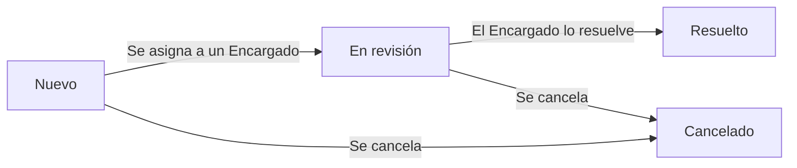

# Manual de usuario

## Cima Fix — Sistema de Reporte y Seguimiento de Incidencias de Mantenimiento e Infraestructura

| Campo                     | Detalle                       |
| ------------------------- | ----------------------------- |
| Producto                  | Cima Fix                      |
| Versión del documento     | Borrador                      |
| Versión del sistema       | Pendiente de definir          |
| Estado                    | En redacción                  |
| Responsable del documento | Mike Armando Montano Valencia |

---

## Historial de cambios

| Versión  | Fecha                   | Cambio                                                                                                                |
| -------- | ----------------------- | --------------------------------------------------------------------------------------------------------------------- |
| Borrador | 24 de noviembre de 2026 | Creación del documento. El contenido se completa de forma incremental; las secciones pendientes se marcan como tales. |
| Borrador | 24 de noviembre de 2026 | Redacción de las secciones 1 a 4: introducción, conceptos básicos, inicio rápido y Reportante.                        |
| Borrador | 24 de noviembre de 2026 | Redacción de la sección 5: Encargado.                                                                                 |
| Borrador | 24 de noviembre de 2026 | Redacción de la sección 6: Admin.                                                                                     |
| Borrador | 25 de noviembre de 2026 | Redacción de las secciones 7 a 9: solución de problemas y contacto, referencia y glosario. |
| Borrador | 26 de noviembre de 2026 | Retiro del contenido sobre correos y alertas por acumulación, funcionalidad aún no implementada. |

---

## Tabla de contenidos

<!-- START doctoc generated TOC please keep comment here to allow auto update -->
<!-- DON'T EDIT THIS SECTION, INSTEAD RE-RUN doctoc TO UPDATE -->

- [1. Introducción](#1-introducci%C3%B3n)
  - [1.1 Qué es Cima Fix](#11-qu%C3%A9-es-cima-fix)
  - [1.2 A quién va dirigido](#12-a-qui%C3%A9n-va-dirigido)
  - [1.3 Qué no hace Cima Fix](#13-qu%C3%A9-no-hace-cima-fix)
  - [1.4 Qué necesitas para usarlo](#14-qu%C3%A9-necesitas-para-usarlo)
  - [1.5 Cómo usar este manual](#15-c%C3%B3mo-usar-este-manual)
- [2. Conceptos básicos](#2-conceptos-b%C3%A1sicos)
  - [2.1 Cómo se identifica un problema](#21-c%C3%B3mo-se-identifica-un-problema)
  - [2.2 Los tres roles](#22-los-tres-roles)
  - [2.3 Ciclo de vida de un reporte](#23-ciclo-de-vida-de-un-reporte)
  - [2.4 Prioridad](#24-prioridad)
  - [2.5 Qué reportes ves y qué datos ve cada quien](#25-qu%C3%A9-reportes-ves-y-qu%C3%A9-datos-ve-cada-quien)
- [3. Inicio rápido](#3-inicio-r%C3%A1pido)
  - [3.1 Iniciar sesión](#31-iniciar-sesi%C3%B3n)
  - [3.2 Registrar un reporte desde el enlace de un espacio](#32-registrar-un-reporte-desde-el-enlace-de-un-espacio)
- [4. Reportante](#4-reportante)
  - [4.1 Registrar un reporte](#41-registrar-un-reporte)
  - [4.2 Registrar un reporte desde el enlace de un espacio](#42-registrar-un-reporte-desde-el-enlace-de-un-espacio)
  - [4.3 Adjuntar fotografías](#43-adjuntar-fotograf%C3%ADas)
  - [4.4 Decidir sobre los posibles duplicados](#44-decidir-sobre-los-posibles-duplicados)
  - [4.5 Consultar y filtrar reportes](#45-consultar-y-filtrar-reportes)
  - [4.6 Ver el detalle y el estado de un reporte](#46-ver-el-detalle-y-el-estado-de-un-reporte)
  - [4.7 Cancelar un reporte tuyo](#47-cancelar-un-reporte-tuyo)
  - [4.8 Consultar el mapa del campus](#48-consultar-el-mapa-del-campus)
- [5. Encargado](#5-encargado)
  - [5.1 Alcance del rol de Encargado](#51-alcance-del-rol-de-encargado)
  - [5.2 Encontrar los reportes que atender](#52-encontrar-los-reportes-que-atender)
  - [5.3 Asignar o reasignar un reporte](#53-asignar-o-reasignar-un-reporte)
  - [5.4 Resolver un reporte asignado a tu cuenta](#54-resolver-un-reporte-asignado-a-tu-cuenta)
  - [5.5 Cancelar un reporte del campus](#55-cancelar-un-reporte-del-campus)
  - [5.6 Consultar las cuentas con rol en el campus](#56-consultar-las-cuentas-con-rol-en-el-campus)
- [6. Admin](#6-admin)
  - [6.1 Alcance del rol de Admin](#61-alcance-del-rol-de-admin)
  - [6.2 Consultar el catálogo del campus](#62-consultar-el-cat%C3%A1logo-del-campus)
  - [6.3 Agregar un edificio, un espacio o una categoría](#63-agregar-un-edificio-un-espacio-o-una-categor%C3%ADa)
  - [6.4 Cambiar el nombre de un edificio, un espacio o una categoría](#64-cambiar-el-nombre-de-un-edificio-un-espacio-o-una-categor%C3%ADa)
  - [6.5 Cambiar la gravedad de una categoría](#65-cambiar-la-gravedad-de-una-categor%C3%ADa)
  - [6.6 Desactivar y reactivar un edificio, un espacio o una categoría](#66-desactivar-y-reactivar-un-edificio-un-espacio-o-una-categor%C3%ADa)
  - [6.7 Indicar la posición de un edificio en el plano](#67-indicar-la-posici%C3%B3n-de-un-edificio-en-el-plano)
  - [6.8 Consultar y copiar el enlace de un espacio](#68-consultar-y-copiar-el-enlace-de-un-espacio)
  - [6.9 Asignar o cambiar el rol de una cuenta](#69-asignar-o-cambiar-el-rol-de-una-cuenta)
  - [6.10 Retirar el rol de una cuenta](#610-retirar-el-rol-de-una-cuenta)
  - [6.11 Definir los umbrales del mapa](#611-definir-los-umbrales-del-mapa)
  - [6.12 Atender reportes como Admin](#612-atender-reportes-como-admin)
- [7. Solución de problemas y contacto](#7-soluci%C3%B3n-de-problemas-y-contacto)
  - [7.1 Inicio de sesión](#71-inicio-de-sesi%C3%B3n)
  - [7.2 Registrar un reporte](#72-registrar-un-reporte)
  - [7.3 Consultar reportes y abrir enlaces](#73-consultar-reportes-y-abrir-enlaces)
  - [7.4 Mapa](#74-mapa)
  - [7.5 Atender reportes (Encargado y Admin)](#75-atender-reportes-encargado-y-admin)
  - [7.6 Configurar el campus (Admin)](#76-configurar-el-campus-admin)
  - [7.7 Contacto](#77-contacto)
- [8. Referencia](#8-referencia)
  - [8.1 Estados y transiciones](#81-estados-y-transiciones)
  - [8.2 Permisos por rol](#82-permisos-por-rol)
  - [8.3 Campos del formulario y sus límites](#83-campos-del-formulario-y-sus-l%C3%ADmites)
  - [8.4 Plazos y límites del sistema](#84-plazos-y-l%C3%ADmites-del-sistema)
- [9. Glosario](#9-glosario)

<!-- END doctoc generated TOC please keep comment here to allow auto update -->

---

## 1. Introducción

### 1.1 Qué es Cima Fix

Cima Fix es un sistema web para reportar problemas de mantenimiento e infraestructura del campus y darles seguimiento. Con él avisas de un problema, por ejemplo una luz que no enciende, y consultas en cualquier momento en qué estado está tu reporte.

Hoy se usa en el Campus Sauzal de la Universidad Autónoma de Baja California (UABC), en Ensenada. Te ofrece:

- **Un registro consultable.** Cada reporte queda guardado y se puede consultar después.
- **Aviso de posibles duplicados.** Antes de registrar tu reporte, Cima Fix te muestra los reportes abiertos parecidos, para que no se repita un problema que ya fue reportado.
- **Seguimiento del estado.** Cada reporte indica si está sin atender, en revisión, resuelto o cancelado.
- **Un mapa del campus.** Muestra en qué edificios hay reportes abiertos.

### 1.2 A quién va dirigido

Cima Fix lo usan tres tipos de persona:

- **Estudiantes y docentes**, que reportan problemas y consultan su estado. Tienen el rol de **Reportante**.
- **Personal encargado de atender incidencias**, que asigna y resuelve reportes. Tiene el rol de **Encargado**.
- **Personal responsable de configurar un campus**, que mantiene el catálogo, los roles y los umbrales. Tiene el rol de **Admin**.

Toda cuenta nueva empieza como Reportante. En la [sección 2.2](#22-los-tres-roles) se explica qué puede hacer cada rol.

### 1.3 Qué no hace Cima Fix

- **No sustituye al personal de mantenimiento ni decide por él qué atender.** Registra los reportes y da seguimiento; el diagnóstico y la visita al lugar siguen a cargo del personal.
- **No gestiona los reportes que requieren un proveedor externo.** Esos reportes siguen su propio canal, aparte de Cima Fix.
- **No detecta duplicados por sí solo.** Te muestra reportes abiertos que pueden ser el mismo problema y tú decides si lo son.
- **No envía notificaciones al celular ni es una aplicación que se instala.** Es un sitio web que abres en el navegador, y funciona en pantallas de celular.
- **No permite editar un reporte después de enviarlo.** Revisa los datos antes de enviar.

### 1.4 Qué necesitas para usarlo

- **Una cuenta institucional `@uabc.edu.mx`.** Cima Fix no tiene registro ni contraseña propios: inicias sesión con Google usando esa cuenta.
- **Un celular o una computadora con conexión a internet.**
- **Un navegador compatible:** las dos últimas versiones principales de Chrome, Safari, Firefox o Edge.

### 1.5 Cómo usar este manual

Convenciones:

- Los nombres de pantallas, botones y opciones aparecen en **negrita**, tal como los ves en Cima Fix.
- Los pasos están numerados. Haz una acción por paso, en orden.
- Cada tarea indica su objetivo, lo que necesitas antes de empezar y el resultado que debes ver al terminar.
- **Importante** señala algo que no se puede deshacer o que conviene revisar antes de continuar. **Nota** agrega información útil.

Qué leer según tu rol:

| Si eres…                          | Lee…                  |
| --------------------------------- | --------------------- |
| Reportante (estudiante o docente) | Secciones 2, 3 y 4    |
| Encargado                         | Secciones 2, 3, 4 y 5 |
| Admin                             | Secciones 2, 3, 4 y 6 |

Los Encargados y los Admins también pueden reportar problemas, por eso la sección 4 es para todos. Las secciones 7, 8 y 9 sirven a cualquier rol.

---

## 2. Conceptos básicos

### 2.1 Cómo se identifica un problema

Todo reporte indica dónde ocurre el problema y de qué tipo es:

- **Campus:** la sede de la universidad.
- **Edificio:** una estructura o zona identificable dentro del campus, por ejemplo un estacionamiento o una cancha.
- **Espacio:** la ubicación específica dentro de un edificio, por ejemplo un salón.
- **Categoría:** el tipo de incidencia.

Cada espacio tiene su propio **enlace del espacio**, que normalmente está impreso como un código QR junto al espacio. Al abrirlo, el formulario de reporte aparece con el campus, el edificio y el espacio ya elegidos.

### 2.2 Los tres roles

Tu rol determina qué puedes hacer en Cima Fix. Estas reglas aplican a los tres:

- Toda cuenta es **Reportante** en todos los campus por defecto. Como Reportante puedes registrar y consultar reportes en cualquier campus activo.
- Los permisos de Encargado y de Admin rigen solo en el campus donde te asignaron ese rol. En los demás campus sigues siendo Reportante, a menos que también te asignen un rol ahí.
- Tienes un solo rol en cada campus, pero puedes tener roles distintos en campus distintos. Por ejemplo, Encargado en uno y Admin en otro.
- Un Admin del campus asigna y retira los roles de Encargado y Admin. Si necesitas uno, pídeselo a un Admin de tu campus.

| Rol        | Qué hace                                                                                                                                                                                             |
| ---------- | ---------------------------------------------------------------------------------------------------------------------------------------------------------------------------------------------------- |
| Reportante | Registra reportes en cualquier campus activo, confirma duplicados, consulta reportes y el mapa, y cancela los reportes que registró.                                                                 |
| Encargado  | Todo lo de un Reportante, y además atiende los reportes de su campus: se asigna reportes o los asigna a otros Encargados, resuelve los asignados a su cuenta y cancela cualquier reporte del campus. |
| Admin      | Todo lo de un Reportante, y además configura su campus: catálogo, roles y umbrales. También asigna y cancela reportes, pero no los resuelve.                                                         |

La tabla completa de permisos está en la [sección 8](#8-referencia).

### 2.3 Ciclo de vida de un reporte

Un reporte siempre tiene uno de estos cuatro estados:

| Estado      | Qué significa                                                           |
| ----------- | ----------------------------------------------------------------------- |
| Nuevo       | El reporte está registrado y todavía no se asigna a ningún Encargado.   |
| En revisión | El reporte está asignado a un Encargado.                                |
| Resuelto    | El Encargado asignado marcó el problema como solucionado.               |
| Cancelado   | El reporte se canceló, por quien lo registró o por personal del campus. |

Un **reporte abierto** es el que está en estado Nuevo o En revisión.

Ten presente que:

- Un reporte En revisión puede pasar a otro Encargado sin cambiar de estado, pero nunca se queda sin Encargado asignado.
- Un reporte Resuelto o Cancelado ya no cambia ni se reabre. Si el problema vuelve a ocurrir, registra un reporte nuevo.

### 2.4 Prioridad

Cada reporte tiene una prioridad **Baja**, **Media** o **Alta** que Cima Fix calcula sola; nadie la asigna a mano. Parte de la gravedad de la categoría y sube un nivel por cada 3 personas que confirmaron que se trata del mismo problema. Los reportes de mayor prioridad aparecen primero en la consulta.

### 2.5 Qué reportes ves y qué datos ve cada quien

- **Reportes abiertos:** los ves siempre.
- **Reportes Resueltos:** los ves durante 7 días de 24 horas desde el momento en que se resolvieron. Después, solo los ven los Encargados y Admins del campus del reporte.
- **Reportes Cancelados:** no los ves como Reportante, ni siquiera si tú los registraste.
- **Correos de las personas:** tu correo institucional es el único dato personal que Cima Fix guarda de ti. Solo lo ven los Encargados y Admins del campus del reporte. Tú tampoco ves el correo de quien registró un reporte ni el de la persona asignada.

---

## 3. Inicio rápido

### 3.1 Iniciar sesión

**Objetivo.** Entrar a Cima Fix con tu cuenta institucional.

**Antes de empezar.** Ten a la mano tu cuenta `@uabc.edu.mx`.

**Pasos.**

1. Abre Cima Fix en tu navegador.
2. Pulsa **Continuar con Google**.
3. Elige tu cuenta `@uabc.edu.mx`.
4. Espera a que Cima Fix te lleve a la pantalla de inicio.

**Resultado.** Tu sesión queda iniciada y se mantiene durante 30 días. Pasado ese plazo, Cima Fix te pide iniciar sesión otra vez.

> **Nota:** Si abres el enlace de un espacio o de un reporte sin haber iniciado sesión, Cima Fix te pide iniciar sesión y, al terminar, te lleva a donde querías ir.

> **Nota:** Solo funcionan las cuentas `@uabc.edu.mx`. Con una cuenta de otro dominio, Cima Fix rechaza el inicio de sesión.

### 3.2 Registrar un reporte desde el enlace de un espacio

**Objetivo.** Reportar un problema en el lugar donde ocurre, con el menor número de datos posible.

**Antes de empezar.** Ten sesión iniciada ([sección 3.1](#31-iniciar-sesi%C3%B3n)) y estar junto al espacio, donde está el código QR.

**Pasos.**

1. Escanea el código QR del espacio con la cámara de tu celular.
2. Abre el enlace que aparece en la pantalla del celular.
3. Comprueba que el campus, el edificio y el espacio que aparecen ya elegidos son los correctos.
4. Elige la categoría del problema.
5. Escribe la descripción del problema.
6. Pulsa **Enviar reporte**.
7. Si Cima Fix muestra posibles duplicados y ninguno es tu problema, pulsa **Ninguno es mi problema, continuar**.

**Resultado.** Cima Fix muestra tu reporte con el estado **Nuevo**, su prioridad y la fecha y hora en que se registró.

> **Nota:** Si ves un aviso de que el espacio no está disponible, elige tú mismo lo que falte. Más detalles en la [sección 4.2](#42-registrar-un-reporte-desde-el-enlace-de-un-espacio).

> **Nota:** Si Cima Fix muestra posibles duplicados, léelos antes de decidir. Cómo hacerlo está en la [sección 4.4](#44-decidir-sobre-los-posibles-duplicados).

---

## 4. Reportante

Esta sección sirve a cualquier persona con cuenta. Los Encargados y los Admins también la usan, porque también pueden reportar.

Antes de empezar cualquiera de estas tareas, inicia sesión ([sección 3.1](#31-iniciar-sesi%C3%B3n)).

### 4.1 Registrar un reporte

**Objetivo.** Reportar un problema del campus eligiendo tú el lugar.

**Antes de empezar.** Ten a la mano dónde ocurre el problema (campus, edificio y espacio) y una descripción. Si quieres, ten también hasta 3 fotografías.

**Pasos.**

1. En la pantalla de inicio, elige la opción para reportar un problema.
2. Elige el campus.
3. Elige el edificio.
4. Elige el espacio.
5. Elige la categoría.
6. Escribe la descripción del problema.
7. Si quieres, adjunta fotografías, como se explica en la [sección 4.3](#43-adjuntar-fotograf%C3%ADas).
8. Lee el aviso que indica que tu correo será visible para el personal que atiende el reporte.
9. Pulsa **Enviar reporte**.
10. Si Cima Fix muestra posibles duplicados, decide como se explica en la [sección 4.4](#44-decidir-sobre-los-posibles-duplicados).

**Resultado.** Cima Fix muestra tu reporte con el estado **Nuevo**, su prioridad y la fecha y hora en que se registró. El reporte ya aparece en la consulta de reportes.

> **Importante:** No puedes modificar un reporte después de enviarlo. Revisa el lugar, la categoría, la descripción y las fotografías antes de pulsar **Enviar reporte**.

> **Nota:** Las listas dependen unas de otras. Al elegir el campus, los edificios y las categorías se limitan a los de ese campus. Al elegir el edificio, los espacios se limitan a los de ese edificio. Elige en el orden de los pasos.

> **Nota:** La descripción es obligatoria, no puede estar vacía ni tener solo espacios y admite hasta 1,000 caracteres. Si Cima Fix rechaza algún dato, te muestra un aviso con el motivo.

### 4.2 Registrar un reporte desde el enlace de un espacio

**Objetivo.** Registrar un reporte con el campus, el edificio y el espacio ya elegidos.

**Antes de empezar.** Ten el enlace del espacio, normalmente un código QR junto al espacio.

**Pasos.**

1. Escanea el código QR del espacio con la cámara de tu celular, o abre el enlace del espacio en tu navegador.
2. Si Cima Fix te lo pide, inicia sesión ([sección 3.1](#31-iniciar-sesi%C3%B3n)). Al terminar, vuelves al formulario de ese espacio.
3. Comprueba que el campus, el edificio y el espacio sean los correctos. Si no lo son, cámbialos.
4. Completa la categoría y la descripción, y envía el reporte como en los pasos 5 a 10 de la [sección 4.1](#41-registrar-un-reporte).

**Resultado.** El reporte queda registrado con el estado **Nuevo**.

**Si el espacio no está disponible.** Cima Fix muestra un aviso de que el espacio no está disponible y preselecciona solo lo que sí está disponible. Elige tú el resto de los datos. Esto puede ocurrir en estos casos:

- El espacio ya no se ofrece, pero su edificio sí: aparecen elegidos el campus y el edificio.
- El edificio del espacio ya no se ofrece: aparece elegido solo el campus.
- El campus no está activo o el enlace no corresponde a ningún espacio: no aparece nada elegido.

### 4.3 Adjuntar fotografías

**Objetivo.** Agregar fotografías que ayuden a entender el problema.

**Antes de empezar.** Ten las fotografías en tu dispositivo. Cada una debe cumplir lo siguiente:

- Formato JPEG, PNG, WebP o HEIC.
- Hasta 10 MB cada una.
- Hasta 3 fotografías por reporte.

**Pasos.**

1. En el formulario de reporte, pulsa la opción para adjuntar fotografías.
2. Elige una fotografía de tu dispositivo.
3. Repite el paso 2 si quieres adjuntar otra, hasta un máximo de 3.

**Resultado.** Las fotografías se envían junto con tu reporte al pulsar **Enviar reporte** y aparecen en el reporte.

> **Nota:** Si una fotografía no cumple los requisitos, Cima Fix te indica el motivo y no la adjunta.

> **Nota:** Si una fotografía no se puede guardar al enviar, el reporte no se registra. Cima Fix te avisa y conserva los datos que escribiste; vuelve a pulsar **Enviar reporte**. También puedes enviar el reporte sin fotografías.

### 4.4 Decidir sobre los posibles duplicados

**Objetivo.** Evitar reportar de nuevo un problema que ya está reportado.

**Antes de empezar.** Llena el formulario y pulsa **Enviar reporte** ([sección 4.1](#41-registrar-un-reporte)). Cima Fix muestra esta lista solo cuando existen reportes abiertos del mismo campus, categoría y edificio.

**Pasos.**

1. Lee el primer reporte de la lista: su descripción, sus fotografías, su estado y su prioridad.
2. Lee los demás reportes de la lista.
3. Elige una de estas opciones:
   - Si alguno es tu mismo problema, pulsa **Es el mismo problema** en ese reporte.
   - Si ninguno es tu problema, pulsa **Ninguno es mi problema, continuar**.

**Resultado.**

- Con **Es el mismo problema**, tu confirmación queda registrada en ese reporte y Cima Fix no registra un reporte nuevo. Cima Fix te muestra el reporte confirmado y su prioridad puede subir.
- Con **Ninguno es mi problema, continuar**, Cima Fix registra tu reporte con el estado **Nuevo**.

> **Importante:** Cima Fix no compara textos: la lista incluye todos los reportes abiertos del mismo campus, categoría y edificio, aunque traten de problemas distintos. Confirma solo si de verdad es el mismo problema.

> **Importante:** Al confirmar un duplicado no se registra un reporte nuevo, así que tu descripción y tus fotografías no se guardan.

> **Nota:** No puedes confirmar un reporte que registraste tú ni confirmar dos veces el mismo reporte. Esos reportes aparecen en la lista con la leyenda **Tú registraste este reporte** o **Ya lo confirmaste**, sin botón de confirmar.

### 4.5 Consultar y filtrar reportes

**Objetivo.** Ver los reportes registrados y encontrar los que te interesan.

**Pasos.**

1. En la pantalla de inicio, elige la opción para consultar reportes.
2. Si quieres ver solo los reportes que registraste o confirmaste tú, elige **Mis reportes**.
3. Si quieres acotar la lista, aplica los filtros que necesites.
4. Revisa la lista de reportes.

**Resultado.** La lista muestra los reportes que cumplen todos los filtros que aplicaste.

Filtros disponibles:

| Filtro       | Qué muestra                                                       |
| ------------ | ----------------------------------------------------------------- |
| Campus       | Los reportes del campus elegido. Solo se ofrecen campus activos.  |
| Categoría    | Los reportes de esa categoría. Aparece una vez elegido un campus. |
| Edificio     | Los reportes de ese edificio. Aparece una vez elegido un campus.  |
| Estado       | Los reportes en ese estado.                                       |
| Mis reportes | Los reportes que registraste o confirmaste como duplicado.        |

Orden de la lista:

1. Primero los reportes abiertos y después los Resueltos y Cancelados que puedas ver.
2. Dentro de cada grupo, de mayor a menor prioridad.
3. Entre reportes de igual prioridad, primero el más antiguo.

> **Nota:** Solo ves los reportes que las reglas de la [sección 2.5](#25-qu%C3%A9-reportes-ves-y-qu%C3%A9-datos-ve-cada-quien) te permiten ver.

### 4.6 Ver el detalle y el estado de un reporte

**Objetivo.** Saber en qué estado está un reporte y qué datos tiene.

**Pasos.**

1. En la lista de reportes, elige el reporte que quieres ver.
2. Revisa sus datos.

**Resultado.** Cima Fix muestra el campus, el edificio, el espacio, la categoría, la descripción, las fotografías, el estado, la prioridad, el número de personas que confirmaron el duplicado, la fecha y hora de creación y, si está Resuelto, la fecha y hora de resolución. Cima Fix no muestra a un Reportante el correo de quien registró el reporte ni el de la persona asignada.

> **Nota:** Las fechas y horas se muestran en la hora local de Baja California.

> **Nota:** Cada reporte tiene su propio enlace, que puedes abrir con tu sesión iniciada. Si abres el enlace de un reporte que no puedes ver, Cima Fix te avisa que el reporte no está disponible y no muestra ningún dato. Si el reporte se resolvió hace más de 7 días, el aviso lo indica.

> **Nota:** Si las fotografías no se pueden mostrar en este momento, Cima Fix muestra el resto de los datos del reporte sin ellas.

### 4.7 Cancelar un reporte tuyo

**Objetivo.** Cancelar un reporte que registraste y que ya no es necesario.

**Antes de empezar.** Comprueba que el reporte cumpla estas tres condiciones:

- Lo registraste tú.
- Sigue abierto (Nuevo o En revisión).
- Nadie lo ha confirmado como duplicado.

**Pasos.**

1. Abre el detalle del reporte ([sección 4.6](#46-ver-el-detalle-y-el-estado-de-un-reporte)).
2. Elige **Cancelar reporte**.
3. En el aviso de confirmación, elige **Sí, cancelar reporte**.

**Resultado.** El reporte pasa al estado **Cancelado** y deja de aparecer para ti.

> **Importante:** Cancelar no se puede deshacer: un reporte Cancelado no se reabre. Si el problema sigue, tendrás que registrar un reporte nuevo.

> **Nota:** Si Cima Fix no te ofrece la opción de cancelar, es porque el reporte ya se cerró, no lo registraste tú o alguien ya lo confirmó como duplicado.

### 4.8 Consultar el mapa del campus

**Objetivo.** Ver en qué edificios hay reportes abiertos.

**Pasos.**

1. En la pantalla de inicio, elige la opción para ver el mapa.
2. Si hay más de un campus activo, elige el campus que quieres ver.
3. Acerca, aleja y desplaza el plano para ver los edificios.
4. Selecciona un indicador para ver el nombre del edificio.

**Resultado.** El mapa muestra el plano del campus con un indicador en cada edificio que tiene reportes abiertos. Cada indicador muestra el número de reportes abiertos del edificio.

Cómo leer el mapa:

- Los edificios sin reportes abiertos no tienen indicador.
- Si el Admin definió los umbrales del mapa, el indicador se ve distinto según su nivel (Bajo, Medio o Alto) y el mapa muestra una leyenda con el rango de reportes de cada nivel. Si no los definió, todos los indicadores se ven igual.
- Debajo del mapa hay una lista de los edificios con indicador, con su nombre, su número de reportes abiertos y, si hay umbrales, su nivel. Úsala si prefieres leer en lugar de mirar el plano.
- Si el campus no tiene ningún edificio ubicado en el plano, el mapa muestra el plano y un aviso.
- Al seleccionar un edificio, ves la lista de sus reportes abiertos, con el mismo orden de la consulta. Puedes volver al mapa sin que se actualice.

> **Importante:** El mapa no se actualiza solo. Muestra los reportes que existían cuando lo abriste. Para ver los cambios, recarga la página o elige otro campus.

---

## 5. Encargado

Esta sección sirve a las personas con rol de Encargado en un campus. Los Encargados también pueden reportar y consultar reportes, así que todo lo de la [sección 4](#4-reportante) sigue disponible.

Antes de empezar cualquiera de estas tareas, inicia sesión ([sección 3.1](#31-iniciar-sesi%C3%B3n)).

### 5.1 Alcance del rol de Encargado

Como Encargado atiendes los reportes del campus donde se te asignó ese rol. Frente a un Reportante, cambia lo siguiente:

- Asignas y reasignas reportes ([sección 5.3](#53-asignar-o-reasignar-un-reporte)), resuelves los asignados a tu cuenta ([sección 5.4](#54-resolver-un-reporte-asignado-a-tu-cuenta)) y cancelas cualquier reporte abierto del campus ([sección 5.5](#55-cancelar-un-reporte-del-campus)).
- Consultas los reportes Cancelados y los Resueltos sin límite de tiempo, y ves el correo de quien registró cada reporte y el de la persona asignada ([sección 2.5](#25-qu%C3%A9-reportes-ves-y-qu%C3%A9-datos-ve-cada-quien)).
- Estos permisos rigen solo en el campus donde tienes el rol. En los demás campus sigues siendo Reportante ([sección 2.2](#22-los-tres-roles)).
- En el detalle de cada reporte, Cima Fix muestra solo las acciones que puedes hacer sobre él.

### 5.2 Encontrar los reportes que atender

**Objetivo.** Ver los reportes del campus que están sin asignar o que tienes a tu cargo.

**Pasos.**

1. Abre la lista de reportes como se explica en la [sección 4.5](#45-consultar-y-filtrar-reportes).
2. En el filtro **Campus**, elige el campus donde eres Encargado.
3. Aplica el filtro que necesites:
   - Para ver los reportes sin asignar, elige el estado **Nuevo** en el filtro **Estado**.
   - Para ver los reportes que tienes a tu cargo, elige **Asignados a mí**.
4. Revisa la lista de reportes.

**Resultado.** La lista muestra los reportes del campus que cumplen todos los filtros que aplicaste, con los abiertos primero y, dentro de ellos, los de mayor prioridad (sección 4.5).

> **Nota:** En tu campus, la lista también incluye los reportes Cancelados y los Resueltos hace más de 7 días, que un Reportante no ve.

### 5.3 Asignar o reasignar un reporte

**Objetivo.** Poner un reporte a cargo de un Encargado del campus: el primero que lo atiende, si el reporte está **Nuevo**, o uno distinto, si ya está **En revisión**.

**Antes de empezar.**

- Ten el rol de Encargado en el campus del reporte.
- Comprueba que el reporte esté abierto (**Nuevo** o **En revisión**).
- Si lo asignas a otra persona, su cuenta debe tener el rol de Encargado en ese campus. Un Admin no puede recibir reportes.

**Pasos.**

1. Abre el detalle del reporte ([sección 4.6](#46-ver-el-detalle-y-el-estado-de-un-reporte)).
2. Elige a quién asignarlo:
   - Si vas a encargarte tú, elige **Asignarme**.
   - Si lo asignas a otro Encargado, elige **Asignar a…**.
3. Si elegiste **Asignar a…**, elige la cuenta del Encargado.

**Resultado.** El reporte queda asignado a esa cuenta y el detalle lo muestra así. Si estaba **Nuevo**, pasa a **En revisión**; si ya estaba **En revisión**, sigue en ese estado.

> **Nota:** Si el reporte cambia de estado mientras lo asignas, por ejemplo porque otro Encargado lo asignó antes, Cima Fix rechaza la asignación. Abre el detalle para ver el estado actual.

### 5.4 Resolver un reporte asignado a tu cuenta

**Objetivo.** Marcar como solucionado un reporte que tienes a cargo.

**Antes de empezar.** El reporte debe estar **En revisión** y asignado a tu cuenta. Si está asignado a otra cuenta, no puedes resolverlo: primero debe asignarse a la tuya ([sección 5.3](#53-asignar-o-reasignar-un-reporte)).

> **Importante:** Resolver no se puede deshacer: un reporte Resuelto no se reabre. Si el problema vuelve a ocurrir, se debe registrar un reporte nuevo ([sección 2.3](#23-ciclo-de-vida-de-un-reporte)).

**Pasos.**

1. Abre el detalle del reporte ([sección 4.6](#46-ver-el-detalle-y-el-estado-de-un-reporte)).
2. Elige la opción para resolver el reporte.
3. Si Cima Fix te pide confirmar, confirma la resolución.

**Resultado.** El reporte pasa al estado **Resuelto**. El detalle muestra la fecha y hora de resolución.

### 5.5 Cancelar un reporte del campus

**Objetivo.** Cancelar un reporte abierto del campus, sin importar quién lo registró.

**Antes de empezar.** Ten el rol de Encargado en el campus del reporte y comprueba que el reporte esté abierto (**Nuevo** o **En revisión**).

> **Importante:** Cancelar no se puede deshacer: un reporte Cancelado no se reabre. Si el problema sigue, se debe registrar un reporte nuevo ([sección 2.3](#23-ciclo-de-vida-de-un-reporte)). Además, el reporte deja de aparecer para los Reportantes, incluidos quien lo registró y quienes lo confirmaron como duplicado ([sección 2.5](#25-qu%C3%A9-reportes-ves-y-qu%C3%A9-datos-ve-cada-quien)).

**Pasos.**

1. Abre el detalle del reporte ([sección 4.6](#46-ver-el-detalle-y-el-estado-de-un-reporte)).
2. Elige la opción para cancelar el reporte.
3. Si Cima Fix te pide confirmar, confirma la cancelación.

**Resultado.** El reporte pasa al estado **Cancelado**.

> **Nota:** A diferencia de un Reportante, puedes cancelar un reporte aunque otras personas ya lo hayan confirmado como duplicado ([sección 4.7](#47-cancelar-un-reporte-tuyo)).

### 5.6 Consultar las cuentas con rol en el campus

**Objetivo.** Ver qué cuentas tienen el rol de Encargado o de Admin en el campus, por ejemplo para saber a quién puedes asignar un reporte.

**Antes de empezar.** Ten el rol de Encargado o de Admin en ese campus.

**Pasos.**

1. Elige la opción para consultar las cuentas con rol del campus.
2. Revisa la lista.

**Resultado.** Cima Fix muestra, de cada cuenta con rol de Encargado o de Admin en el campus, su correo institucional y su rol. La lista incluye las cuentas que todavía no han iniciado sesión y no incluye las que solo tienen el rol de Reportante.

> **Nota:** Como Encargado solo consultas la lista. Un Admin del campus asigna y retira los roles ([sección 2.2](#22-los-tres-roles)).

## 6. Admin

Esta sección sirve a las personas con rol de Admin en un campus. Los Admins también pueden reportar y consultar reportes, así que todo lo de la [sección 4](#4-reportante) sigue disponible.

Antes de empezar cualquiera de estas tareas, inicia sesión ([sección 3.1](#31-iniciar-sesi%C3%B3n)).

### 6.1 Alcance del rol de Admin

Como Admin configuras el campus donde se te asignó ese rol. Frente a un Reportante, cambia lo siguiente:

- Mantienes el catálogo del campus: edificios, espacios y categorías ([secciones 6.2 a 6.6](#62-consultar-el-cat%C3%A1logo-del-campus)), la posición de los edificios en el plano ([sección 6.7](#67-indicar-la-posici%C3%B3n-de-un-edificio-en-el-plano)) y el enlace de cada espacio ([sección 6.8](#68-consultar-y-copiar-el-enlace-de-un-espacio)).
- Asignas y retiras los roles de Encargado y de Admin ([sección 6.9](#69-asignar-o-cambiar-el-rol-de-una-cuenta) y [sección 6.10](#610-retirar-el-rol-de-una-cuenta)).
- Defines los umbrales del mapa ([sección 6.11](#611-definir-los-umbrales-del-mapa)).
- Asignas y cancelas reportes del campus, pero no los resuelves, y no puedes recibir reportes asignados ([sección 6.12](#612-atender-reportes-como-admin)).
- Consultas los reportes Cancelados y los Resueltos sin límite de tiempo, y ves el correo de quien registró cada reporte y el de la persona asignada ([sección 2.5](#25-qu%C3%A9-reportes-ves-y-qu%C3%A9-datos-ve-cada-quien)).
- Estos permisos rigen solo en el campus donde tienes el rol. En los demás campus sigues siendo Reportante, a menos que también te asignen un rol ahí ([sección 2.2](#22-los-tres-roles)).

Lo que no se hace desde Cima Fix:

- **Dar de alta un campus nuevo.** El alta de un campus y de su primer Admin se hace fuera de Cima Fix, por el equipo de desarrollo. El plano del campus se incorpora junto con el alta y tampoco se cambia desde Cima Fix.
- **Imprimir y colocar los códigos QR.** Cima Fix te da el enlace de cada espacio; imprimir y colocar el código QR corresponde a la UABC.

### 6.2 Consultar el catálogo del campus

**Objetivo.** Ver los edificios, los espacios y las categorías del campus, incluidos los que están desactivados.

**Antes de empezar.** Ten el rol de Admin en el campus.

**Pasos.**

1. Elige la opción para gestionar el catálogo del campus.
2. Si eres Admin en más de un campus, elige el campus que quieres configurar.
3. Revisa los edificios, los espacios de cada edificio y las categorías.

**Resultado.** Cima Fix muestra los edificios del campus, los espacios de cada edificio y las categorías del campus. De cada uno indica si está activo o desactivado. Los desactivados siguen apareciendo. Cada espacio muestra su enlace.

> **Nota:** Esta lista no es la que ve quien registra un reporte. En el formulario de reporte solo aparecen los elementos que se ofrecen ([sección 6.6](#66-desactivar-y-reactivar-un-edificio-un-espacio-o-una-categor%C3%ADa)).

### 6.3 Agregar un edificio, un espacio o una categoría

**Objetivo.** Registrar un edificio, un espacio o una categoría nuevos en el catálogo del campus.

**Antes de empezar.**

- Ten el rol de Admin en el campus.
- Ten el nombre del elemento. Para una categoría, decide también su gravedad: Baja, Media o Alta.
- Para un espacio, comprueba que su edificio ya esté registrado.
- Comprueba que el nombre no exista ya en el catálogo, ni siquiera como elemento desactivado.

**Pasos.**

1. Abre el catálogo del campus (pasos 1 y 2 de la [sección 6.2](#62-consultar-el-cat%C3%A1logo-del-campus)).
2. Elige la opción para agregar lo que necesitas:
   - Para un edificio, la opción para agregar un edificio.
   - Para un espacio, elige primero el edificio y luego la opción para agregar un espacio.
   - Para una categoría, la opción para agregar una categoría.
3. Escribe el nombre.
4. Si agregas una categoría, elige su gravedad.
5. Guarda el nuevo elemento.

**Resultado.** El elemento aparece en el catálogo del campus. Cada espacio nuevo recibe su propio enlace ([sección 6.8](#68-consultar-y-copiar-el-enlace-de-un-espacio)). Una categoría nueva existe solo en este campus.

> **Importante:** Un edificio nuevo no aparece en el formulario de reporte hasta que tenga al menos un espacio activo. Agrega sus espacios después de registrarlo.

> **Importante:** Un elemento del catálogo no se puede eliminar. Si te equivocas en el nombre, cámbialo ([sección 6.4](#64-cambiar-el-nombre-de-un-edificio-un-espacio-o-una-categor%C3%ADa)); si ya no lo necesitas, desactívalo ([sección 6.6](#66-desactivar-y-reactivar-un-edificio-un-espacio-o-una-categor%C3%ADa)).

> **Nota:** No puede haber dos edificios con el mismo nombre en un campus, ni dos espacios con el mismo nombre en un edificio, ni dos categorías con el mismo nombre en un campus. Cima Fix no distingue mayúsculas de minúsculas ni acentos, ignora los espacios sobrantes y cuenta también los elementos desactivados. Si el nombre ya lo tiene un elemento desactivado, reactívalo en lugar de crear otro. El mismo nombre sí se acepta en otro edificio (para un espacio) o en otro campus (para un edificio o una categoría).

> **Nota:** La gravedad de una categoría es obligatoria y determina la prioridad de sus reportes ([sección 2.4](#24-prioridad)).

### 6.4 Cambiar el nombre de un edificio, un espacio o una categoría

**Objetivo.** Corregir o actualizar el nombre de un elemento del catálogo.

**Antes de empezar.**

- Ten el rol de Admin en el campus.
- Ten el nuevo nombre. Debe cumplir las reglas de nombres de la [sección 6.3](#63-agregar-un-edificio-un-espacio-o-una-categor%C3%ADa).

**Pasos.**

1. Abre el catálogo del campus (pasos 1 y 2 de la [sección 6.2](#62-consultar-el-cat%C3%A1logo-del-campus)).
2. Elige el elemento. Si es un espacio, búscalo dentro de su edificio.
3. Elige la opción para cambiar el nombre.
4. Escribe el nuevo nombre.
5. Guarda el cambio.

**Resultado.** El nuevo nombre se muestra en el catálogo y en los reportes que ya tenían asociado ese elemento.

> **Nota:** El enlace de un espacio no cambia al renombrar el espacio ni su edificio. Los códigos QR que ya imprimiste siguen funcionando.

### 6.5 Cambiar la gravedad de una categoría

**Objetivo.** Cambiar la gravedad de una categoría, que es el punto de partida de la prioridad de sus reportes.

**Antes de empezar.** Ten el rol de Admin en el campus y la categoría ya registrada.

> **Importante:** Al guardar, Cima Fix recalcula la prioridad de todos los reportes abiertos de esa categoría con la nueva gravedad, y por eso cambia su lugar en la consulta ([sección 4.5](#45-consultar-y-filtrar-reportes)). Los reportes Resueltos y Cancelados conservan la prioridad que tenían.

**Pasos.**

1. Abre el catálogo del campus (pasos 1 y 2 de la [sección 6.2](#62-consultar-el-cat%C3%A1logo-del-campus)).
2. Elige la categoría.
3. Elige la opción para cambiar la gravedad.
4. Elige la nueva gravedad: Baja, Media o Alta.
5. Guarda el cambio.

**Resultado.** La categoría conserva la nueva gravedad. Cada reporte abierto de esa categoría muestra la prioridad que resulta de ella: la gravedad sube un nivel por cada 3 confirmaciones de duplicado, sin pasar de Alta ([sección 2.4](#24-prioridad)).

> **Nota:** Nadie puede cambiar a mano la prioridad de un reporte, tampoco un Admin. Se calcula con la gravedad de la categoría y las confirmaciones de duplicado.

### 6.6 Desactivar y reactivar un edificio, un espacio o una categoría

**Objetivo.** Dejar de ofrecer un edificio, un espacio o una categoría que ya no se usan, o volver a ofrecerlos.

**Antes de empezar.**

- Ten el rol de Admin en el campus.
- Para desactivar un edificio o una categoría, comprueba que no tenga reportes abiertos asociados. Si los tiene, espera a que se resuelvan o cancélalos ([sección 6.12](#612-atender-reportes-como-admin)). Los reportes Resueltos y Cancelados no lo impiden.
- Un espacio sí se puede desactivar aunque tenga reportes abiertos.

> **Importante:** Desactivar un edificio también deja de ofrecer todos sus espacios, y desactivar el último espacio activo de un edificio deja de ofrecer el edificio. Quien abra el enlace de un espacio que no se ofrece verá un aviso de que el espacio no está disponible ([sección 4.2](#42-registrar-un-reporte-desde-el-enlace-de-un-espacio)).

**Pasos para desactivar.**

1. Abre el catálogo del campus (pasos 1 y 2 de la [sección 6.2](#62-consultar-el-cat%C3%A1logo-del-campus)).
2. Elige el edificio, el espacio o la categoría.
3. Elige la opción para desactivarlo.
4. Si Cima Fix te pide confirmar, confirma.

**Pasos para reactivar.**

1. Abre el catálogo del campus (pasos 1 y 2 de la [sección 6.2](#62-consultar-el-cat%C3%A1logo-del-campus)).
2. Elige el elemento desactivado.
3. Elige la opción para reactivarlo.
4. Si Cima Fix te pide confirmar, confirma.

**Resultado.**

- Al desactivar, el elemento deja de aparecer entre las opciones al registrar un reporte y en los filtros de la consulta. Sigue en el catálogo, marcado como desactivado, y los reportes que ya lo tenían asociado lo siguen mostrando.
- Al reactivar, el elemento vuelve a ofrecerse, salvo que siga sin ofrecerse por otra razón: un espacio cuyo edificio sigue desactivado, o un edificio sin espacios activos.

> **Nota:** Desactivar es la única forma de retirar un elemento del catálogo: no se elimina.

> **Nota:** Si Cima Fix rechaza desactivar un edificio o una categoría, es porque tiene reportes abiertos. Cuando se resuelvan o se cancelen, vuelve a intentarlo.

### 6.7 Indicar la posición de un edificio en el plano

**Objetivo.** Ubicar un edificio sobre el plano del campus para que el mapa le muestre un indicador, y cambiar o retirar esa posición cuando haga falta.

**Antes de empezar.** Ten el rol de Admin en el campus y el edificio ya registrado ([sección 6.3](#63-agregar-un-edificio-un-espacio-o-una-categor%C3%ADa)).

**Pasos para indicar o cambiar la posición.**

1. Abre el catálogo del campus (pasos 1 y 2 de la [sección 6.2](#62-consultar-el-cat%C3%A1logo-del-campus)).
2. Elige el edificio.
3. Elige la opción para indicar su posición en el plano.
4. Indica sobre el plano la posición del edificio.
5. Guarda la posición.

**Pasos para retirar la posición.**

1. Abre el catálogo del campus (pasos 1 y 2 de la [sección 6.2](#62-consultar-el-cat%C3%A1logo-del-campus)).
2. Elige el edificio.
3. Elige la opción para retirar su posición.
4. Si Cima Fix te pide confirmar, confirma.

**Resultado.**

- Al indicar o cambiar la posición, Cima Fix la conserva. Si el edificio tiene reportes abiertos, el mapa le muestra un indicador en esa posición.
- Al retirarla, el edificio queda sin posición y sin indicador en el mapa. Puedes indicarle otra después.

> **Nota:** Un edificio sin posición sí se puede elegir al registrar un reporte. Solo que el mapa no le muestra indicador, aunque tenga reportes abiertos.

> **Nota:** Si ningún edificio del campus tiene posición, el mapa muestra el plano con un aviso ([sección 4.8](#48-consultar-el-mapa-del-campus)).

> **Nota:** El mapa no se actualiza solo. Quien lo tenga abierto verá el cambio al recargarlo ([sección 4.8](#48-consultar-el-mapa-del-campus)).

### 6.8 Consultar y copiar el enlace de un espacio

**Objetivo.** Obtener el enlace de un espacio, por ejemplo para generar su código QR.

**Antes de empezar.** Ten el rol de Admin en el campus y el espacio ya registrado ([sección 6.3](#63-agregar-un-edificio-un-espacio-o-una-categor%C3%ADa)).

**Pasos.**

1. Abre el catálogo del campus (pasos 1 y 2 de la [sección 6.2](#62-consultar-el-cat%C3%A1logo-del-campus)).
2. Busca el espacio dentro de su edificio.
3. Copia el enlace del espacio.

**Resultado.** Tienes el enlace propio del espacio. Al abrirlo, Cima Fix muestra el formulario de reporte con el campus, el edificio y el espacio ya elegidos ([sección 4.2](#42-registrar-un-reporte-desde-el-enlace-de-un-espacio)).

> **Nota:** El enlace de cada espacio es distinto de los demás y nunca cambia, ni siquiera al renombrar el espacio o su edificio.

> **Nota:** Si el espacio no se ofrece, porque está desactivado o porque lo está su edificio, el enlace muestra el aviso de espacio no disponible ([sección 6.6](#66-desactivar-y-reactivar-un-edificio-un-espacio-o-una-categor%C3%ADa)). Al reactivarlo, el mismo enlace vuelve a funcionar.

> **Nota:** Antes de imprimir un código QR, abre el enlace con tu sesión iniciada y comprueba que lleva al espacio correcto.

### 6.9 Asignar o cambiar el rol de una cuenta

**Objetivo.** Dar a una cuenta el rol de Encargado o de Admin en tu campus, o cambiarle de uno a otro.

**Antes de empezar.**

- Ten el rol de Admin en el campus.
- Ten el correo institucional de la cuenta, que debe terminar en `@uabc.edu.mx`. Da igual si la persona ya inició sesión alguna vez: si no lo ha hecho, el rol queda asignado y lo conserva cuando inicie sesión por primera vez. Dos correos que solo difieren en mayúsculas y minúsculas son la misma cuenta.
- Si vas a pasar a Admin a una cuenta que es Encargado, comprueba que no tenga reportes abiertos asignados en el campus. Si los tiene, reasígnalos antes ([sección 5.3](#53-asignar-o-reasignar-un-reporte)).
- Si vas a pasar a Encargado a un Admin, incluida tu propia cuenta, comprueba que el campus conserve otro Admin que ya haya iniciado sesión al menos una vez.

> **Importante:** Revisa bien el correo antes de guardar. Un Encargado o un Admin ve el correo de quien registra cada reporte ([sección 2.5](#25-qu%C3%A9-reportes-ves-y-qu%C3%A9-datos-ve-cada-quien)).

**Pasos.**

1. Abre la lista de cuentas con rol del campus, como se explica en la [sección 5.6](#56-consultar-las-cuentas-con-rol-en-el-campus).
2. Elige la opción para asignar un rol.
3. Escribe el correo institucional de la cuenta.
4. Elige el rol: Encargado o Admin.
5. Guarda la asignación.

**Resultado.** La cuenta aparece en la lista con el rol que le asignaste. Ese rol reemplaza al que tenía en este campus y no cambia el que tenga en otros campus.

> **Nota:** Para cambiar el rol de una cuenta que ya tiene uno, repite los pasos con el rol nuevo.

Cima Fix rechaza la asignación y te muestra el motivo en estos casos:

- El correo no termina en `@uabc.edu.mx`.
- La cuenta es Encargado, tiene reportes abiertos asignados en el campus y la pasarías a Admin.
- El cambio dejaría al campus sin ningún Admin que haya iniciado sesión al menos una vez. Un Admin recién asignado que nunca ha iniciado sesión no cuenta: pídele que inicie sesión.

### 6.10 Retirar el rol de una cuenta

**Objetivo.** Quitar a una cuenta el rol de Encargado o de Admin en tu campus.

**Antes de empezar.**

- Ten el rol de Admin en el campus.
- Si la cuenta es Encargado, comprueba que no tenga reportes abiertos asignados en el campus. Si los tiene, reasígnalos ([sección 5.3](#53-asignar-o-reasignar-un-reporte)) o cancélalos ([sección 5.5](#55-cancelar-un-reporte-del-campus)) antes. Los reportes Resueltos o Cancelados asignados a la cuenta no lo impiden.
- Si la cuenta es Admin, comprueba que el campus conserve otro Admin que ya haya iniciado sesión al menos una vez.

**Pasos.**

1. Abre la lista de cuentas con rol del campus, como se explica en la [sección 5.6](#56-consultar-las-cuentas-con-rol-en-el-campus).
2. Elige la cuenta.
3. Elige la opción para retirar su rol.
4. Si Cima Fix te pide confirmar, confirma.

**Resultado.** La cuenta pasa a ser Reportante en este campus: puede reportar y consultar reportes, pero ya no atiende reportes ni configura el campus. Su rol en otros campus no cambia, y deja de aparecer en la lista de cuentas con rol.

### 6.11 Definir los umbrales del mapa

**Objetivo.** Definir a partir de cuántos reportes abiertos el mapa marca un edificio con nivel Medio o Alto.

**Antes de empezar.**

- Ten el rol de Admin en el campus.
- Decide dos números, que se definen siempre juntos:
  - El umbral de nivel **Medio**: un número entero de 2 o más.
  - El umbral de nivel **Alto**: un número entero mayor que el de nivel Medio.

**Pasos.**

1. Elige la opción para configurar los umbrales del mapa del campus.
2. Si eres Admin en más de un campus, elige el campus que quieres configurar.
3. Escribe el umbral de nivel **Medio**.
4. Escribe el umbral de nivel **Alto**.
5. Guarda los umbrales.

**Para modificarlos o retirarlos.** Para modificarlos, repite los pasos con los nuevos números. Para retirarlos, usa la opción para quitarlos y guarda; se retiran los dos a la vez.

**Resultado.** Los indicadores del mapa se distinguen por nivel y el mapa muestra una leyenda con el rango de cada nivel. Por ejemplo, con un umbral Medio de 3 y un umbral Alto de 6, la leyenda indica Bajo: 1 a 2, Medio: 3 a 5 y Alto: 6 o más. Sin umbrales, todos los indicadores se ven igual y no hay leyenda.

> **Nota:** Cima Fix rechaza un umbral Medio menor que 2, un umbral Alto que no sea mayor que el Medio, los decimales y los valores que no son números. Te muestra un aviso con el motivo.

> **Nota:** Los umbrales del mapa solo cambian cómo se ve el mapa.

> **Nota:** Los umbrales de un campus no afectan a los de otro. El mapa no se actualiza solo: quien lo tenga abierto verá el cambio al recargarlo ([sección 4.8](#48-consultar-el-mapa-del-campus)).

### 6.12 Atender reportes como Admin

Como Admin también atiendes reportes del campus, con algunas diferencias respecto del Encargado. Los pasos de cada tarea están en la [sección 5](#5-encargado); aquí solo se indica qué cambia para ti.

| Tarea                                                                           | Como Admin                                                                                                                                                     |
| ------------------------------------------------------------------------------- | -------------------------------------------------------------------------------------------------------------------------------------------------------------- |
| [Encontrar los reportes que atender](#52-encontrar-los-reportes-que-atender)    | Igual. No uses el filtro **Asignados a mí**: un Admin no puede tener reportes asignados.                                                                       |
| [Asignar o reasignar un reporte](#53-asignar-o-reasignar-un-reporte)            | Puedes hacerlo. No puedes asignarte reportes a ti: elige siempre **Asignar a…** y escoge a un Encargado del campus.                                            |
| [Resolver un reporte](#54-resolver-un-reporte-asignado-a-tu-cuenta)             | No puedes. Solo resuelve el Encargado a quien está asignado el reporte. Si un reporte necesita resolverse, asígnalo a un Encargado.                            |
| [Cancelar un reporte del campus](#55-cancelar-un-reporte-del-campus)            | Igual: puedes cancelar cualquier reporte abierto del campus, aunque otras personas ya lo hayan confirmado como duplicado.                                      |
| [Consultar las cuentas con rol](#56-consultar-las-cuentas-con-rol-en-el-campus) | Igual. Además, tú asignas y retiras los roles ([sección 6.9](#69-asignar-o-cambiar-el-rol-de-una-cuenta) y [sección 6.10](#610-retirar-el-rol-de-una-cuenta)). |

> **Nota:** Donde la sección 5 pide el rol de Encargado para asignar o cancelar un reporte, el rol de Admin también sirve.

> **Nota:** Si el campus no tiene Encargados a quienes asignar, asigna primero el rol de Encargado a una cuenta ([sección 6.9](#69-asignar-o-cambiar-el-rol-de-una-cuenta)).

## 7. Solución de problemas y contacto

Esta sección reúne los problemas más comunes y qué hacer en cada caso. Busca tu situación según lo que estabas haciendo. Si no la encuentras, o el problema sigue después de intentar lo indicado, escribe al equipo como se explica en la [sección 7.7](#77-contacto).

### 7.1 Inicio de sesión

| Qué ocurre                                                                    | Por qué ocurre                                                                                   | Qué hacer                                                                                                                                                                                    |
| ----------------------------------------------------------------------------- | ------------------------------------------------------------------------------------------------ | -------------------------------------------------------------------------------------------------------------------------------------------------------------------------------------------- |
| Cima Fix rechaza tu inicio de sesión.                                         | Solo funcionan las cuentas `@uabc.edu.mx`. Con una cuenta de otro dominio, el acceso se rechaza. | Vuelve a intentarlo y elige tu cuenta institucional. Si tu navegador tiene varias cuentas de Google, comprueba que eliges la que termina en `@uabc.edu.mx`.                                  |
| Cima Fix avisa que la verificación de identidad no está disponible.           | El servicio de Google con el que Cima Fix comprueba tu cuenta no responde en este momento.       | Espera unos minutos, recarga la página e inténtalo de nuevo. Si ya tenías la sesión iniciada, no te afecta: sigues usando Cima Fix con normalidad.                                           |
| Cima Fix te pide iniciar sesión otra vez.                                     | La sesión dura 30 días desde que la iniciaste, o la cerraste antes.                              | Inicia sesión de nuevo ([sección 3.1](#31-iniciar-sesi%C3%B3n)).                                                                                                                             |
| Te asignaron el rol de Encargado o de Admin y no ves las opciones de ese rol. | El rol rige solo en el campus donde te lo asignaron.                                             | Recarga la página y comprueba que trabajas en ese campus. Si sigue igual, pide a un Admin del campus que compruebe en la lista de cuentas con rol que tu correo aparece con el rol correcto. |

### 7.2 Registrar un reporte

| Qué ocurre | Por qué ocurre | Qué hacer |
| -------------------------------------------------------------------------------------------------- | -------------------------------------------------------------------------------------------------------------------------------------------------------------------------------------------------------------------------------- | -------------------------------------------------------------------------------------------------------------------------------------------------------------------------------------------------------------------------------------------------------------------------------- | --------------------------------------------------------------------------------------------------------------------------------------------------------------------------------------- |
| Cima Fix no te deja enviar el reporte y muestra un aviso con el motivo. | Falta el campus, el edificio, el espacio o la categoría, o la descripción está vacía, tiene solo espacios o pasa de 1,000 caracteres. | Corrige el dato que indica el aviso ([sección 4.1](#41-registrar-un-reporte)). |
| No encuentras el edificio, el espacio o la categoría que buscas. | Las listas dependen unas de otras: los edificios y las categorías son los del campus elegido, y los espacios son los del edificio elegido. Además, no se ofrecen los elementos desactivados ni un edificio sin espacios activos. | Comprueba que elegiste primero el campus y luego el edificio. Si sigue sin aparecer, avisa a un Admin del campus e indica el lugar; si no sabes a quién acudir, escribe al equipo ([sección 7.7](#77-contacto)). |
| Al abrir el código QR de un espacio, Cima Fix avisa que el espacio no está disponible. | El espacio ya no se ofrece, su edificio tampoco, el campus no está activo, o el enlace no corresponde a ningún espacio. | Elige tú los datos que falten ([sección 4.2](#42-registrar-un-reporte-desde-el-enlace-de-un-espacio)). Si el código QR sigue llevando a ese aviso, avisa a un Admin del campus e indica dónde está; si no sabes a quién acudir, escribe al equipo ([sección 7.7](#77-contacto)). | Elige tú los datos que falten ([sección 4.2](#42-registrar-un-reporte-desde-el-enlace-de-un-espacio)). Si el código QR sigue llevando a ese aviso, avisa al equipo e indica dónde está. |
| No puedes adjuntar una fotografía. | La fotografía no cumple los requisitos: formato JPEG, PNG, WebP o HEIC, hasta 10 MB cada una y hasta 3 por reporte. | Lee el motivo que muestra Cima Fix y elige otra fotografía ([sección 4.3](#43-adjuntar-fotograf%C3%ADas)). |
| Al enviar el reporte, Cima Fix avisa de una falla con las fotografías y el reporte no se registra. | Una fotografía no se pudo guardar. | Tus datos siguen en el formulario. Vuelve a pulsar **Enviar reporte**, o envía el reporte sin fotografías. |
| Cima Fix rechaza tu reporte y avisa que llegaste al límite. | Cada cuenta puede registrar hasta 10 reportes por hora. Las confirmaciones de duplicado no cuentan para el límite. | Espera un poco: Cima Fix vuelve a aceptar reportes cuando la hora lo permite. Antes de volver a reportar, comprueba si el problema ya está reportado ([sección 4.4](#44-decidir-sobre-los-posibles-duplicados)). |

### 7.3 Consultar reportes y abrir enlaces

| Qué ocurre                                                                          | Por qué ocurre                                                                                                                                                                                                           | Qué hacer                                                                                                                                      |
| ----------------------------------------------------------------------------------- | ------------------------------------------------------------------------------------------------------------------------------------------------------------------------------------------------------------------------ | ---------------------------------------------------------------------------------------------------------------------------------------------- |
| No ves un reporte que registraste.                                                  | Un Reportante no ve los reportes Cancelados, ni siquiera los que registró. Los Resueltos se ven solo durante 7 días de 24 horas desde su resolución. También puede haber filtros aplicados.                              | Quita los filtros y revisa la lista. Las reglas completas están en la [sección 2.5](#25-qu%C3%A9-reportes-ves-y-qu%C3%A9-datos-ve-cada-quien). |
| Al abrir el enlace de un reporte, Cima Fix avisa que el reporte no está disponible. | El enlace no corresponde a ningún reporte, o no tienes permiso para verlo (por ejemplo, está Cancelado). Si el aviso dice que el reporte fue resuelto y que ya no se muestra, pasaron más de 7 días desde su resolución. | Comprueba que copiaste el enlace completo. Si el aviso indica que el reporte fue resuelto, no hay nada más que hacer.                          |
| No aparecen los filtros **Categoría** y **Edificio**.                               | Se ofrecen solo después de elegir un campus.                                                                                                                                                                             | Elige primero el filtro **Campus**.                                                                                                            |
| Las fotografías de un reporte no se muestran.                                       | Cima Fix no puede mostrarlas en este momento. El resto de los datos del reporte sí se muestra.                                                                                                                           | Inténtalo de nuevo más tarde.                                                                                                                  |

### 7.4 Mapa

| Qué ocurre                                                | Por qué ocurre                                                                                                            | Qué hacer                                                                                                                                                                                                |
| --------------------------------------------------------- | ------------------------------------------------------------------------------------------------------------------------- | -------------------------------------------------------------------------------------------------------------------------------------------------------------------------------------------------------- |
| El mapa no muestra los cambios recientes.                 | El mapa no se actualiza solo: muestra los reportes que existían cuando lo abriste.                                        | Recarga la página o elige otro campus ([sección 4.8](#48-consultar-el-mapa-del-campus)).                                                                                                                 |
| Un edificio no tiene indicador en el mapa.                | Un edificio muestra indicador solo si no está desactivado, tiene reportes abiertos y tiene posición indicada en el plano. | Comprueba si el edificio tiene reportes abiertos. Si los tiene, pide a un Admin del campus que indique su posición en el plano ([sección 6.7](#67-indicar-la-posici%C3%B3n-de-un-edificio-en-el-plano)). |
| Todos los indicadores se ven igual y no hay leyenda.      | El Admin del campus no ha definido los umbrales del mapa. Sin ellos, los indicadores no tienen nivel.                     | Si necesitas que se distingan por nivel, pide a un Admin del campus que defina los umbrales ([sección 6.11](#611-definir-los-umbrales-del-mapa)).                                                        |
| El mapa muestra el plano con un aviso y ningún indicador. | Ningún edificio del campus tiene posición indicada en el plano.                                                           | Pide a un Admin del campus que indique la posición de los edificios. Mientras tanto, consulta los reportes en la lista de reportes ([sección 4.5](#45-consultar-y-filtrar-reportes)).                    |

### 7.5 Atender reportes (Encargado y Admin)

| Qué ocurre                                                     | Por qué ocurre                                                                                                                                                                               | Qué hacer                                                                                                                                                                                                        |
| -------------------------------------------------------------- | -------------------------------------------------------------------------------------------------------------------------------------------------------------------------------------------- | ---------------------------------------------------------------------------------------------------------------------------------------------------------------------------------------------------------------- |
| No ves la acción que buscas en el detalle de un reporte.       | Cima Fix muestra solo las acciones que puedes hacer sobre ese reporte, según tu rol en el campus del reporte y su estado.                                                                    | Revisa tu rol en ese campus ([sección 2.2](#22-los-tres-roles)) y el estado del reporte ([sección 2.3](#23-ciclo-de-vida-de-un-reporte)).                                                                        |
| Cima Fix rechaza una asignación.                               | El reporte cambió de estado mientras lo asignabas, por ejemplo porque otro Encargado lo asignó antes.                                                                                        | Abre de nuevo el detalle para ver el estado actual ([sección 5.3](#53-asignar-o-reasignar-un-reporte)).                                                                                                          |
| No encuentras a la persona a quien quieres asignar un reporte. | Solo se puede asignar a una cuenta con el rol de Encargado en el campus del reporte. Un Admin no puede recibir reportes.                                                                     | Consulta las cuentas con rol del campus ([sección 5.6](#56-consultar-las-cuentas-con-rol-en-el-campus)). Si la persona no es Encargado, pide a un Admin que le asigne ese rol.                                   |
| No puedes resolver un reporte.                                 | Solo el Encargado a quien está asignado un reporte **En revisión** puede resolverlo. Un Admin no resuelve reportes.                                                                          | Si eres Encargado, asígnate el reporte y resuélvelo ([sección 5.4](#54-resolver-un-reporte-asignado-a-tu-cuenta)). Si eres Admin, asígnalo a un Encargado ([sección 6.12](#612-atender-reportes-como-admin)).    |
| Resolviste o cancelaste un reporte por error.                  | Un reporte Resuelto o Cancelado no se reabre.                                                                                                                                                | Si el problema sigue, registra un reporte nuevo ([sección 2.3](#23-ciclo-de-vida-de-un-reporte)).                                                                                                                |

### 7.6 Configurar el campus (Admin)

| Qué ocurre                                                             | Por qué ocurre                                                                                                                                                                                               | Qué hacer                                                                                                                                                                |
| ---------------------------------------------------------------------- | ------------------------------------------------------------------------------------------------------------------------------------------------------------------------------------------------------------ | ------------------------------------------------------------------------------------------------------------------------------------------------------------------------ |
| Cima Fix rechaza el nombre de un edificio, un espacio o una categoría. | Ya existe un elemento con ese nombre en su ámbito. Cima Fix no distingue mayúsculas, acentos ni espacios sobrantes, y cuenta también los elementos desactivados.                                             | Si el nombre lo tiene un elemento desactivado, reactívalo en lugar de crear otro ([sección 6.3](#63-agregar-un-edificio-un-espacio-o-una-categor%C3%ADa)).               |
| No puedes desactivar un edificio o una categoría.                      | Tiene reportes abiertos asociados.                                                                                                                                                                           | Espera a que se resuelvan o cancélalos, y vuelve a intentarlo ([sección 6.6](#66-desactivar-y-reactivar-un-edificio-un-espacio-o-una-categor%C3%ADa)).                   |
| Un edificio nuevo no aparece en el formulario de reporte.              | Un edificio se ofrece solo si tiene al menos un espacio activo.                                                                                                                                              | Agrega al menos un espacio al edificio ([sección 6.3](#63-agregar-un-edificio-un-espacio-o-una-categor%C3%ADa)).                                                         |
| Cima Fix rechaza asignar o retirar un rol y muestra el motivo.         | El correo no termina en `@uabc.edu.mx`; o la cuenta es Encargado y tiene reportes abiertos asignados en el campus; o el cambio dejaría al campus sin ningún Admin que haya iniciado sesión al menos una vez. | Sigue el motivo que muestra Cima Fix. Los detalles están en las secciones [6.9](#69-asignar-o-cambiar-el-rol-de-una-cuenta) y [6.10](#610-retirar-el-rol-de-una-cuenta). |
| Necesitas dar de alta un campus nuevo.                                 | El alta de un campus y de su primer Admin se hace fuera de Cima Fix, por el equipo de desarrollo.                                                                                                            | Escribe al equipo ([sección 7.7](#77-contacto)).                                                                                                                         |

### 7.7 Contacto

Escribe al equipo de Cima Fix si tu problema no aparece en esta sección o si sigue después de intentar lo indicado:

**cima.fix.uabc@gmail.com**

Para que el equipo pueda ayudarte con rapidez, incluye en tu mensaje:

- Qué intentabas hacer y qué ocurrió.
- El texto del aviso que viste, o una captura de pantalla.
- La fecha y la hora aproximadas.
- El campus, el edificio y el espacio, si el problema es de un lugar o de un código QR.
- El enlace del reporte, si el problema es de un reporte.
- El navegador y el dispositivo que usas.

---

## 8. Referencia

Esta sección reúne en tablas los datos que más se consultan. Para los pasos de cada tarea, ve a las secciones 3 a 6.

### 8.1 Estados y transiciones

**Estados de un reporte**

| Estado      | Qué significa                                                           | Quién lo ve                                                                                                                                            |
| ----------- | ----------------------------------------------------------------------- | ------------------------------------------------------------------------------------------------------------------------------------------------------ |
| Nuevo       | El reporte está registrado y todavía no se asigna a ningún Encargado.   | Cualquier persona con sesión iniciada.                                                                                                                 |
| En revisión | El reporte está asignado a un Encargado.                                | Cualquier persona con sesión iniciada.                                                                                                                 |
| Resuelto    | El Encargado asignado marcó el problema como solucionado.               | Cualquier persona con sesión iniciada, durante 7 días de 24 horas desde que se resolvió. Después, solo los Encargados y Admins del campus del reporte. |
| Cancelado   | El reporte se canceló, por quien lo registró o por personal del campus. | Solo los Encargados y Admins del campus del reporte.                                                                                                   |

**Cambios de estado permitidos**

| De                  | A           | Cuándo ocurre                                                             | Quién lo hace                                                                                                                                 |
| ------------------- | ----------- | ------------------------------------------------------------------------- | --------------------------------------------------------------------------------------------------------------------------------------------- |
| Nuevo               | En revisión | Al asignar el reporte a un Encargado del campus. El cambio es automático. | Un Encargado o un Admin del campus.                                                                                                           |
| En revisión         | En revisión | Al reasignar el reporte a otro Encargado. El estado no cambia.            | Un Encargado o un Admin del campus.                                                                                                           |
| En revisión         | Resuelto    | Al marcar el problema como solucionado.                                   | El Encargado asignado al reporte.                                                                                                             |
| Nuevo o En revisión | Cancelado   | Al cancelar el reporte.                                                   | Un Encargado o un Admin del campus, cualquier reporte. Quien lo registró, solo los suyos y mientras nadie los haya confirmado como duplicado. |

**Lo que Cima Fix no permite**

- Pasar un reporte de Nuevo a Resuelto sin asignarlo antes.
- Devolver un reporte a Nuevo o dejarlo sin Encargado asignado. Un reporte asignado solo cambia de Encargado.
- Reabrir un reporte Resuelto o Cancelado. Si el problema vuelve a ocurrir, registra un reporte nuevo.

Para el detalle de cada cambio, consulta la [sección 2.3](#23-ciclo-de-vida-de-un-reporte).

### 8.2 Permisos por rol

Lo que un Encargado o un Admin puede hacer, lo puede hacer solo en el campus donde tiene ese rol. En los demás campus, sus permisos son los de un Reportante ([sección 2.2](#22-los-tres-roles)).

| Permiso                                                                            | Reportante | Encargado | Admin | Más información                                                                                               |
| ---------------------------------------------------------------------------------- | ---------- | --------- | ----- | ------------------------------------------------------------------------------------------------------------- |
| Registrar reportes en cualquier campus activo                                      | Sí         | Sí        | Sí    | [Sección 4.1](#41-registrar-un-reporte)                                                                       |
| Consultar reportes de cualquier campus                                             | Sí         | Sí        | Sí    | [Sección 4.5](#45-consultar-y-filtrar-reportes)                                                               |
| Consultar reportes Cancelados                                                      | No         | Sí        | Sí    | [Sección 2.5](#25-qu%C3%A9-reportes-ves-y-qu%C3%A9-datos-ve-cada-quien)                                       |
| Consultar reportes Resueltos pasado el plazo de 7 días                             | No         | Sí        | Sí    | [Sección 2.5](#25-qu%C3%A9-reportes-ves-y-qu%C3%A9-datos-ve-cada-quien)                                       |
| Ver el correo de quien registró un reporte y el de la cuenta asignada              | No         | Sí        | Sí    | [Sección 2.5](#25-qu%C3%A9-reportes-ves-y-qu%C3%A9-datos-ve-cada-quien)                                       |
| Cancelar los reportes que registró, mientras no tengan confirmaciones de duplicado | Sí         | Sí        | Sí    | [Sección 4.7](#47-cancelar-un-reporte-tuyo)                                                                   |
| Asignar reportes                                                                   | No         | Sí        | Sí    | [Sección 5.3](#53-asignar-o-reasignar-un-reporte)                                                             |
| Resolver los reportes asignados a su cuenta                                        | No         | Sí        | No    | [Sección 5.4](#54-resolver-un-reporte-asignado-a-tu-cuenta)                                                   |
| Cancelar cualquier reporte                                                         | No         | Sí        | Sí    | [Sección 5.5](#55-cancelar-un-reporte-del-campus)                                                             |
| Gestionar el catálogo del campus                                                   | No         | No        | Sí    | [Secciones 6.2 a 6.8](#62-consultar-el-cat%C3%A1logo-del-campus)                                              |
| Consultar las cuentas con rol de Encargado o Admin del campus                      | No         | Sí        | Sí    | [Sección 5.6](#56-consultar-las-cuentas-con-rol-en-el-campus)                                                 |
| Asignar y retirar roles dentro del campus                                          | No         | No        | Sí    | [Sección 6.9](#69-asignar-o-cambiar-el-rol-de-una-cuenta) y [sección 6.10](#610-retirar-el-rol-de-una-cuenta) |
| Definir los umbrales del mapa del campus                                           | No         | No        | Sí    | [Sección 6.11](#611-definir-los-umbrales-del-mapa)                                                            |

Ten presente que:

- Un reporte solo se asigna a una cuenta con el rol de Encargado en el campus del reporte. Un Admin puede asignar reportes, pero no recibirlos ([sección 6.12](#612-atender-reportes-como-admin)).
- Un Encargado resuelve únicamente los reportes asignados a su cuenta.
- Nadie puede cambiar a mano la prioridad de un reporte, cualquiera que sea su rol ([sección 2.4](#24-prioridad)).

### 8.3 Campos del formulario y sus límites

**Formulario de reporte**

| Campo       | ¿Obligatorio? | Qué debes saber                                                                                                    |
| ----------- | ------------- | ------------------------------------------------------------------------------------------------------------------ |
| Campus      | Sí            | Solo se ofrecen campus activos.                                                                                    |
| Edificio    | Sí            | Se ofrecen los del campus elegido. No se ofrecen los edificios desactivados ni los que no tienen espacios activos. |
| Espacio     | Sí            | Se ofrecen los del edificio elegido. No se ofrecen los espacios desactivados.                                      |
| Categoría   | Sí            | Se ofrecen las categorías activas del campus elegido.                                                              |
| Descripción | Sí            | Admite hasta 1,000 caracteres. No puede estar vacía ni tener solo espacios.                                        |
| Fotografías | No            | Hasta 3 por reporte, en formato JPEG, PNG, WebP o HEIC y de hasta 10 MB cada una.                                  |

Ten presente que:

- Si abres el enlace de un espacio, el campus, el edificio y el espacio aparecen ya elegidos y puedes cambiarlos ([sección 4.2](#42-registrar-un-reporte-desde-el-enlace-de-un-espacio)).
- El formulario no pide tu correo ni la prioridad. Cima Fix toma el correo de tu cuenta, calcula la prioridad sola y registra el reporte con el estado **Nuevo**.
- Después de enviar un reporte no puedes modificar ninguno de sus datos.

**Configuración del campus (Admin)**

| Dato                                       | Dónde se explica                                                                                                                                       | Límites                                                                                                                                                                                                                               |
| ------------------------------------------ | ------------------------------------------------------------------------------------------------------------------------------------------------------ | ------------------------------------------------------------------------------------------------------------------------------------------------------------------------------------------------------------------------------------- |
| Nombre de un edificio, espacio o categoría | [Secciones 6.3](#63-agregar-un-edificio-un-espacio-o-una-categor%C3%ADa) y [6.4](#64-cambiar-el-nombre-de-un-edificio-un-espacio-o-una-categor%C3%ADa) | Obligatorio. No puede repetirse: entre edificios del campus, entre espacios del edificio ni entre categorías del campus. No se distinguen mayúsculas, acentos ni espacios sobrantes, y se cuentan también los elementos desactivados. |
| Gravedad de una categoría                  | [Secciones 6.3](#63-agregar-un-edificio-un-espacio-o-una-categor%C3%ADa) y [6.5](#65-cambiar-la-gravedad-de-una-categor%C3%ADa)                        | Obligatoria: Baja, Media o Alta.                                                                                                                                                                                                      |
| Posición de un edificio en el plano        | [Sección 6.7](#67-indicar-la-posici%C3%B3n-de-un-edificio-en-el-plano)                                                                                 | Opcional. Sin posición, el edificio no tiene indicador en el mapa.                                                                                                                                                                    |
| Correo de la cuenta                        | [Sección 6.9](#69-asignar-o-cambiar-el-rol-de-una-cuenta)                                                                                              | Debe terminar en `@uabc.edu.mx`. No se distinguen mayúsculas de minúsculas.                                                                                                                                                           |
| Rol de la cuenta                           | [Sección 6.9](#69-asignar-o-cambiar-el-rol-de-una-cuenta)                                                                                              | Encargado o Admin.                                                                                                                                                                                                                    |
| Umbral del mapa de nivel Medio             | [Sección 6.11](#611-definir-los-umbrales-del-mapa)                                                                                                     | Número entero de 2 o más. Se define junto con el umbral de nivel Alto.                                                                                                                                                                |
| Umbral del mapa de nivel Alto              | [Sección 6.11](#611-definir-los-umbrales-del-mapa)                                                                                                     | Número entero mayor que el umbral de nivel Medio.                                                                                                                                                                                     |

### 8.4 Plazos y límites del sistema

| Qué                                                   | Valor                                                                                     | Más información                                                         |
| ----------------------------------------------------- | ----------------------------------------------------------------------------------------- | ----------------------------------------------------------------------- |
| Duración de la sesión                                 | 30 días desde que la inicias, salvo que la cierres antes.                                 | [Sección 3.1](#31-iniciar-sesi%C3%B3n)                                  |
| Reportes que puede registrar una cuenta               | Hasta 10 por hora. Las confirmaciones de duplicado no cuentan para el límite.             | [Sección 7.2](#72-registrar-un-reporte)                                 |
| Visibilidad de un reporte Resuelto para un Reportante | 7 días de 24 horas desde que se resolvió.                                                 | [Sección 2.5](#25-qu%C3%A9-reportes-ves-y-qu%C3%A9-datos-ve-cada-quien) |
| Confirmaciones de duplicado                           | Una por cuenta en cada reporte. No puedes confirmar un reporte que registraste tú.        | [Sección 4.4](#44-decidir-sobre-los-posibles-duplicados)                |
| Prioridad                                             | Sube un nivel por cada 3 confirmaciones de duplicado, sin pasar de Alta.                  | [Sección 2.4](#24-prioridad)                                            |
| Fechas y horas                                        | Se muestran siempre en la hora local de Baja California. | [Sección 4.6](#46-ver-el-detalle-y-el-estado-de-un-reporte)             |

## 9. Glosario

Estos son los términos que usan Cima Fix y este manual, en orden alfabético.

| Término                   | Definición                                                                                                                                                                                      |
| ------------------------- | ----------------------------------------------------------------------------------------------------------------------------------------------------------------------------------------------- |
| Admin                     | Rol de la persona responsable de configurar un campus: el catálogo, los roles y los umbrales. También asigna y cancela reportes, pero no los resuelve.                                          |
| Asignación                | Acción de poner un reporte a cargo de un Encargado del campus. Al asignar un reporte Nuevo, pasa a En revisión. Reasignar es pasar un reporte En revisión a otro Encargado.                     |
| Campus                    | Sede física de la universidad cuyas incidencias se gestionan en Cima Fix (por ejemplo, el Campus Sauzal).                                                                                       |
| Campus activo             | Campus disponible para registrar reportes.                                                                                                                                                      |
| Catálogo                  | Conjunto de edificios, espacios y categorías de un campus.                                                                                                                                      |
| Categoría                 | Clasificación del tipo de incidencia. Cada campus tiene las suyas.                                                                                                                              |
| Confirmación de duplicado | Acción de indicar que tu problema ya corresponde a un reporte existente, en lugar de registrar uno nuevo.                                                                                       |
| Cuenta institucional      | Cuenta de Google del dominio `@uabc.edu.mx` con la que inicias sesión en Cima Fix. Su correo es el único dato personal que Cima Fix guarda.                                                     |
| Edificio                  | Estructura física o zona identificable dentro de un campus (por ejemplo, un estacionamiento o una cancha).                                                                                      |
| Elemento desactivado      | Edificio, espacio o categoría que el Admin dejó de ofrecer. No aparece al registrar reportes, pero sigue en el catálogo y en los reportes que ya lo tenían asociado.                            |
| Encargado                 | Rol de la persona responsable de atender incidencias en un campus: asigna reportes, resuelve los asignados a su cuenta y cancela cualquier reporte abierto del campus.                          |
| Enlace del espacio        | Enlace propio de cada espacio. Al abrirlo se muestra el formulario de reporte con el campus, el edificio y el espacio ya elegidos. Normalmente está impreso como un código QR junto al espacio. |
| Espacio                   | Ubicación específica dentro de un edificio (por ejemplo, un salón).                                                                                                                             |
| Estado del reporte        | Situación de atención de un reporte: Nuevo, En revisión, Resuelto o Cancelado.                                                                                                                  |
| Gravedad                  | Nivel (Baja, Media o Alta) que el Admin asigna a cada categoría. Es el punto de partida de la prioridad de sus reportes.                                                                        |
| Indicador                 | Marca que el mapa muestra sobre un edificio con reportes abiertos y posición en el plano. Incluye el número de reportes abiertos del edificio.                                                  |
| Nivel del indicador       | Bajo, Medio o Alto, según el número de reportes abiertos del edificio y los umbrales del mapa. Sin umbrales definidos, los indicadores no tienen nivel.                                         |
| Plano                     | Imagen de un campus sobre la que se indica la posición de sus edificios. Es la base del mapa.                                                                                                   |
| Posible duplicado         | Reporte abierto del mismo campus, categoría y edificio que el reporte que estás registrando. Cima Fix te lo muestra para que decidas si es el mismo problema.                                   |
| Prioridad                 | Valor (Baja, Media o Alta) que Cima Fix calcula en cada reporte para ordenar qué atender primero. Parte de la gravedad de la categoría y sube un nivel por cada 3 confirmaciones de duplicado.  |
| Reportante                | Rol por defecto de toda cuenta. Registra y consulta reportes en cualquier campus activo y cancela los que registró. Suelen ser estudiantes y docentes.                                          |
| Reporte (incidencia)      | Registro de un problema de mantenimiento o infraestructura del campus, hecho por una persona con cuenta.                                                                                        |
| Reporte abierto           | Reporte en estado Nuevo o En revisión.                                                                                                                                                          |
| Rol                       | Conjunto de permisos de una cuenta en un campus: Reportante, Encargado o Admin. Una cuenta tiene un solo rol en cada campus.                                                                    |
| Sesión                    | Periodo en el que tu cuenta permanece dentro de Cima Fix sin volver a iniciar sesión. Dura 30 días desde que la inicias, salvo que la cierres antes.                                            |
| Umbral del mapa           | Número de reportes abiertos de un edificio a partir del cual su indicador pasa a nivel Medio o Alto. Lo define el Admin del campus, y los dos umbrales se definen juntos.                       |