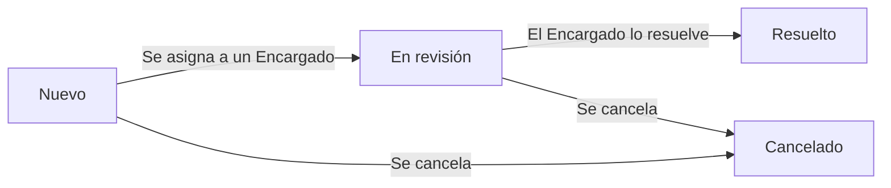

# Manual de usuario

## Cima Fix — Sistema de Reporte y Seguimiento de Incidencias de Mantenimiento e Infraestructura

| Campo                     | Detalle                       |
| ------------------------- | ----------------------------- |
| Producto                  | Cima Fix                      |
| Versión del documento     | Borrador                      |
| Versión del sistema       | Pendiente de definir          |
| Estado                    | En redacción                  |
| Responsable del documento | Mike Armando Montano Valencia |

---

## Historial de cambios

| Versión  | Fecha                   | Cambio                                                                                                                |
| -------- | ----------------------- | --------------------------------------------------------------------------------------------------------------------- |
| Borrador | 24 de noviembre de 2026 | Creación del documento. El contenido se completa de forma incremental; las secciones pendientes se marcan como tales. |
| Borrador | 24 de noviembre de 2026 | Redacción de las secciones 1 a 4: introducción, conceptos básicos, inicio rápido y Reportante.                        |

---

## Tabla de contenidos

<!-- START doctoc generated TOC please keep comment here to allow auto update -->
<!-- DON'T EDIT THIS SECTION, INSTEAD RE-RUN doctoc TO UPDATE -->

- [1. Introducción](#1-introducci%C3%B3n)
  - [1.1 Qué es Cima Fix](#11-qu%C3%A9-es-cima-fix)
  - [1.2 A quién va dirigido](#12-a-qui%C3%A9n-va-dirigido)
  - [1.3 Qué no hace Cima Fix](#13-qu%C3%A9-no-hace-cima-fix)
  - [1.4 Qué necesitas para usarlo](#14-qu%C3%A9-necesitas-para-usarlo)
  - [1.5 Cómo usar este manual](#15-c%C3%B3mo-usar-este-manual)
- [2. Conceptos básicos](#2-conceptos-b%C3%A1sicos)
  - [2.1 Cómo se identifica un problema](#21-c%C3%B3mo-se-identifica-un-problema)
  - [2.2 Los tres roles](#22-los-tres-roles)
  - [2.3 Ciclo de vida de un reporte](#23-ciclo-de-vida-de-un-reporte)
  - [2.4 Prioridad](#24-prioridad)
  - [2.5 Qué reportes ves y qué datos ve cada quien](#25-qu%C3%A9-reportes-ves-y-qu%C3%A9-datos-ve-cada-quien)
- [3. Inicio rápido](#3-inicio-r%C3%A1pido)
  - [3.1 Iniciar sesión](#31-iniciar-sesi%C3%B3n)
  - [3.2 Registrar un reporte desde el enlace de un espacio](#32-registrar-un-reporte-desde-el-enlace-de-un-espacio)
- [4. Reportante](#4-reportante)
  - [4.1 Registrar un reporte](#41-registrar-un-reporte)
  - [4.2 Registrar un reporte desde el enlace de un espacio](#42-registrar-un-reporte-desde-el-enlace-de-un-espacio)
  - [4.3 Adjuntar fotografías](#43-adjuntar-fotograf%C3%ADas)
  - [4.4 Decidir sobre los posibles duplicados](#44-decidir-sobre-los-posibles-duplicados)
  - [4.5 Consultar y filtrar reportes](#45-consultar-y-filtrar-reportes)
  - [4.6 Ver el detalle y el estado de un reporte](#46-ver-el-detalle-y-el-estado-de-un-reporte)
  - [4.7 Cancelar un reporte tuyo](#47-cancelar-un-reporte-tuyo)
  - [4.8 Consultar el mapa del campus](#48-consultar-el-mapa-del-campus)
  - [4.9 Correos que recibes](#49-correos-que-recibes)
- [5. Encargado](#5-encargado)
- [6. Admin](#6-admin)
- [7. Solución de problemas y contacto](#7-soluci%C3%B3n-de-problemas-y-contacto)
- [8. Referencia](#8-referencia)
- [9. Glosario](#9-glosario)

<!-- END doctoc generated TOC please keep comment here to allow auto update -->

---

## 1. Introducción

### 1.1 Qué es Cima Fix

Cima Fix es un sistema web para reportar problemas de mantenimiento e infraestructura del campus y darles seguimiento. Con él avisas de un problema, por ejemplo una luz que no enciende, y consultas en cualquier momento en qué estado está tu reporte.

Hoy se usa en el Campus Sauzal de la Universidad Autónoma de Baja California (UABC), en Ensenada. Te ofrece:

- **Un registro consultable.** Cada reporte queda guardado y se puede consultar después.
- **Aviso de posibles duplicados.** Antes de registrar tu reporte, Cima Fix te muestra los reportes abiertos parecidos, para que no se repita un problema que ya fue reportado.
- **Seguimiento del estado.** Cada reporte indica si está sin atender, en revisión, resuelto o cancelado.
- **Un mapa del campus.** Muestra en qué edificios hay reportes abiertos.
- **Correos.** Recibes un correo cuando se resuelve o se cancela un reporte tuyo.

### 1.2 A quién va dirigido

Cima Fix lo usan tres tipos de persona:

- **Estudiantes y docentes**, que reportan problemas y consultan su estado. Tienen el rol de **Reportante**.
- **Personal encargado de atender incidencias**, que asigna y resuelve reportes. Tiene el rol de **Encargado**.
- **Personal responsable de configurar un campus**, que mantiene el catálogo, los roles y los umbrales. Tiene el rol de **Admin**.

Toda cuenta nueva empieza como Reportante. En la [sección 2.2](#22-los-tres-roles) se explica qué puede hacer cada rol.

### 1.3 Qué no hace Cima Fix

- **No sustituye al personal de mantenimiento ni decide por él qué atender.** Registra los reportes y da seguimiento; el diagnóstico y la visita al lugar siguen a cargo del personal.
- **No gestiona los reportes que requieren un proveedor externo.** Esos reportes siguen su propio canal, aparte de Cima Fix.
- **No detecta duplicados por sí solo.** Te muestra reportes abiertos que pueden ser el mismo problema y tú decides si lo son.
- **No envía notificaciones al celular ni es una aplicación que se instala.** Es un sitio web que abres en el navegador, y funciona en pantallas de celular.
- **No permite editar un reporte después de enviarlo.** Revisa los datos antes de enviar.

### 1.4 Qué necesitas para usarlo

- **Una cuenta institucional `@uabc.edu.mx`.** Cima Fix no tiene registro ni contraseña propios: inicias sesión con Google usando esa cuenta.
- **Un celular o una computadora con conexión a internet.**
- **Un navegador compatible:** las dos últimas versiones principales de Chrome, Safari, Firefox o Edge.

### 1.5 Cómo usar este manual

Convenciones:

- Los nombres de pantallas, botones y opciones aparecen en **negrita**, tal como los ves en Cima Fix.
- Los pasos están numerados. Haz una acción por paso, en orden.
- Cada tarea indica su objetivo, lo que necesitas antes de empezar y el resultado que debes ver al terminar.
- **Importante** señala algo que no se puede deshacer o que conviene revisar antes de continuar. **Nota** agrega información útil.

Qué leer según tu rol:

| Si eres…                          | Lee…                  |
| --------------------------------- | --------------------- |
| Reportante (estudiante o docente) | Secciones 2, 3 y 4    |
| Encargado                         | Secciones 2, 3, 4 y 5 |
| Admin                             | Secciones 2, 3, 4 y 6 |

Los Encargados y los Admins también pueden reportar problemas, por eso la sección 4 es para todos. Las secciones 7, 8 y 9 sirven a cualquier rol.

---

## 2. Conceptos básicos

### 2.1 Cómo se identifica un problema

Todo reporte indica dónde ocurre el problema y de qué tipo es:

- **Campus:** la sede de la universidad.
- **Edificio:** una estructura o zona identificable dentro del campus, por ejemplo un estacionamiento o una cancha.
- **Espacio:** la ubicación específica dentro de un edificio, por ejemplo un salón.
- **Categoría:** el tipo de incidencia.

Cada espacio tiene su propio **enlace del espacio**, que normalmente está impreso como un código QR junto al espacio. Al abrirlo, el formulario de reporte aparece con el campus, el edificio y el espacio ya elegidos.

### 2.2 Los tres roles

Tu rol determina qué puedes hacer en Cima Fix. Estas reglas aplican a los tres:

- Toda cuenta es **Reportante** en todos los campus por defecto. Como Reportante puedes registrar y consultar reportes en cualquier campus activo.
- Los permisos de Encargado y de Admin rigen solo en el campus donde te asignaron ese rol. En los demás campus sigues siendo Reportante, a menos que también te asignen un rol ahí.
- Tienes un solo rol en cada campus, pero puedes tener roles distintos en campus distintos. Por ejemplo, Encargado en uno y Admin en otro.
- Un Admin del campus asigna y retira los roles de Encargado y Admin. Si necesitas uno, pídeselo a un Admin de tu campus.

| Rol        | Qué hace                                                                                                                                                                                             |
| ---------- | ---------------------------------------------------------------------------------------------------------------------------------------------------------------------------------------------------- |
| Reportante | Registra reportes en cualquier campus activo, confirma duplicados, consulta reportes y el mapa, y cancela los reportes que registró.               |
| Encargado  | Todo lo de un Reportante, y además atiende los reportes de su campus: se asigna reportes o los asigna a otros Encargados, resuelve los asignados a su cuenta y cancela cualquier reporte del campus. |
| Admin      | Todo lo de un Reportante, y además configura su campus: catálogo, roles y umbrales. También asigna y cancela reportes, pero no los resuelve.                                                         |

La tabla completa de permisos está en la [sección 8](#8-referencia).

### 2.3 Ciclo de vida de un reporte

Un reporte siempre tiene uno de estos cuatro estados:

| Estado      | Qué significa                                                           |
| ----------- | ----------------------------------------------------------------------- |
| Nuevo       | El reporte está registrado y todavía no se asigna a ningún Encargado.   |
| En revisión | El reporte está asignado a un Encargado.                                |
| Resuelto    | El Encargado asignado marcó el problema como solucionado.               |
| Cancelado   | El reporte se canceló, por quien lo registró o por personal del campus. |

Un **reporte abierto** es el que está en estado Nuevo o En revisión.

Ten presente que:

- Un reporte En revisión puede pasar a otro Encargado sin cambiar de estado, pero nunca se queda sin Encargado asignado.
- Un reporte Resuelto o Cancelado ya no cambia ni se reabre. Si el problema vuelve a ocurrir, registra un reporte nuevo.

### 2.4 Prioridad

Cada reporte tiene una prioridad **Baja**, **Media** o **Alta** que Cima Fix calcula sola; nadie la asigna a mano. Parte de la gravedad de la categoría y sube un nivel por cada 3 personas que confirmaron que se trata del mismo problema. Los reportes de mayor prioridad aparecen primero en la consulta.

### 2.5 Qué reportes ves y qué datos ve cada quien

- **Reportes abiertos:** los ves siempre.
- **Reportes Resueltos:** los ves durante 7 días de 24 horas desde el momento en que se resolvieron. Después, solo los ven los Encargados y Admins del campus del reporte.
- **Reportes Cancelados:** no los ves como Reportante, ni siquiera si tú los registraste.
- **Correos de las personas:** tu correo institucional es el único dato personal que Cima Fix guarda de ti. Solo lo ven los Encargados y Admins del campus del reporte. Tú tampoco ves el correo de quien registró un reporte ni el de la persona asignada.

---

## 3. Inicio rápido

### 3.1 Iniciar sesión

**Objetivo.** Entrar a Cima Fix con tu cuenta institucional.

**Antes de empezar.** Ten a la mano tu cuenta `@uabc.edu.mx`.

**Pasos.**

1. Abre Cima Fix en tu navegador.
2. Pulsa el botón de Google.
3. Elige tu cuenta `@uabc.edu.mx`.
4. Espera a que Cima Fix te lleve a la pantalla de inicio.

**Resultado.** Tu sesión queda iniciada y se mantiene durante 30 días. Pasado ese plazo, Cima Fix te pide iniciar sesión otra vez.

> **Nota:** Si abres el enlace de un espacio o de un reporte sin haber iniciado sesión, Cima Fix te pide iniciar sesión y, al terminar, te lleva a donde querías ir.

> **Nota:** Solo funcionan las cuentas `@uabc.edu.mx`. Con una cuenta de otro dominio, Cima Fix rechaza el inicio de sesión.

### 3.2 Registrar un reporte desde el enlace de un espacio

**Objetivo.** Reportar un problema en el lugar donde ocurre, con el menor número de datos posible.

**Antes de empezar.** Ten sesión iniciada ([sección 3.1](#31-iniciar-sesi%C3%B3n)) y estar junto al espacio, donde está el código QR.

**Pasos.**

1. Escanea el código QR del espacio con la cámara de tu celular.
2. Abre el enlace que aparece en la pantalla del celular.
3. Comprueba que el campus, el edificio y el espacio que aparecen ya elegidos son los correctos.
4. Elige la categoría del problema.
5. Escribe la descripción del problema.
6. Pulsa **Enviar**.
7. Si Cima Fix muestra posibles duplicados y ninguno es tu problema, pulsa **Ninguno es mi problema, registrar**.

**Resultado.** Cima Fix muestra tu reporte con el estado **Nuevo**, su prioridad y la fecha y hora en que se registró.

> **Nota:** Si ves un aviso de que el espacio no está disponible, elige tú mismo lo que falte. Más detalles en la [sección 4.2](#42-registrar-un-reporte-desde-el-enlace-de-un-espacio).

> **Nota:** Si Cima Fix muestra posibles duplicados, léelos antes de decidir. Cómo hacerlo está en la [sección 4.4](#44-decidir-sobre-los-posibles-duplicados).

---

## 4. Reportante

Esta sección sirve a cualquier persona con cuenta. Los Encargados y los Admins también la usan, porque también pueden reportar.

Antes de empezar cualquiera de estas tareas, inicia sesión ([sección 3.1](#31-iniciar-sesi%C3%B3n)).

### 4.1 Registrar un reporte

**Objetivo.** Reportar un problema del campus eligiendo tú el lugar.

**Antes de empezar.** Ten a la mano dónde ocurre el problema (campus, edificio y espacio) y una descripción. Si quieres, ten también hasta 3 fotografías.

**Pasos.**

1. En la pantalla de inicio, elige la opción para reportar un problema.
2. Elige el campus.
3. Elige el edificio.
4. Elige el espacio.
5. Elige la categoría.
6. Escribe la descripción del problema.
7. Si quieres, adjunta fotografías, como se explica en la [sección 4.3](#43-adjuntar-fotograf%C3%ADas).
8. Lee el aviso que indica que tu correo será visible para el personal que atiende el reporte.
9. Pulsa **Enviar**.
10. Si Cima Fix muestra posibles duplicados, decide como se explica en la [sección 4.4](#44-decidir-sobre-los-posibles-duplicados).

**Resultado.** Cima Fix muestra tu reporte con el estado **Nuevo**, su prioridad y la fecha y hora en que se registró. El reporte ya aparece en la consulta de reportes.

> **Importante:** No puedes modificar un reporte después de enviarlo. Revisa el lugar, la categoría, la descripción y las fotografías antes de pulsar **Enviar**.

> **Nota:** Las listas dependen unas de otras. Al elegir el campus, los edificios y las categorías se limitan a los de ese campus. Al elegir el edificio, los espacios se limitan a los de ese edificio. Elige en el orden de los pasos.

> **Nota:** La descripción es obligatoria, no puede estar vacía ni tener solo espacios y admite hasta 1,000 caracteres. Si Cima Fix rechaza algún dato, te muestra un aviso con el motivo.

### 4.2 Registrar un reporte desde el enlace de un espacio

**Objetivo.** Registrar un reporte con el campus, el edificio y el espacio ya elegidos.

**Antes de empezar.** Ten el enlace del espacio, normalmente un código QR junto al espacio.

**Pasos.**

1. Escanea el código QR del espacio con la cámara de tu celular, o abre el enlace del espacio en tu navegador.
2. Si Cima Fix te lo pide, inicia sesión ([sección 3.1](#31-iniciar-sesi%C3%B3n)). Al terminar, vuelves al formulario de ese espacio.
3. Comprueba que el campus, el edificio y el espacio sean los correctos. Si no lo son, cámbialos.
4. Completa la categoría y la descripción, y envía el reporte como en los pasos 5 a 10 de la [sección 4.1](#41-registrar-un-reporte).

**Resultado.** El reporte queda registrado con el estado **Nuevo**.

**Si el espacio no está disponible.** Cima Fix muestra un aviso de que el espacio no está disponible y preselecciona solo lo que sí está disponible. Elige tú el resto de los datos. Esto puede ocurrir en estos casos:

- El espacio ya no se ofrece, pero su edificio sí: aparecen elegidos el campus y el edificio.
- El edificio del espacio ya no se ofrece: aparece elegido solo el campus.
- El campus no está activo o el enlace no corresponde a ningún espacio: no aparece nada elegido.

### 4.3 Adjuntar fotografías

**Objetivo.** Agregar fotografías que ayuden a entender el problema.

**Antes de empezar.** Ten las fotografías en tu dispositivo. Cada una debe cumplir lo siguiente:

- Formato JPEG, PNG, WebP o HEIC.
- Hasta 10 MB cada una.
- Hasta 3 fotografías por reporte.

**Pasos.**

1. En el formulario de reporte, pulsa la opción para adjuntar fotografías.
2. Elige una fotografía de tu dispositivo.
3. Repite el paso 2 si quieres adjuntar otra, hasta un máximo de 3.

**Resultado.** Las fotografías se envían junto con tu reporte al pulsar **Enviar** y aparecen en el reporte.

> **Nota:** Si una fotografía no cumple los requisitos, Cima Fix te indica el motivo y no la adjunta.

> **Nota:** Si una fotografía no se puede guardar al enviar, el reporte no se registra. Cima Fix te avisa y conserva los datos que escribiste; vuelve a pulsar **Enviar**. También puedes enviar el reporte sin fotografías.

### 4.4 Decidir sobre los posibles duplicados

**Objetivo.** Evitar reportar de nuevo un problema que ya está reportado.

**Antes de empezar.** Llena el formulario y pulsa **Enviar** ([sección 4.1](#41-registrar-un-reporte)). Cima Fix muestra esta lista solo cuando existen reportes abiertos del mismo campus, categoría y edificio.

**Pasos.**

1. Lee el primer reporte de la lista: su descripción, sus fotografías, su estado y su prioridad.
2. Lee los demás reportes de la lista.
3. Elige una de estas opciones:
   - Si alguno es tu mismo problema, pulsa **Es este mismo problema** en ese reporte.
   - Si ninguno es tu problema, pulsa **Ninguno es mi problema, registrar**.

**Resultado.**

- Con **Es este mismo problema**, tu confirmación queda registrada en ese reporte y Cima Fix no registra un reporte nuevo. Cima Fix te muestra el reporte confirmado y su prioridad puede subir. Recibirás un correo cuando se resuelva o se cancele.
- Con **Ninguno es mi problema, registrar**, Cima Fix registra tu reporte con el estado **Nuevo**.

> **Importante:** Cima Fix no compara textos: la lista incluye todos los reportes abiertos del mismo campus, categoría y edificio, aunque traten de problemas distintos. Confirma solo si de verdad es el mismo problema.

> **Importante:** Al confirmar un duplicado no se registra un reporte nuevo, así que tu descripción y tus fotografías no se guardan.

> **Nota:** No puedes confirmar un reporte que registraste tú ni confirmar dos veces el mismo reporte. Esos reportes aparecen en la lista con la leyenda **Tú registraste este reporte** o **Ya lo confirmaste**, sin botón de confirmar.

### 4.5 Consultar y filtrar reportes

**Objetivo.** Ver los reportes registrados y encontrar los que te interesan.

**Pasos.**

1. En la pantalla de inicio, elige la opción para consultar reportes.
2. Si quieres ver solo los reportes que registraste o confirmaste tú, elige **Mis reportes**.
3. Si quieres acotar la lista, aplica los filtros que necesites.
4. Revisa la lista de reportes.

**Resultado.** La lista muestra los reportes que cumplen todos los filtros que aplicaste.

Filtros disponibles:

| Filtro       | Qué muestra                                                       |
| ------------ | ----------------------------------------------------------------- |
| Campus       | Los reportes del campus elegido. Solo se ofrecen campus activos.  |
| Categoría    | Los reportes de esa categoría. Aparece una vez elegido un campus. |
| Edificio     | Los reportes de ese edificio. Aparece una vez elegido un campus.  |
| Estado       | Los reportes en ese estado.                                       |
| Mis reportes | Los reportes que registraste o confirmaste como duplicado.        |

Orden de la lista:

1. Primero los reportes abiertos y después los Resueltos y Cancelados que puedas ver.
2. Dentro de cada grupo, de mayor a menor prioridad.
3. Entre reportes de igual prioridad, primero el más antiguo.

> **Nota:** Solo ves los reportes que las reglas de la [sección 2.5](#25-qu%C3%A9-reportes-ves-y-qu%C3%A9-datos-ve-cada-quien) te permiten ver.

### 4.6 Ver el detalle y el estado de un reporte

**Objetivo.** Saber en qué estado está un reporte y qué datos tiene.

**Pasos.**

1. En la lista de reportes, elige el reporte que quieres ver.
2. Revisa sus datos.

**Resultado.** Cima Fix muestra el campus, el edificio, el espacio, la categoría, la descripción, las fotografías, el estado, la prioridad, el número de personas que confirmaron el duplicado, la fecha y hora de creación y, si está Resuelto, la fecha y hora de resolución. Cima Fix no muestra a un Reportante el correo de quien registró el reporte ni el de la persona asignada.

> **Nota:** Las fechas y horas se muestran en la hora local de Baja California.

> **Nota:** Cada reporte tiene su propio enlace, que puedes abrir con tu sesión iniciada. Si abres el enlace de un reporte que no puedes ver, Cima Fix te avisa que el reporte no está disponible y no muestra ningún dato. Si el reporte se resolvió hace más de 7 días, el aviso lo indica.

> **Nota:** Si las fotografías no se pueden mostrar en este momento, Cima Fix muestra el resto de los datos del reporte sin ellas.

### 4.7 Cancelar un reporte tuyo

**Objetivo.** Cancelar un reporte que registraste y que ya no es necesario.

**Antes de empezar.** Comprueba que el reporte cumpla estas tres condiciones:

- Lo registraste tú.
- Sigue abierto (Nuevo o En revisión).
- Nadie lo ha confirmado como duplicado.

**Pasos.**

1. Abre el detalle del reporte ([sección 4.6](#46-ver-el-detalle-y-el-estado-de-un-reporte)).
2. Elige la opción para cancelar el reporte.
3. Si Cima Fix te pide confirmar, confirma la cancelación.

**Resultado.** El reporte pasa al estado **Cancelado** y deja de aparecer para ti. Recibe un correo de cancelación quien lo confirmó como duplicado y la persona asignada, si la hay. Tú no recibes correo de una cancelación que hiciste.

> **Importante:** Cancelar no se puede deshacer: un reporte Cancelado no se reabre. Si el problema sigue, tendrás que registrar un reporte nuevo.

> **Nota:** Si Cima Fix no te ofrece la opción de cancelar, es porque el reporte ya se cerró, no lo registraste tú o alguien ya lo confirmó como duplicado.

### 4.8 Consultar el mapa del campus

**Objetivo.** Ver en qué edificios hay reportes abiertos.

**Pasos.**

1. En la pantalla de inicio, elige la opción para ver el mapa.
2. Si hay más de un campus activo, elige el campus que quieres ver.
3. Acerca, aleja y desplaza el plano para ver los edificios.
4. Selecciona un indicador para ver el nombre del edificio.

**Resultado.** El mapa muestra el plano del campus con un indicador en cada edificio que tiene reportes abiertos. Cada indicador muestra el número de reportes abiertos del edificio.

Cómo leer el mapa:

- Los edificios sin reportes abiertos no tienen indicador.
- Si el Admin definió los umbrales del mapa, el indicador se ve distinto según su nivel (Bajo, Medio o Alto) y el mapa muestra una leyenda con el rango de reportes de cada nivel. Si no los definió, todos los indicadores se ven igual.
- Debajo del mapa hay una lista de los edificios con indicador, con su nombre, su número de reportes abiertos y, si hay umbrales, su nivel. Úsala si prefieres leer en lugar de mirar el plano.
- Si el campus no tiene ningún edificio ubicado en el plano, el mapa muestra el plano y un aviso.
- Al seleccionar un edificio, ves la lista de sus reportes abiertos, con el mismo orden de la consulta. Puedes volver al mapa sin que se actualice.

> **Importante:** El mapa no se actualiza solo. Muestra los reportes que existían cuando lo abriste. Para ver los cambios, recarga la página o elige otro campus.

### 4.9 Correos que recibes

Cima Fix te envía correos en estos casos:

| Cuándo                                               | Qué incluye el correo                                                                                        |
| ---------------------------------------------------- | ------------------------------------------------------------------------------------------------------------ |
| Se resolvió un reporte que registraste o confirmaste | El campus, el edificio, el espacio y la categoría del reporte, y el enlace para abrirlo.                     |
| Se canceló un reporte que registraste o confirmaste  | El campus, el edificio, el espacio y la categoría del reporte. No incluye el enlace, porque no puedes verlo. |

Ten presente que:

- Recibes un solo correo por cada acción, aunque cumplas más de una condición.
- No recibes correo de una acción que hiciste tú.
- Los correos no muestran el correo de otras personas.
- Las fechas y horas están en hora local de Baja California.
- El correo es un aviso, no la fuente oficial: si esperabas uno y no llega, consulta el reporte en Cima Fix.

---

## 5. Encargado

Pendiente.

## 6. Admin

Pendiente.

## 7. Solución de problemas y contacto

Pendiente.

## 8. Referencia

Pendiente.

## 9. Glosario

Pendiente.
